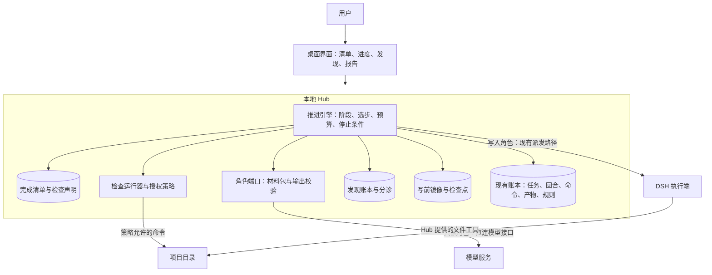
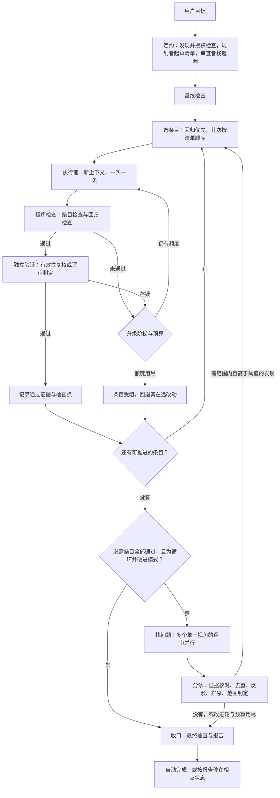

# 推进循环架构：用可验证的反馈把模型用量转化为交付质量

> 2026-11-24 状态：既有桌面循环的维护与实验记录；以下分期不再安排新首版工作。当前架构见[手机总管首版](mobile-manager-v1.md)。

> 2026-11-21 用户修订：新循环的架构只负责启动、组织和推进。执行与独立复核都用完整的原生 DSH Agent，角色描述只分配工作，不裁剪文件、终端、网络及原生子 Agent 等工具。首轮直接做事，不等待清单定约。复核以实际检查和自然语言交接；它可以建议继续或收口，缺少明确结论时仍把反馈交给下一轮，不能把格式当成通过依据或任务失败。星引保留轮次安排、暂停、账本与运行预算。
>
> 新循环的工作目录仍是用户所选项目，用户给定的实际操作边界写入任务。使用原生全权限，操作系统不会代替用户约束阻止项目外写入。发布、推送、项目外写入须有明确任务授权；该权限模型不改写正在运行或历史工作的已授权范围。下文记录原清单循环的设计及既有证据。

> 类型：架构设计
> 状态：有效；L1 已完成真实链路验收，L2 已实现并通过本地验收，等待真实缺陷评测；默认保持单次
> 更新：2026-11-20（Asia/Shanghai）
> 适用：星引 Alcor Windows 桌面端 Hub，以 0.1.8 源码为现状基线；不改变 D2 放行条件和手机端范围

核心设计是：**由 Hub 程序驱动一个持续的循环，把目标拆成可验证的完成清单，一次推进一条，用程序检查和独立角色裁定是否完成，完成后继续找出最重要的问题并排序修复；模型只在循环的每一步提交候选结果。** 多个 Agent 的价值来自各自专注一个角色，并且彼此的产出能被检查，而不是来自数量本身。循环从创建到收口不要求用户审批或中途确认。

配套文档：

- [实施指南](advance-loop-implementation.md)：改动地图、数据契约、算法、工作包、测试与放行清单。后续开发按它逐个工作包推进。
- [角色契约与提示词草案](advance-loop-roles.md)：每个角色的输入材料、输出契约和提示词草案。
- [L0 实验规程](advance-loop-experiment.md)：对照实验的任务集规则、组别、指标和已冻结的判定线。

单次模式的现行契约仍以[架构入口](architecture.md)和[详细桌面方案](../mobile-app/from-home/docs/alcor-desktop-architecture.md)为准。循环模式与它们不一致之处，以本文[第 15 节](#conventions)为准。

阅读入口：[状态与边界](#status)、[问题与依据](#background)、[设计原则](#principles)、[免确认运行](#no-confirmation)、[总体架构](#architecture)、[领域模型](#domain)、[循环流程](#flow)、[角色与上下文](#roles)、[检查运行器](#check-runner)、[预算与调度](#budget)、[恢复](#recovery)、[权限](#permissions)、[用户体验](#ux)、[漏检学习](#misses)、[决定与既有约定](#conventions)、[分期](#staging)、[风险](#risks)、[来源](#sources)。

何时阅读：评估或实现循环推进、完成清单、检查运行、独立验证、评审分诊、多候选时；修改 `finishRun`、`tick`、DSH 文件工具或任务状态机之前。

## 0. 状态与边界

| 内容 | 状态 | 依据 |
| --- | --- | --- |
| 方向：重心从总管路由转向组织多个 Agent 循环推进；四个待解决的问题 | 用户已提出（2026-11-19） | [第 1.1 节](#background) |
| 免确认运行：权限问题不影响运行，尽量不要求审批或中途确认 | 用户已确认的要求（2026-11-19） | [第 1.1 节](#background)、[第 4 节](#no-confirmation) |
| 采纳本设计、各项取舍、阶段先后、实验门槛 | 用户委托决定（2026-11-19），已逐项记录 | [第 15.1 节](#decisions) |
| “用量可以换质量”及其成立条件 | 本任务集上的循环组较同模型单次组通过更多，仍与强模型单次组相差 15.6 个百分点 | [正式对照](roadmap.md#loop-l1-start)、[来源](#sources) |
| L0 最小循环、账本、检查运行器、预算与恢复 | 已实现并验证；可进入完整 L1，默认保持单次 | [路线图与证据](roadmap.md#loop-l0-local) |
| L1 定约与独立验证 | 已实现并验证；按冻结任务集做后续复测 | [路线图](roadmap.md#loop-l1-start) |
| L2 改进轮与分诊 | 已通过真实缺陷验收 | [路线图](roadmap.md#loop-l2-live) |
| L3 升级阶梯 | 同条件固定回放 13/22 对 11/22，达到阶段判定线 | [路线图](roadmap.md#loop-l3-replay) |
| L4 漏检学习 | 归因和历史检查回执路径通过真实模型验收；文本评审样本也验证了基线已命中时不启用 | [实施指南](advance-loop-implementation.md#l4-miss-learning)、[路线图](roadmap.md#loop-l4-live) |
| 文中的次数、并发、阈值等数值 | 初值，待实验校准 | [第 10 节](#budget) |
| 对现有实现的描述 | 2026-11-19 阅读 0.1.8 源码所得；未运行测试、模型或执行端 | [实施指南](advance-loop-implementation.md) |

本文和配套文档是设计与实施依据。设计阶段只写文档；后续实现以[路线图](roadmap.md#loop-l0-local)的验证记录为准。文中没有真实端点凭据。真实模型实验会消耗模型额度，需要用户一句明确的开工指令才开始。

## 1. 问题、假设与依据

### 1.1 用户提出的方向、问题与要求

2026-11-19 用户原话，按先后顺序：

> 我理解的是一个agent专注一个方向其实是可以做的比让一个agent同时处理很多不同方向的活要发挥更好的
>
> 我想当前这个星引桌面端，或许最应该做的价值不是总管，而是如何组织很多的agent，让这些agent不断推进任务，循环反馈，让deepseek这种模型，也能在相同的提示词下，用量来达到GPT6，Claude opus这种模型能达到的质。
>
> 用ai开发我发现的问题有ai不会主动推进任务，不会自主改善，有时候做一个半成品就完了，有时候发现不了最重要最需要改进的问题，必须人来提醒。
>
> 都由你决定吧，我希望权限问题不要影响运行，尽量不要让我审批或者中途做一些确认操作
>
> 你只需完成设计架构文档和一些别的文档之类，不用进行实际开发
>
> 让文档能够完整指导后续开发就行

由此得到三类输入：

- **四个要解决的问题**：不主动推进、做成半成品就停、不会自主改善、发现不了最重要的问题。
- **一项已确认的要求**：权限问题不影响运行，尽量不要求审批或中途确认。它决定了[第 4 节](#no-confirmation)的运行方式。
- **一项委托**：是否采纳、各项取舍和先后由设计方决定。决定逐项记录在[第 15.1 节](#decisions)。本轮只交付文档，不做开发。

### 1.2 根因与现有实现的对应

| 问题 | 根因 | 现有实现（0.1.8）中的位置 |
| --- | --- | --- |
| 不主动推进 | 模型只在被调用时工作，回合结束即停；需要外部决定“下一步做什么”并再次调用 | 执行回合结束后任务进入“待验收”并等待用户；只有预先声明了文件检查才会自动继续（`finishRun`） |
| 做成半成品就停 | “完成”由执行者自己声明；长任务中上下文被占满后倾向提前收尾 | 任务的验收依据是一段文字；自动验收只能判断“文件是否包含约定文本”（`verifyFiles`） |
| 不会自主改善 | 没有独立于作者的批评者；经验没有沉淀到下一次 | 只读核对成员需要用户手动委派；自动偏好和方法学习在路线中后置 |
| 发现不了最重要的问题 | 作者锚定在自己的产出上；只读代码不运行；单次评审随机抓到小问题 | DSH 执行端没有终端，写完代码无法构建或测试；没有按影响排序的机制 |

### 1.3 假设及其成立条件

**假设：** 在同一条用户提示词下，`deepseek-flash` 这类模型通过循环推进投入更多调用，在具备可执行检查的开发任务上，可以达到强模型单次执行的交付质量。

**成立条件：** 用量只有经过可信的反馈信号才能转化为质量。信号有三种来源：程序可执行的检查、独立于作者的判断、运行产物得到的证据。没有这些信号时，更多调用只产生更多未经验证的产出。

| 外部来源 | 结论 | 对本设计的含义 | 适用边界 |
| --- | --- | --- | --- |
| Stanford《Large Language Monkeys》 | DeepSeek-Coder-V2 在 SWE-bench Lite 上单次解决 15.9%，采样 250 次并用单元测试挑选后为 56%，高于当时更强模型单次的 43%；采样 5 次比 GPT-4o 或 Claude 3.5 Sonnet 单次更划算。没有自动验证时，多数投票和打分模型在几百个样本后不再提升 | 量换质的关键是能自动挑出对的结果，所以检查运行器是本设计的第一优先 | 2024 年的模型和基准，采样由脚本完成；不能直接推到 `deepseek-flash` 对当前强模型 |
| Anthropic《Effective harnesses for long-running agents》 | 前沿模型做长任务同样会“试图一次做完导致功能做到一半”和“看到已有进展就宣布完成”；用初始全部未通过的功能清单、一次一个功能、干净状态和端到端测试来解决 | 完成清单、一次一条、检查点直接取自这里 | 实验对象是 Claude 和网页应用；清单状态在其实验中由编码模型自己修改，本设计改为只有验证方能改 |
| Anthropic《Harness design for long-running application development》 | 模型评价自己的产出时一味肯定；把评估者从生成者中分出来并调成怀疑态度更可行。同一模型单跑 20 分钟、9 美元，核心功能不可用；规划、生成、评估三角色跑 6 小时、200 美元，可用。评估者开箱即用时很差，需要多轮校准；它的价值取决于任务是否超出模型单独可靠完成的范围 | 独立验证者、先约定“完成是什么”、评估者需要校准。模型越弱，循环承担的部分越多（这一点是推论，原文没有直接验证） | 评估者使用浏览器自动化实际操作应用，本设计首版没有这类工具；成本约为单跑的 20 倍 |
| Anthropic《How we built our multi-agent research system》 | 在其检索评测中 token 用量解释了 80% 的成绩差异；多智能体约为聊天的 15 倍 token；升级模型的收益大于 token 预算翻倍；编码任务中真正可并行的部分比研究任务少 | 用量有效但不等价于模型能力；并行应留给只读工作，写入保持单一 | 结论来自检索类任务 |

### 1.4 设计立场

1. **价值在循环和反馈，不在 Agent 的数量。** 先建检查与裁定，再增加角色。
2. **按循环中的角色分工，而不是把一份实现切给多个并行写入者。** 写入者同一时刻只有一个；读、评、排序可以并行。
3. **现有内核是地基。** 账本、状态机、有界修正、验收绑定产物版本都继续使用；总管对话保留为入口。
4. **先验证假设再建全套。** 最小循环加对照实验通过后才继续（[第 16 节](#staging)）。

## 2. 目标、非目标与成功标准

**目标**

- 任务创建后可以无人值守地推进到“清单全部有证据通过”，或如实报告停在哪里。
- 循环从创建到收口不要求用户审批或中途确认。
- 执行者的完成声明不能使条目通过。
- 清单通过后能继续发现问题，并把对用户目标影响最大的几条转成后续工作。
- 用户每次提醒的遗漏被记录并转成后续的检查项，同类遗漏的提醒次数下降。
- 每一步的用量和证据可见，预算到界即停。

**非目标**

- 原清单循环不追求任意任务上与强模型等质；没有检查手段的审美和产品直觉仍由用户判断。2026-11-23 用户为原生成果图另立目标：团队协作的结果要明显优于单个 Agent 执行，强模型不作为对标。做法见[开工前定质量标准](native-loop-target.md#standard-first)；只能目视判断的维度仍交用户。
- 不让循环自行扩大目标或预算，也不放开[第 4.3 节](#hard-limits)的硬限制。
- 不引入常驻的模型进程；所有角色调用按事件触发、从账本重建上下文。
- 不替代现有的单次执行；小任务不必承担循环的成本。
- 不在本设计内解决原生桌面会话续聊、多设备等 D2 及后续既有事项。

**适用范围：** 循环首先面向具备可执行检查的开发任务。方案、调查等定性任务可以使用评审判定，但收益未经验证，不作为首要场景。循环模式首版只支持 DSH 执行端。

**成功标准**（判定线已冻结，见[实验规程](advance-loop-experiment.md#thresholds)）

| 指标 | 含义 |
| --- | --- |
| 隐藏检查通过率 | 一次运行结束后，评分用的隐藏检查全部通过的比例；循环组与单次组、强模型组比较 |
| 机制性虚假完成 | 可见检查未通过却被标为通过，或检查被改动后仍被采信；要求为零 |
| 隐藏检查差距 | 系统判定完成而隐藏检查未通过的比例；只度量，不要求为零 |
| 人工提醒次数 | 每项交付中用户需要指出遗漏的次数，相对单次组下降 |
| 中途打断次数 | 循环运行期间要求用户操作的次数；目标为零 |
| 用量与时长 | 已知 token、用量未知的调用数、执行回合数、墙钟时间，分角色列出 |

## 3. 设计原则

以下各条是循环的不变量，实现和后续修改都要保持。

1. **循环由程序驱动。** 下一步由 Hub 根据账本计算，不依赖某个模型会话记得要继续。
2. **完成由证据裁定。** 条目只有按其声明的检查方式得到通过证据才算通过；执行者的说明只是候选材料。
3. **执行者不能改变评判标准。** 完成清单、检查声明和受保护的检查文件对执行者只读；修订只能走定约流程。
4. **一次一条，停在干净状态。** 每个执行回合只推进一个条目；循环停下时，工作区要么处于最近的检查点，要么明确标出没有回退成功的在途改动。
5. **单一写入者。** 同一工作区同一时刻只有一个写入者；并行只用于只读角色和隔离的候选。
6. **角色各自使用新的上下文。** 每次调用的输入由程序从账本组装并留下材料清单；角色之间不直接对话，只通过账本交接。
7. **发现必须带证据，评审不等于验收。** 证据引用不成立的发现直接作废；多个评审意见一致不能使条目通过。
8. **用量按需投入。** 默认走最便宜的路径，只有失败证据才触发升级；每一级有预算和停止条件。
9. **默认不打断用户。** 遇到原本需要人确认的情形，程序按保守默认处理并继续其余工作，处理结果写进收口报告。
10. **不越出目标，不突破硬限制。** 循环只在任务所属的项目和预算内行动；超出原目标的改进只作为建议；发布、推送、项目之外的写入等硬限制不因免确认而放开。
11. **如实收口。** 预算到界或没有进展时停止并报告，不降低标准，也不把投入耗尽算作完成。
12. **人的提醒是数据。** 用户指出的每个遗漏都登记，并归因到本应发现它的环节。

## 4. 免确认运行

### 4.1 规则

循环开始后不向用户请求审批或确认，也不等待用户回答。原本需要人确认的情形，一律由程序按保守默认处理并继续其余工作。用户随时可以查看、纠正、暂停或取消，但系统不等待这些操作。

“保守默认”的含义是：拿不准的事按不采信、不扩大、不覆盖处理。例如来路不明的命令不运行，存疑的改动不算通过，外部修改过的文件不覆盖。

### 4.2 原本需要确认的情形如何自动处理

| 情形 | 自动处理 | 用户在哪里看到 |
| --- | --- | --- |
| 各角色用什么模型和强度 | 用设置中的默认值；创建循环时不出现确认卡 | 循环详情 |
| 完成清单是否正确 | 定约后直接开工；清单可见，可随时修改，修改按[修订规则](#contract-revision)生效 | 清单视图 |
| 目标有歧义 | 规划者选择最合理的解释并记为假设，不提问等待 | 清单视图、报告 |
| 定约失败：输出无效或没有产生条目 | 退化为单一条目“完成用户目标”，用评审判定加基线检查把关 | 报告 |
| 检查命令能否运行 | 按[内置策略](#check-policy)自动授权；策略之外的命令不运行，相应条目降级为评审判定 | 检查列表、报告 |
| 检查在基线时无法运行或超时 | 该检查标为不可用并跳过；没有可用检查的条目降级为评审判定 | 报告 |
| 执行者试图修改检查文件 | 文件工具直接拒绝这次写入，执行继续 | 回合记录 |
| 执行者对检查提出异议 | 验证者裁决；检查有误则由检查编写者修订一次；仍无法解决的，条目受阻 | 报告 |
| 条目反复未通过 | 走[升级阶梯](#escalation)；用尽后条目受阻，回退它的在途改动，继续其他条目 | 报告 |
| 执行回合结果未知 | 自动核对原生结束记录；核对到就继续，核对不到则循环停止 | 任务状态、报告 |
| 发现超出原目标 | 搁置为建议，不执行 | 报告 |
| 工作区被星引之外的操作修改 | 不覆盖外部改动；受影响的条目受阻 | 报告 |
| 结果是否验收 | 必需条目全部通过即自动完成，并标明每个条目的证据等级 | 报告 |
| 预算到界 | 停止并报告 | 任务状态、报告 |

### 4.3 不因免确认而放开的硬限制

以下各项与用户是否在场无关，循环在任何情况下都不做：

- 发布、推送、部署，或向项目之外的目的地发送项目内容（模型服务除外）。
- Hub 自身的操作写入、删除任务所属项目目录之外的文件；回退时只恢复循环自己改过的文件。
- 读取或向模型发送凭据类文件；向检查进程传递模型密钥或执行端凭据。
- 联网安装新的依赖。需要新依赖的条目受阻，并在报告中写明缺什么。
- 超出预算继续运行，或自行追加预算。
- 读取或修改其他项目。
- 运行内置策略之外、且不是用户亲自填写的命令。

### 4.4 循环仍会停下的情形

下面几种是循环的结束状态，都附带报告。它们不是等待批准的中途暂停：

- 创建时无法确定任务属于哪个项目、目标为空、任务是只读任务，或 DSH 执行端不可用。这些情况直接拒绝创建并说明原因。
- 执行回合结果未知，且自动核对不到原生结束记录。为避免重复执行，循环停止。
- 预算到界。
- 所有剩余条目都已受阻。

### 4.5 用户可以做但不必做的事

随时修改清单、暂停或取消、追加预算后继续、重开已通过的条目、把遗漏记为漏检样本。这些都是可选操作，循环不依赖它们。

## 5. 总体架构

| 组件 | 责任 | 不承担 |
| --- | --- | --- |
| 推进引擎 | 维护循环阶段，按账本选择下一步，计量预算，判断停止 | 模型推理；绕过任务内核直接改状态 |
| 完成清单 | 保存条目、检查方式、通过证据和修订历史 | 由执行者修改 |
| 检查运行器与授权策略 | 发现检查入口，按策略决定哪些可以运行，运行并保存输出和结果分类 | 运行策略之外的命令 |
| 角色端口 | 为每次角色调用组装材料、调用模型、校验结构化输出 | 让角色互相调用或决定命令能否运行 |
| 发现账本与分诊 | 保存发现，核对证据，去重、反驳、排序、判定范围 | 把发现直接当作验收结论 |
| 写前镜像与检查点 | 在文件工具每次写入前保存原内容，条目通过后记检查点，支持回退 | 修改项目之外的文件或创建提交 |

循环复用现有的任务、回合、命令、产物账本和 DSH 派发路径，改动集中在回合结束后的处理、调度的准入判断、任务包和文件工具。逐文件的改动见[实施指南的改动地图](advance-loop-implementation.md#change-map)。

## 6. 领域模型

循环不另建任务体系。一个循环附着在一个现有任务上，执行回合仍是 Run，派发仍走 Command。新增的是下面这些记录；字段契约见[实施指南的数据契约](advance-loop-implementation.md#contracts)。

### 6.1 新增记录

| 记录 | 最少保存内容 | 核心约束 |
| --- | --- | --- |
| Loop（循环） | 所属任务、推进模式、阶段、当前步骤、清单修订号、角色配置快照、预算上限与已用量、停止原因 | 一个任务最多一个未结束的循环；阶段只由推进引擎改变 |
| Criterion（条目） | 标题、可观察的行为描述、来源（初始清单、发现转入、用户追加、回归）、对应的用户原话或“假设”标记、必需或可选、检查方式、状态、尝试次数、通过证据及其等级、定义哈希 | 只有检查运行或指定的验证方能把状态改为通过；必需条目的放宽、删除和豁免只能来自用户 |
| Check（检查声明） | 名称、类型（命令或文件）、程序与参数数组、相对工作目录、超时、来源（项目已有、定约后编写、用户给定）、授权依据、绑定哈希 | 模型只能引用或提议；能否运行由策略决定 |
| CheckRun（检查运行） | 检查、关联条目、对应的执行回合、工作区版本标识、起止时间、结果分类、退出码、输出副本引用 | 结果绑定工作区版本标识；工作区变化后旧结果不再作为通过依据 |
| 角色调用 | 循环、角色、阶段与轮次、模型配置快照、材料清单、输出、校验结果、用量、状态 | 沿用现有 `invocation` 记录并扩展；同一步骤同一输入不重复调用 |
| Finding（发现） | 轮次、视角、结论、证据引用、对目标的影响、状态、合并关系、核实结果、排序、去向 | 证据引用由程序核对；未核实的发现不能自动转为条目 |
| 写前镜像 | 执行回合、文件路径、修改前内容的副本引用（新建的文件记为“新建”）、修改后的内容哈希 | 由文件工具在写入前记录；回退时只恢复当前内容与记录一致的文件 |
| Checkpoint（检查点） | 循环、条目、截至该点的执行回合、工作区版本标识、检查结果摘要 | 只在条目通过后建立；是回退的目标位置 |
| Candidate（候选） | 条目、隔离工作区、思路提示、执行回合、检查结果、是否选中 | 候选之间互不可见；只整合选中的一个 |
| Miss（漏检样本） | 用户原话引用、所属交付、归因环节、派生的检查项、验证结果、启用状态 | 派生项不能放开硬限制或放宽条目 |

### 6.2 阶段与状态

循环阶段与任务状态的对应如下。任务状态沿用现有状态机；L1 新增“草稿”及其到“等待执行”“已取消”的转移，此外不增加转移。

| 循环阶段 | 含义 | 任务状态 |
| --- | --- | --- |
| 定约中 | 发现并授权检查；规划者、清单审查者起草和检查清单 | 草稿（L1 新增；L0 的清单由用户给定，没有这个阶段） |
| 基线 | 在未改动的工作区上运行全部检查 | 草稿；L0 中为“等待执行”并注明正在运行基线检查 |
| 推进：执行 | 检查编写者或执行者的回合正在进行 | 执行中 |
| 推进：检查与验证 | 程序检查、独立验证进行中 | 待验收 |
| 找问题、分诊 | 评审与排序进行中 | 待验收 |
| 收口 | 最终检查和报告 | 待验收 |
| 已收口 | 循环结束 | 已完成；存在“用户判定”的必需条目时为待验收 |
| 已停止 | 预算到界、剩余条目全部受阻、未知回合核对不到 | 需要处理 |

用户暂停和取消仍是任务状态；任务为“已暂停”“已取消”时，推进引擎不再选步。选出下一条目时任务从“待验收”回到“等待执行”，由现有调度派发。

条目状态：未开始、进行中、已通过、未通过、待复核、受阻、已豁免（仅用户）。

条目的证据等级：程序检查、评审判定、用户判定。

发现状态：已提出、证据无效、重复、已反驳、未核实、已确认、已转条目、已搁置、已修复、不处理（用户决定）。

### 6.3 版本、证据绑定与失效

**工作区版本标识**用来把检查结果绑定到一个确定的工作区状态，并发现星引之外的修改。Git 项目取当前提交加上 `git status` 列出的变化及这些文件内容的摘要；非 Git 项目取循环自身改动过的文件及其内容哈希的摘要。非 Git 项目只能发现循环改动过的文件被外部修改，这一局限如实标注。

条目的通过证据绑定三项：条目定义哈希、工作区版本标识、检查的绑定哈希。任何一项变化，证据都要重新取得。这与现有“验收绑定具体产物版本，后续修改使旧验收过期”的规则一致。

- **后续回合改动了工作区。** 已通过条目的命令检查在回归检查中重新运行；失败则该条目变为未通过，来源记为回归，并优先处理。
- **仅凭评审判定通过的条目。** 其证据涉及的文件被改动后变为待复核，在下一次验证或收口时重新判定。
- **用户修改清单或目标。** 清单修订号递增，按[修订规则](#contract-revision)自动生效。未受影响且证据仍有效的条目保持通过。
- **检查的绑定内容变化。** 按同一策略自动重新判定能否运行；此前的检查运行不再作为通过依据。

## 7. 循环流程

### 7.1 定约

定约把用户的一句目标变成完成清单。它不需要用户确认，完成后循环直接开工。

1. **检查发现与自动授权。** 程序在项目内只读查找已有的检查入口（例如 `package.json` 的脚本、测试目录），按[内置策略](#check-policy)决定哪些可以运行。
2. **起草。** 规划者依据用户原话、项目入口文档、有效规则、可用检查和已启用的漏检检查项，输出：对目标的理解、明确不做的事项、所作的假设、条目列表和每个条目的检查方式。每个必需条目要对应用户原话片段，否则标为“假设”。有歧义时选择最合理的解释并写进假设，不提问等待。
3. **审查。** 清单审查者只做三件事：找遗漏、找无法验证的条目、找超出目标的条目。规划者据此修订一次。
4. **程序校验。** 每个条目都有检查方式；引用的检查存在且已授权；条目数量不超过上限。规划者的输出无效或没有产生条目时，退化为单一条目“完成用户目标”，用评审判定加基线检查把关，并在报告中注明。
5. **基线检查。** 在未改动的工作区上运行全部命令检查，结果分三种：通过的检查作为回归把关；未通过的记为既有失败，不归咎于执行者，也不用于回归把关；无法运行或超时的标为不可用并跳过。

检查方式有四种，按可信程度排列：

| 检查方式 | 含义 | 通过依据 | 证据等级 |
| --- | --- | --- | --- |
| 命令检查 | 运行策略允许的命令并核对结果，例如测试、类型检查、构建 | 检查运行通过，且验证者的有效性复核没有存疑 | 程序检查 |
| 文件检查 | 文件存在或包含约定文本（现有能力） | 程序核对通过 | 程序检查 |
| 评审判定 | 没有可执行检查时，由验证者对照条目写明的要点判断 | 每个要点都有带证据引用的满足结论 | 评审判定 |
| 用户判定 | 体验、审美等需要用户亲自判断 | 循环只准备供判断的材料，不自动通过 | 用户判定 |

规划者优先选择命令检查；只有确实无法用命令验证时才用评审判定。

新功能通常没有现成的检查。这类条目由**检查编写者**在实现之前写出验收检查，它只能写入检查路径。写完后程序先运行一次，结果必须是未通过，才把这些检查文件列为受保护并交给执行者。检查在实现前已经通过，说明检查无效或功能已存在，交回检查编写者重写一次；仍然如此则该条目降级为评审判定。

清单的修订规则：

- 用户可以随时修改，形成新的清单修订号，不需要再确认。新增的条目排入清单；被修改的条目回到未开始，旧证据作废；被用户删除的条目记为已豁免。正在进行的回合如果属于被修改或删除的条目，按现有规则停止。
- 分诊只能新增条目或重开已有条目，不能删除或放宽。
- 执行者不能修改清单。它认为条目不可行或检查有误时在答复中提出异议并附证据；验证者在新的上下文里判断是实现的问题还是检查的问题。检查有误则交回检查编写者修订一次；仍无法解决的，条目受阻并写进报告。

### 7.2 推进

- **选条目。** 回归导致的未通过条目最先处理；其余按清单顺序和依赖选择。默认每个执行回合只做一个条目。
- **任务包。** 在现有任务包的基础上加入：当前条目及其检查说明、已通过条目的摘要、受保护路径、这一条目之前失败的检查输出和验证者意见。执行者被明确告知不处理其他条目。
- **上下文。** 新条目使用新的原生会话；同一条目的首次修正可以续接原会话；连续失败后改用新会话，避免沿着错误思路继续。
- **进度以账本为准。** 循环状态不写入用户的项目目录；执行者得到的是只读摘要。
- **在原目录内串行。** 循环直接在项目目录里工作，与现有默认任务一致，不建隔离工作区。同一工作区同一时刻只有一个写入者。
- **写前镜像。** DSH 执行端的所有写入都经过 Hub 提供的文件工具。工具在每次写入前保存原内容，由此得到每个回合精确的改动范围和真实的文本差异。
- **检查点与回退。** 条目通过后记一个检查点。条目受阻或改用新会话重试时，按写前镜像把这个条目的改动逆序恢复到最近的检查点。恢复前核对文件的当前内容与记录一致；不一致说明有外部修改，这个文件不恢复，并在报告中列出。

写前镜像只覆盖文件工具的写入。检查进程自己写出的文件（例如构建产物）不在其中，不回退。

### 7.3 验证

验证分三步，全部通过条目才算通过。

1. **程序检查。** 先运行当前条目的检查，再运行回归检查（基线时通过的检查和已通过条目的检查）。与基线对比，既有失败不计入，新增失败记为回归。检查运行前后核对工作区，检查自身改动了源文件的，视为检查声明不合格。
2. **独立验证。** 验证者在新的上下文里只看条目、真实差异、相关文件、检查输出和本回合被拒绝的写入记录，不看执行者的自述。对命令检查通过的条目，它做有效性复核：改动是否真正实现了条目描述的行为，还是只迎合了检查（例如按测试输入写死结果、绕过断言）。对评审判定的条目，它逐个要点给出结论和证据引用。
3. **裁定。** 由程序按规则决定：条目检查通过、没有回归、验证者没有存疑，三项同时成立才标为通过，并记录检查运行、工作区版本标识和验证调用作为通过证据。

未通过时，把失败的检查名称、退出码、输出末段和验证者意见原样交给下一次尝试，并进入[升级阶梯](#escalation)。

### 7.4 找问题

只在“循环并改进”模式下、必需条目全部通过之后进行，受改进轮数上限约束。

先由程序准备证据包：全部检查的输出、循环开始以来的真实差异、条目及其通过依据、用户原话、已启用的漏检检查项，以及程序扫描到的半成品迹象（待办标记、空实现、占位文本）。

每个评审者只承担一个视角，拿到与该视角相关的材料：

| 视角 | 要回答的问题 |
| --- | --- |
| 目标符合 | 逐句对照用户原话，哪些没有做到或做偏了 |
| 完整性 | 哪些功能只有外壳、只走通了成功路径、定义了却没有被接入 |
| 正确性与边界 | 错误处理、边界输入、状态与并发上有什么会出错 |
| 使用路径 | 按用户实际操作的顺序走一遍，哪一步走不通或让人困惑 |
| 一致性 | 与现有代码约定、文档和已确认的规则有什么冲突，文档是否需要同步 |
| 简化 | 有哪些不必要的复杂和重复 |
| 项目自定 | 由漏检样本归纳出的本项目检查项 |

每条发现必须包含结论、证据引用（文件与原文片段、检查输出片段或复现步骤）和对目标的影响。每个视角的发现数量有上限；没有发现时返回空列表，不要求凑数。

### 7.5 分诊

1. **证据核对。** 程序核对每条引用：文件存在，引用的文本与文件内容相符，检查运行存在。引用不成立的发现作废。
2. **去重。** 先按证据位置聚类，再由分诊者确认合并。
3. **反驳。** 对保留下来的发现，反驳者在新的上下文里尝试证明它不成立。结论为成立、不成立或无法判断；无法判断的保留在报告中，不自动转为条目。
4. **排序。** 对已确认的发现两两比较“哪一条对用户目标影响更大”，每对正反各问一次，结论不一致记为相当。比较次数有上限。
5. **范围判定。** 指向已有条目实际未满足的，重开该条目；属于用户目标之内但清单遗漏的，新增条目；超出目标的，搁置为给用户的建议。
6. **入清单。** 每轮只取排在最前、且高于阈值的少数几条。其余连同理由保留在报告里。

一轮分诊没有产生高于阈值的范围内发现，或改进轮数、预算用尽，就进入收口。

### 7.6 收口

收口不需要用户操作。

- 在最终的工作区上重新运行全部检查，重新判定待复核的条目。
- 生成报告，首屏依次是：没有通过的必需条目及原因；仅凭评审判定通过的条目；所作的假设；搁置的建议。其后是每个条目的状态、证据等级和通过依据，被拒绝的写入、不可用的检查、没有回退成功的文件，以及各角色的已知用量和用量未知的调用数。
- 任务的最终状态按下表确定：

| 收口时的情况 | 任务状态 | 说明 |
| --- | --- | --- |
| 必需条目全部通过，证据等级是程序检查或评审判定 | 已完成 | 验收方式记为循环清单；报告标明哪些条目只有评审判定 |
| 其余必需条目通过，另有“用户判定”的必需条目 | 待验收 | 循环已结束，只等用户判断这些条目 |
| 有必需条目受阻，或因预算、未知回合停止 | 需要处理 | 已通过条目的改动保留，受阻条目的在途改动已回退 |

设置中可以把第一行改为“含评审判定时停在待验收”，默认不改。任务完成后用户仍可重开任何条目。

循环在收口或停止时向总管对话发一条带报告入口的消息；运行过程中不向主对话发消息。

### 7.7 升级阶梯

同一条目未通过时，按下面的顺序逐级投入更多用量。每一级都计入预算；不可用的级别跳过并记录原因。

| 级别 | 做法 | 触发 |
| --- | --- | --- |
| 1 | 带失败证据重试，续接原会话 | 首次未通过 |
| 2 | 回退到检查点；诊断者归纳失败原因并给出不同思路；执行者用新会话重试 | 重试额度用尽，或连续两次没有可验证的进展 |
| 3 | 在隔离工作区并行多个候选，各用不同思路；用检查结果挑选，只整合一个 | 第 2 级仍未通过；仅 Git 项目 |
| 4 | 规划者把条目拆成更小的子条目，各有自己的检查 | 候选都未通过，或候选不可用 |
| 5 | 改用设置中配置的顾问模型做诊断或执行这一条目 | 用户在设置里配置了顾问模型；默认没有 |
| 6 | 条目受阻，回退其在途改动，继续其他不依赖它的条目 | 以上各级用尽 |

“可验证的进展”指：至少一个条目由未通过变为通过，或同一组检查中未通过的数量减少，并且没有新增回归。一次尝试没有改动任何文件，或失败输出与上一次相同，记为没有进展。候选的挑选顺序是：全部检查通过、没有回归、改动更小、验证者两两比较更优。没有候选通过时不整合任何一个。

## 8. 角色与上下文

| 角色 | 专注的一件事 | 通道 | 写入 |
| --- | --- | --- | --- |
| 规划者 | 把目标展开成条目和检查方式；必要时拆分条目 | 直连模型接口 | 无 |
| 清单审查者 | 找遗漏、不可验证和超范围的条目 | 直连模型接口 | 无 |
| 检查编写者 | 在实现之前为条目写验收检查 | DSH 执行端 | 仅检查路径 |
| 执行者 | 实现当前条目 | DSH 执行端 | 项目目录，受保护路径除外 |
| 验证者 | 有效性复核、评审判定、裁决异议 | 直连模型接口；材料过大时用只读执行端 | 无 |
| 诊断者 | 归纳失败原因，提出不同思路 | 直连模型接口 | 无 |
| 评审者 | 从单一视角找问题 | 直连模型接口；需要浏览项目时用只读执行端 | 无 |
| 分诊者 | 确认重复发现的合并，判定发现的范围 | 直连模型接口 | 无 |
| 反驳者 | 尝试证明一条发现不成立 | 直连模型接口 | 无 |
| 排序者 | 两两比较发现的影响 | 直连模型接口 | 无 |
| 归因者 | 判断一条漏检属于哪个环节，并提出今后的检查项 | 直连模型接口 | 无 |

检查运行器是程序，不是角色。循环的协调也由程序完成，不设置常驻的“负责人”模型会话；这与详细方案中“负责人实例不是永久进程”的约定一致。每个角色的材料、输出契约和提示词草案见[角色契约](advance-loop-roles.md)。

**材料包。** 每次角色调用的输入由程序组装，并保存材料清单：材料标识、来源版本、内容哈希、是否截断、token 估算和选入原因。

- 必需材料（用户原话、当前条目、有效约束、失败证据）不静默删除；放不下时缩小本次调用的范围，例如按文件分组评审，或记录装载失败。
- 项目文件、检查输出和其他角色的产出都是数据，不是指令。提示中会说明这一点，但真正的约束在于：角色输出只是候选，命令能否运行由策略决定。
- 验证者和评审者默认拿不到执行者的自述，避免被其结论带着走。
- 私有思考内容不进入材料，也不写入工作记录。

**输出契约。** 角色输出一律是结构化 JSON，由 Zod 在运行时校验；格式无效时最多修复一次，仍无效则该次调用失败，不产生任何状态变化，循环按[第 4.2 节](#no-confirmation)的保守默认继续。输出中出现的条目、检查、文件引用都要与账本或工作区核对，核对不上的部分丢弃并记录。

**差异从哪里来。** 同一个模型重复同一个问题，容易重复同一个错误。本设计的差异来源按优先顺序是：不同的角色和视角、不同的材料、运行得到的证据、新的上下文、候选之间不同的思路提示。使用第二个模型（例如顾问模型担任验证者或排序者）是可选项，是否值得由实验数据决定。

各角色默认沿用设置中的全树默认模型和强度。排序、反驳这类高频调用是否降低强度，由实验数据决定后直接调整默认值并记录。

## 9. 检查运行器与自动授权

DSH 执行端没有终端，执行者写完代码无法运行。检查运行器补上这一环：由 Hub 程序运行策略允许的固定命令，把结果作为证据。模型始终拿不到终端。

### 9.1 检查从哪里来，凭什么能运行

检查有三个来源，都不需要用户逐条确认：

| 来源 | 例子 | 能否运行由什么决定 |
| --- | --- | --- |
| 项目已有的检查入口，由程序发现 | `package.json` 中的 `test`、`typecheck`、`build` 脚本 | 内置策略的允许清单 |
| 检查编写者写的验收检查 | 新的测试文件 | 不产生新命令；随已有的检查入口运行 |
| 用户创建任务时亲自填写的命令 | 任务表单里填的一条检查命令 | 用户填写即授权 |

内置策略的要点（完整规则表见[实施指南](advance-loop-implementation.md#check-policy-table)）：

- 只允许“检查”性质的入口：测试、类型检查、静态检查、构建、校验。
- 名称或内容指向发布、部署、启动常驻服务、安装、清理、自动修改源文件的入口一律不运行，拒绝优先于允许。
- 模型提议的命令，只有与已发现的入口或允许的固定形态完全一致才采用；否则丢弃并记录，相应条目降级为评审判定。
- 检查声明保存程序和参数数组，不保存拼接的命令字符串；工作目录是项目内的相对路径。Windows 上 `npm` 这类 `.cmd` 入口需要经 `cmd.exe` 启动，运行器拒绝含 shell 元字符的参数。
- 每个检查记录它命中的策略规则，作为授权依据。授权绑定命令行、命令解析到的脚本文本和检查配置文件的哈希；绑定内容变化时按同一策略自动重新判定。
- 安装依赖、生成代码等准备性质的命令不属于检查，循环不运行它们。

### 9.2 执行与证据

- 同一工作区内，检查与写入者互斥，检查之间串行。
- 子进程使用最小环境变量，沿用现有 `childEnv` 的做法，不继承模型密钥或执行端凭据。设置中可以追加检查所需的可执行文件目录。
- 每个检查有超时和输出上限；超时或用户暂停时终止整棵进程树。
- 输出经脱敏后保存首尾片段的副本，按内容哈希引用；不把完整输出写入普通日志。
- 每次检查运行同时记为任务时间线上的一条工作记录，用户可以展开查看命令、退出码和输出片段。

### 9.3 结果分类

| 分类 | 含义 | 去向 |
| --- | --- | --- |
| 通过 | 检查正常运行并满足通过条件 | 作为条目通过或没有回归的证据 |
| 未通过 | 检查正常运行，结果不满足 | 输出交给执行者，消耗该条目的尝试额度 |
| 环境错误 | 命令无法启动、依赖缺失等，与改动无关 | 不消耗尝试额度。基线时出现：该检查标为不可用并跳过。推进中出现：重跑一次，仍然如此则该检查标为不可用 |
| 超时 | 超过声明的时限 | 推进中按未通过处理；基线时就超时则标为不可用 |
| 不稳定 | 同一工作区版本上重复运行结果不一致 | 既不作为通过依据也不作为未通过依据；在报告中列出 |
| 未知 | 运行中 Hub 退出 | 确认没有残留进程后重新运行 |

一个条目的检查全部不可用时，这个条目降级为评审判定，并在报告中注明没有可执行的检查。

### 9.4 防止改动评判标准

约束落在 Hub 提供的文件工具上，对执行者是硬性的：

- **受保护路径。** 循环开始时已存在的测试文件和测试配置、检查编写者写入的验收检查、用户指定的文件。执行者对它们的写入被工具直接拒绝，并得到“检查不能修改，如有异议请在答复中说明”的提示。
- **脚本入口。** `package.json` 可以修改，但其中 `scripts` 部分的任何变化都会使这次写入被拒绝。
- **新增测试。** 执行者可以新建自己的测试文件。它们随测试套件运行，但不能作为条目通过的依据。
- **拒绝记录。** 被拒绝的写入记入回合记录，并作为材料交给验证者。
- **只迎合检查的改动。** 靠验证者的有效性复核和实验中的隐藏检查来发现；这是判断，不是保证。

Codex 执行端自带终端，写入不经过 Hub 的文件工具，无法做到同等约束。因此循环模式首版只支持 DSH。

### 9.5 信任模型

运行一条检查命令，等于在本机以当前 Windows 用户的身份运行这个项目里的代码，其中包括执行者刚写入的代码。因此在循环模式下，实际的执行边界从“只能读写项目文件”扩大为“可以通过检查命令间接运行项目内的代码”。

这一边界已按用户委托决定接受（[决定 6](#decisions)），理由和约束如下：

- 它与现有做法处于同一等级：自 0.1.4 起，Codex 执行默认不逐次审批，并沿用本机的有效权限。
- 星引不能限制检查进程的网络访问和项目目录之外的文件访问。任务卡上的“网络关闭”只对执行端成立，对检查进程不成立。
- 不需要用户参与的缓解手段始终生效：策略允许清单、拒绝优先、最小环境变量、超时与进程树终止、[第 4.3 节](#hard-limits)的硬限制。它们限制的是意外，不是恶意代码。
- 更强的隔离（低完整性级别运行、Windows 沙盒、容器）列为后续可选项，未经验证不作承诺。
- 循环只应在用户自己信任的项目上开启；推进模式由用户在创建任务或设置中选择。

## 10. 调度、并发与预算

**事件驱动。** 推进引擎在执行回合结束、检查结束、角色调用返回、用户操作和定时扫描时被唤醒，根据账本算出下一步。每一步先写入带去重键的步骤记录，再执行，再记录结果；重复唤醒不会重复执行。

**并发。**

- 写入者（执行者、检查编写者、候选）占用现有的执行并发槽，同一工作区串行。
- 只读角色调用使用独立的并发上限，不占执行槽；遇到限流时退避。
- 同一工作区上是读写互斥关系：多个只读角色可以同时读同一份内容，但不与写入者或检查同时进行。
- 停止、暂停、取消仍走程序快速路径，不排在循环步骤之后。

**预算。** 每个循环创建时从设置取得上限，任何一项到界即停：

| 项目 | 初值 | 说明 |
| --- | --- | --- |
| 执行回合总数 | 30 | 含检查编写者和候选 |
| 角色调用总数 | 200 | 只读角色 |
| 每个条目的带证据重试 | 2 | 沿用现有自动修正的上限 |
| 每个条目的候选数 | 3 | 仅 Git 项目 |
| 改进轮数 | 2 | 仅“循环并改进” |
| 每个视角的发现数 | 5 | |
| 每轮转入清单的发现数 | 3 | |
| 每轮反驳的发现数 | 10 | |
| 每轮两两比较次数 | 40 | |
| 墙钟时间 | 180 分钟 | |
| 只读角色并发 | 4 | 受端点限流约束 |
| 初始清单条目数 | 40 | 超过时只取前 40 条并在报告中说明 |
| 单个检查的超时 | 600 秒 | |

这些数值是起点，不是验证过的最优值；实验数据用来校准，校准后的配置版本化保存。

- **token 是软限制。** 直连接口的调用在端点返回用量时计入；DSH 执行回合目前不统计用量，统计能力验证前按回合数和时间限制，并把用量标为未知。金额不作承诺。
- **没有进展时停止。** 同一条目连续两次没有可验证的进展就升级；连续三个条目受阻，循环停止。
- **与现有上限的关系。** 循环任务不再使用每任务的 `maxRuns`，改由循环预算约束；单个回合的最长时间仍沿用 `maxMinutes`。重启、换模型不重置已用量；追加预算必须由用户操作，并保留此前的失败记录。

## 11. 可靠性与恢复

循环沿用现有内核的规则：未知结果不重派、旧修订失效、用户暂停不自动恢复、验收绑定产物版本。新增的步骤按其是否有副作用分别处理。

| 中断时正在进行的步骤 | 重启后的处理 |
| --- | --- |
| 执行者、检查编写者、候选的回合 | 回合标为未知。循环自动核对该回合的原生结束记录：核对到则按结果继续；核对不到则循环停止，不重派 |
| 检查运行 | 标为未知；确认没有残留进程后重新运行，因为检查不改变交付内容 |
| 只读角色调用 | 标为未知，用量记为未知；在预算内重新调用，因为没有外部副作用 |
| 回退 | 逐文件进行并记录进度；中断后从未完成处继续，每个文件恢复前都核对当前内容 |

其他情形：

- **每个未结束的循环都有持久的去向。** 要么关联进行中的回合、检查或调用，要么处于带原因的已停止状态。Hub 启动时扫描，没有去向的循环由推进引擎重新选步。
- **用户修改清单或目标。** 沿用现有行为停止旧回合并使下游失效；循环按[修订规则](#contract-revision)自动继续，不等待确认。
- **规则变更。** 沿用现有行为暂停活动任务；继续时所有角色使用新的上下文。
- **外部修改。** 工作区在两步之间被星引之外的操作改动时，工作区版本标识对不上。循环不覆盖外部改动：重新运行受影响的检查，涉及的条目按结果处理；回退时遇到被外部修改的文件就跳过并记录。
- **备份与恢复。** 检查输出、写前镜像和材料副本纳入一致性备份的清单；恢复后循环处于已停止状态，不自动继续。
- **版本隔离。** 提升账本版本并在升级前保存可恢复的备份，旧程序拒绝打开新账本，做法与 0.1.8 引入 DSH 时相同。

## 12. 权限与信息边界

| 主体 | 读项目 | 写项目 | 运行命令 | 联网 |
| --- | --- | --- | --- | --- |
| 只读角色（直连接口） | 仅程序提供的材料 | 否 | 否 | 仅所配置的模型服务 |
| 只读角色（只读执行端） | 项目内，排除敏感文件 | 否 | 否 | 否 |
| 检查编写者 | 项目内，排除敏感文件 | 仅检查路径 | 否 | 否 |
| 执行者 | 项目内，排除敏感文件 | 项目目录，受保护路径除外 | 否 | 否 |
| 检查运行器 | 不受限制（见[第 9.5 节](#trust)） | 不应改动源文件 | 仅策略允许或用户填写的检查命令 | 无法限制 |

- 角色不能创建角色。只有推进引擎能在循环的角色配置和预算内发起调用，不存在无界的递归委派。
- 角色输出不能使命令获得运行资格，不能放宽清单，也不能突破硬限制。
- 发往模型服务的内容限于当前项目的材料；检查输出先脱敏。循环不读取其他项目。
- 记录中不包含认证头、密钥和模型的私有思考。

## 13. 用户体验

以下是交互层面的设计，具体布局和文案在实现后试用校准。

- **创建。** 创建工作时可以选择推进模式：单次（现有行为）、循环、循环并改进。默认值取自设置。提交后直接开始，没有确认卡。从总管对话明确开工时，如果默认推进模式是循环，也直接创建，不出现待确认卡。
- **清单视图。** 工作详情显示条目列表：状态、证据等级、尝试次数、检查输出入口，以及规划者所作的假设。用户可以随时增删改条目，修改立即按修订规则生效。
- **进度。** 显示当前阶段、正在处理的条目、预算消耗和发现列表（状态、排序、去向）。检查运行、被拒绝的写入、回退都出现在任务时间线上，可以展开。
- **Agent 树。** 任务节点保持不变，执行回合仍显示在该节点下。其他角色各占一个子节点，同一角色的多轮调用共用节点，默认折叠显示。
- **通知。** 运行过程只更新右侧动态。循环收口或停止时，在主对话出现一条带报告入口的消息。
- **报告。** 内容和顺序见[第 7.6 节](#closing)。
- **提醒入口。** 用户在任何时候指出遗漏，可以一键记为漏检样本（[第 14 节](#misses)）。用户不需要自己归因。
- **设置。** 默认推进模式、循环预算、收口方式、检查用的可执行文件目录、顾问模型。这些都是一次性设置，不在每次创建时询问。

## 14. 从人的提醒中学习

用户需要提醒，说明某个环节本该发现却没有发现。把提醒变成数据，是“自主改善”在系统层面的做法，也是衡量循环是否有效的直接指标。

1. **登记。** 保存用户原话、所属交付，以及当时的清单、发现与材料引用。
2. **归因。** 判断它属于哪一类：清单漏项、检查没有覆盖、评审没有发现、发现了但排序靠后、检查通过但实现不对。归因由角色提出，用户可以更正，但不需要确认。
3. **派生。** 按归因生成候选：清单模板项、评审视角下的检查项，或一条策略允许的命令检查。
4. **回放验证。** 用当时保存的材料重跑相应环节，确认加入候选后能发现这个问题；再在另外一两个历史交付上确认没有引入大量无关发现。
5. **启用。** 回放通过后自动在该项目启用，出现在规则页，可以查看来源、编辑、停用和删除，沿用现有明确规则的管理方式。

边界与详细方案的复盘学习一致：派生项只影响清单起草和评审内容，不能突破硬限制、放宽条目或启用后台执行；没有回放证据的候选不启用；出现反例时回到待验证。

## 15. 决定与既有约定

### 15.1 已作出的决定

2026-11-19 用户说“都由你决定吧”，并提出免确认运行的要求。下列决定据此作出，记录人为本设计的作者。它们可以由用户随时推翻；推翻后更新本节和受影响的章节。

| 编号 | 决定 | 理由 |
| --- | --- | --- |
| 1 | 采纳本设计作为下一阶段的实施设计；L1～L4 以 L0 实验结果为前提 | 用户认定这是最有价值的方向；假设未经验证，所以后续阶段要等实验结果 |
| 2 | L0 排在 D2 剩余验收项之前；D2 剩余项不取消，状态不变 | D2 剩余项主要是原生桌面会话续聊，对新方向的价值较小 |
| 3 | 循环不设必经的人工确认；清单定约后直接开工，可随时纠正 | 用户已确认的要求 |
| 4 | 各角色使用设置中的默认模型和强度；创建循环时不出现确认卡 | 用户已确认的要求；默认值本身已由用户确认 |
| 5 | 检查命令按内置策略自动授权；策略之外的不运行并自动降级，不询问 | 用户要求权限问题不影响运行；拒绝加降级使循环不会卡住 |
| 6 | 接受检查命令的信任边界；硬限制保留 | 与现有 Codex 执行的免审批处于同一等级；不可逆和越出项目的操作仍然禁止 |
| 7 | 需要人决定的情形按保守默认自动处理，集中写进收口报告 | 用户已确认的要求 |
| 8 | 默认自动收口；只有存在“用户判定”的必需条目时才停在待验收 | 待验收会挡住依赖它的后续工作；证据等级在报告中标明，用户可重开 |
| 9 | 循环内独立验证默认开启；修正上限改由循环预算和升级阶梯约束 | 独立验证是防止半成品的核心；固定 2 次修正不足以支撑循环 |
| 10 | 循环模式首版只支持 DSH，在原目录内串行；回退靠文件工具层的写前镜像；隔离工作区只用于并行候选 | DSH 的写入经过 Hub，可以硬性保护检查并精确回退；隔离工作区缺少依赖目录，检查难以运行 |
| 11 | L0 实验通过之前，默认推进模式保持“单次”；通过后改为“循环” | 假设验证前不让所有任务承担十几倍的用量 |
| 12 | 实验判定线和任务集规则已冻结；任务集由实现方按规则构建，不要求用户审定 | 判定线必须在看到结果之前定下；减少对用户的打扰 |

单次模式下由对话发起的创建确认卡不在本设计范围内，保持现状。是否一并取消，需要用户另行说明。

### 15.2 与既有约定的逐项对照

| 既有约定 | 来源与状态 | 循环模式下的处理 |
| --- | --- | --- |
| 验收目标优先，执行者自主推进 | 用户确认，2026-11-17 | 保留并强化：完成清单就是验收目标，循环不规定实现步骤 |
| 评审是补充证据，多个模型都同意不构成验收 | 详细方案第 8.3 节，实施设计 | 保留：评审只产生发现。“评审判定”是条目声明的检查方式，要求逐要点有证据，并在报告中单列 |
| 不因有空闲就创造新目标 | 详细方案第 8.3 节，实施设计 | 保留：超出目标的发现只作为建议 |
| 未知结果不重派、旧修订失效、暂停不自动恢复 | 详细方案第 7 节，已实现并有测试 | 保留；新增自动核对未知回合的原生结束记录 |
| 树上每个节点是实际受委派的 Agent | 用户确认，0.1.2 | 保留：每个角色一个节点，多轮调用共用节点 |
| 不强制每项工作增加独立评审 Agent；不把所有任务固定成多模型辩论 | 详细方案第 8.1 节，实施设计 | 调整：按工作选择推进模式；循环模式内独立验证默认开启，单次模式不变 |
| 新节点创建前逐个确认模型和强度 | 用户确认，0.1.4 | 调整（决定 4）：循环模式使用默认值，不出现确认卡；单次模式不变 |
| DSH 不开放模型可调用的终端、外网工具或子代理 | 架构入口当前基线，0.1.8 已实现 | 模型侧限制保留；新增 Hub 运行策略允许的检查命令（决定 5、6） |
| 定性结果由用户针对当前版本核对后才完成 | 0.1.0 实现 | 调整（决定 8）：评审判定通过的条目可以自动收口，报告标明证据等级；设置中可改回 |
| 单项交付自动修正最多 2 次，不扩大总尝试额度 | 详细方案第 7.4 节；0.1.0 实现 | 调整（决定 9）：改由循环预算和升级阶梯约束，仍然有界；结构化输出修复最多 1 次保留 |
| 整合需用户点击，不自动提交 | 0.1.0 实现 | 循环在原目录内工作，没有整合环节；回退不创建提交。并行候选选中后的整合在 L3 自动进行，冲突时不覆盖 |
| 首版并发保持小值 | 详细方案第 8.3 节；设置上限 4 | 对写入者保留；新增只读角色的独立并发上限 |
| 自动偏好与方法学习放在 D3 | 开发路线 | 漏检学习属于同类能力，排在最后一个阶段，并沿用复验要求 |
| D2 放行条件 | 开发路线 | 不改变；先后见决定 2 |

### 15.3 实现时需要同步修改的位置

各阶段进入实现并通过验证后，按下面的位置更新，避免两处说法并存：

- [详细桌面方案](../mobile-app/from-home/docs/alcor-desktop-architecture.md)：第 3 节领域模型、第 7.4 节修正上限、第 8.1 节验收实现、第 8.3 节并发、第 10 节授权范围。
- [架构入口](architecture.md)：当前基线和实现边界中关于 DSH 能力、审批与确认的段落。
- [开发路线](roadmap.md)：阶段表和验证记录。
- [桌面端使用说明](../desktop-app/README.md)：推进模式、清单视图、检查策略的使用方法和限制。

## 16. 分期

阶段以 L0～L4 编号（L 取自 Loop），与 D0～D3、E1 相互独立。前一阶段的放行条件满足后才进入下一阶段。每个阶段的工作包、测试和放行清单见[实施指南](advance-loop-implementation.md#work-packages)。

| 阶段 | 内容 | 放行条件 |
| --- | --- | --- |
| L0 最小循环与假设验证 | 检查发现与自动授权；检查运行器；受保护路径；循环驱动（用户给定的清单、一次一条、失败证据回灌、回归检查、预算与停止、自动收口）；最小界面；账本版本；[对照实验](advance-loop-experiment.md) | 自动测试和真实路径验证通过；实验达到已冻结的继续线。未达到则先复盘原因，不继续建后续阶段 |
| L1 定约与独立验证 | 角色端口；规划者与清单审查者；基线规则完善；检查编写者与“先未通过”校验；写前镜像、检查点与回退；验证者与异议裁决；“草稿”状态；对话入口直接创建；未知回合自动核对 | 机制性虚假完成为零；执行者对受保护文件的写入全部被拒绝；已经完成的任务能正常收口；重启恢复用例通过；运行期间没有要求用户操作 |
| L2 找问题与分诊 | 证据包；视角评审；证据核对、去重、反驳、排序、范围判定；改进轮；收口报告完善 | 在埋入已知缺陷的任务上，埋入的缺陷至少一半进入清单；进入清单的发现证据全部核对通过；超出目标的发现没有被执行 |
| L3 升级阶梯 | 诊断者与新会话重试；并行候选与自动选优；条目拆分；可选顾问模型 | 在 L1 中受阻的条目上，解决比例相对不升级有可测的提高；候选不互相覆盖，未选中的不被整合 |
| L4 漏检学习 | 漏检登记、归因、派生、回放验证、启用与管理 | 回放能复现漏检并在加入派生项后发现；停用或删除后不再注入；不突破硬限制 |

每个阶段都要有自动测试和真实路径的验证，并分别记录；模拟结果不能代替真实模型和真实检查的证据。L0 实验达到支持线后，默认推进模式改为“循环”（决定 11）。

## 17. 取舍、风险与未知项

### 17.1 取舍

| 选择 | 原因 | 代价 |
| --- | --- | --- |
| 程序驱动循环，模型只提交候选 | 不依赖模型记得继续；每一步可恢复、可计量 | 需要维护阶段、步骤和预算的一致性 |
| 完成由检查和独立验证裁定 | 消除自报完成 | 没有检查手段的条目只能弱验证或交用户 |
| 免确认运行，保守默认加事后报告 | 用户不被打断，权限问题不卡住运行 | 理解错的目标会被一直做到收口才被发现；评审判定通过的条目可能是错的 |
| 单一写入者，读和评并行 | 避免并行写入的隐性冲突 | 写入阶段不因 Agent 增多而加快 |
| 账本保存循环状态，不写入项目目录 | 不污染用户项目，状态不被执行者改动 | 执行者只能通过任务包了解进度 |
| 检查由 Hub 运行，按策略自动授权 | DSH 模型侧不需要终端；不需要用户逐条确认 | 检查进程以用户身份运行项目代码，边界扩大（[第 9.5 节](#trust)） |
| 在原目录内串行，写前镜像回退 | 检查能用项目已有的依赖；回退精确且不受项目大小限制 | 运行中的中间状态出现在用户的工作目录里；只支持 DSH |
| 用量按失败证据逐级升级 | 控制成本 | 困难条目的总耗时更长 |
| 推进模式按工作选择 | 小任务不付循环的成本 | 默认值需要按实验结果调整 |

### 17.2 风险

- **免确认放大理解偏差。** 没有清单确认这一关，规划者的错误假设会贯穿整个循环。缓解：假设显式列在清单和报告首屏；清单审查者专门找超范围和遗漏；用户随时可以改清单。
- **同一模型的相同盲点。** 多个角色可能犯同一个理解错误。靠视角、材料和运行证据的差异缓解；效果需要实验确认。
- **检查的质量决定上限。** 检查空洞时，循环会给出虚假的信心。“先未通过”校验、有效性复核和隐藏检查只能降低这种风险。
- **弱模型担任验证者和评审者。** 可能放行问题，也可能制造大量无关发现。证据核对和反驳能过滤一部分；其余要靠漏检样本和用户认可率持续校准。
- **成本与时长。** 外部经验是单次的十几到二十倍。端点限流和最高思考强度下的延迟可能使循环很慢。
- **循环的病态。** 修一处坏一处、无止境地打磨、条目膨胀、发现泛滥。分别由回归优先与检查点、停止条件、条目上限与范围判定、发现上限与反驳来约束。
- **界面类功能缺少行为检查。** 首版没有浏览器自动化工具，这类条目多数只能评审判定或用户判定。项目自带的界面冒烟脚本如果符合策略，可以作为命令检查。
- **依赖安装。** 循环不安装依赖，需要新依赖的条目会受阻。
- **检查进程的权限。** 见[第 9.5 节](#trust)。

### 17.3 实现前需要查明的未知项

1. 在 Windows 上可靠地启动、限时和终止检查进程树的具体做法。
2. `deepseek-flash` 对各角色输出契约的 JSON 有效率，以及修复一次后的有效率。
3. 所配置端点对并行调用的限流和最高思考强度下的响应时间。
4. 回环模型通道能否取得 DSH 回合的 token 用量。
5. 每个条目新开 DSH 会话的启动耗时，是否需要会话复用策略。
6. DSH 精确匹配式的文件编辑工具对该模型的失败率，是否需要调整工具说明。
7. 并行候选使用隔离工作区时，如何让检查用上项目已有的依赖目录。

第 1 项在 L0 的检查运行器工作包中查明；第 2～6 项由 L0 实验顺带回答；第 7 项是 L3 的前置调查。

## 18. 来源与维护

**外部来源**（2026-11-19 读取正文；结论的适用边界见第 1.3 节）

- Stanford Scaling Intelligence Lab，[Large Language Monkeys: Scaling Inference Compute with Repeated Sampling](https://arxiv.org/abs/2407.21787)。
- Anthropic，[Effective harnesses for long-running agents](https://www.anthropic.com/research/effective-harnesses-for-long-running-agents)。
- Anthropic，[Harness design for long-running application development](https://www.anthropic.com/research/harness-design-long-running-apps)，2026-03-24。
- Anthropic，[How we built our multi-agent research system](https://www.anthropic.com/research/multi-agent-research-system)。

这些来源的实验对象、模型和工具与星引不同。本文只采用其中的机制，不把它们的效果数字写成星引的收益。

**本仓库来源**

- 现行契约：[架构入口](architecture.md)、[开发路线](roadmap.md)，以及[详细桌面方案](../mobile-app/from-home/docs/alcor-desktop-architecture.md)的第 6、7、8、10 节。
- 现状依据：[实施指南](advance-loop-implementation.md)列出的源文件，2026-11-19 阅读；没有运行测试、模型调用或执行端。

**文档分工。** 本文维护“做什么、为什么”；[实施指南](advance-loop-implementation.md)维护“怎么做、怎么验证”；[角色契约](advance-loop-roles.md)维护各角色的材料、输出和提示词；[实验规程](advance-loop-experiment.md)维护对照实验的规则和判定线。同一事实只在其中一处维护，其余位置链接过去。

**更新触发：** 用户推翻或补充第 15.1 节的决定；L0 实验取得结果；任一阶段进入实现或取得验证证据；检查运行器的隔离能力变化；所依赖的现有模块行为变化。只有通过真实验证的能力才能把状态改为“已实现”或“已验收”；验证结果记入[开发路线](roadmap.md)并在此链接。

## 附录：术语

| 术语 | 含义 |
| --- | --- |
| 推进循环 | 由 Hub 程序驱动、围绕一个任务反复“推进、验证、找问题、排序”的过程 |
| 推进模式 | 单次、循环、循环并改进三种，在创建工作时选择或取设置中的默认值 |
| 免确认运行 | 循环从创建到收口不要求用户审批或中途确认 |
| 保守默认 | 拿不准的事按不采信、不扩大、不覆盖处理 |
| 硬限制 | 无论用户是否在场，循环都不做的事 |
| 完成清单、条目 | 目标被展开成的可验证事项；每个条目有检查方式和状态 |
| 检查 | 判断条目是否满足的方式：命令检查、文件检查、评审判定、用户判定 |
| 证据等级 | 条目凭什么通过：程序检查、评审判定、用户判定 |
| 内置策略 | 决定哪些检查命令可以自动运行的规则 |
| 基线检查 | 改动之前运行全部检查，区分可用于回归把关的检查、既有失败和不可用的检查 |
| 回归 | 基线时通过的检查在新的改动后未通过 |
| 受保护路径 | 执行者不能修改的检查相关文件 |
| 写前镜像 | 文件工具在写入前保存的原内容，用于生成真实差异和回退 |
| 检查点 | 条目通过后记录的回退目标位置 |
| 工作区版本标识 | 代表工作区某一确定状态的摘要 |
| 发现 | 评审者提出的、带证据的问题 |
| 分诊 | 对发现做证据核对、去重、反驳、排序和范围判定 |
| 升级阶梯 | 条目未通过时逐级增加用量的顺序 |
| 可验证的进展 | 条目由未通过变为通过，或未通过的检查数量减少且没有新增回归 |
| 漏检样本 | 用户指出的、循环没有发现的遗漏及其归因 |
| 机制性虚假完成 | 可见检查未通过却被标为通过，或检查被改动后仍被采信 |
