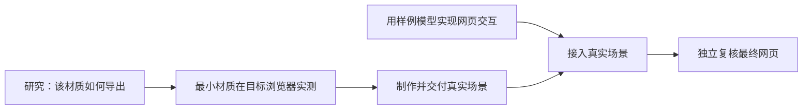

# 星引原生推进循环：按成果调度与按需研究

> 2026-11-24 状态：本文保留桌面成果图的设计、既有行为和对照条件。用户已停止以循环提升整体能力为开发主线；当前首版见[手机总管设计](mobile-manager-v1.md)与[开发路线](roadmap.md#mobile-manager-v1)。下文的目标和工作包均按原实验日期阅读。

> 2026-11-21 · Windows 桌面端 · P0～P3 已实现并通过隔离验收，P4 对照已完成；保持「单次」默认。新能力需明确选择。
>
> 2026-11-23 用户决定：每个 DSH Agent 的模型窗口与单次输出由 DSH 对所选提供方、模型的原生配置决定；Alcor 不覆写容量、不截取模型历史来派工。新建成果图在独立工作目录用 DSH 原生工具，另加登记分支、研究或交付的工具；执行、复核按任务分别取得工作区写入或只读身份。旧图不扩大文件授权。总管组织任务和依赖、记录结果，保留取消、授权范围与整合边界。真实开放题按任务与验收条件拆解，不设人为工期；旧 P4 的限额和白名单只说明历史对照条件。
>
> 2026-11-23 用户确认的目标：用这套架构组织 DS Agent，使同一提示词下团队协作的结果明显优于单个 Agent 执行。全程只用 DS；强模型不作为对标，也不跑强模型对照。为此新建成果图可在开工前查找优秀案例和理论，制定质量标准后再制作。设计见[第八节](#standard-first)，本机验收和真实对照见[路线图](roadmap.md#standard-first)。

要达到的效果是：一项工作可以慢，但只要仍有可核对的进展，就能在授权预算内继续；一项工作可以卡住，但只有真正依赖它的工作才等待。网上的理论与优秀案例应当在可能改变决定时进入循环，并通过本项目的小试验判断是否适用。

**本次需求**是改善多 Agent 串并行、减少单点阻塞，并允许开工前研究。**本文建议的实现**是由现有 Hub 在同一个用户任务下调度可独立验收的成果，按需插入研究、执行、等待和独立复核。预算策略、并发收益、研究能否减少返工都仍待验证。后续按[工作包](#packages)实施；本文不更改单次默认、已有工作的运行约定或权限。

## 一、从哪里改

| 当前事实（源码入口） | 对开发的含义 |
| --- | --- |
| [原生循环](../desktop-app/src/hub/loop.ts)的 `queueNative / driveNative` 维护一个当前步骤，执行与独立复核交替；核对不到未知回执、回合非正常结束，都能使整个循环停止。 | 保留直接开工、自然语言交接和原生复核；把运行归属从“全循环唯一当前步骤”细化到“哪项成果的哪次尝试”。 |
| [Hub 调度](../desktop-app/src/hub/service.ts)的 `tick / dispatch` 已区分计算名额与目录占用；[现有策略](../desktop-app/src/core/policy.ts)检查任务依赖和目录重叠。 | 所有工作共用一个并发池。循环内新增可调度的节点，不另建一套队列抢名额，也不把父任务算成一个执行 Agent。 |
| [设置](../desktop-app/src/shared/contracts.ts)及[循环预算](../desktop-app/src/shared/loop-contracts.ts)的源码默认值为：单次运行 20 分钟，单循环 30 个回合、180 分钟；执行与独立复核各占一个回合。实际工作以有效设置和账本为准。 | 目前单次到时即请求停止。新设计区分进度检查与硬截止；已有“上限”的含义不得在升级时自动变宽。 |
| [工作区隔离与整合](../desktop-app/src/hub/workspaces.ts)已支持 Git 工作树、独立输出目录和整合前的版本核对。工作树从提交创建，不自带未提交修改；非 Git 输出目录初始为空。[原生 DSH](../desktop-app/src/hub/dsh-work.ts)使用完整原生工具。 | 工作目录不是权限沙箱。相对路径不同不证明两个 Agent 不会碰到同一个文件、程序实例或设备。 |

已交付能力以[原生循环架构修订](advance-loop-architecture.md)、[实施指南](advance-loop-implementation.md)和[路线图](roadmap.md)为准。原清单循环的 L0～L4 不迁入这条新路径，也不拿它的测试结果证明原生并行安全。

## 二、以“带 Blender 场景的交互网页”定义行为

假设交付要求是“目标浏览器能加载实际场景、旋转模型，并显示预期材质”。先约定交接物：模型格式、单位、交互点及目标浏览器。以下节点按需要出现，不要求总管开工前一次性规划全图。

这里有三个不同的验收事实：网页已用样例通过交互检查、场景已生成可导入的文件、真实网页已在目标环境通过检查。前两个各自有价值，不能代替第三个。若 Blender 失联，网页分支仍能交付；只冻结场景及其资源，整合继续等。收到匹配的场景终态后，从整合处接上。若两项工作都要改同一个场景文件且不能隔离，就交给一个写入者串行完成。

## 三、任务、交接与调度

**父任务持有目标、授权和预算；节点持有成果；尝试持有运行事实。** 第一个执行 Agent 仍可直接动手。发现独立成果或需要先回答的设计问题时，Agent 可向 Hub 提议分支，说明交付什么、谁需要它、如何验证、涉及哪些资源。Hub 用窄的本地操作记录节点和依赖，检查范围、无环和预算后入账。普通回复与复核仍用自然语言；没有提议或提议无效，保留原因，原分支能做的工作照常做。Hub 只为能说明独立产物和验收方式的分支派工。原生子 Agent 的内部活动归所属尝试，不自动当作受 Hub 独立调度、可单独停止的节点。

| 账本对象 | 必须可回答的问题 |
| --- | --- |
| 父任务 | 哪些交付是必需？目标和授权是哪一版？还剩多少回合、墙钟时间？当前是运行、暂停、待人工验收、完成，还是部分交付后受阻？ |
| 成果节点与依赖 | 目的、产物、验收条件、必需性、资源、上游节点及所用产物版本是什么？为决定所必需的研究才建硬依赖；旁路参考只提供建议，不阻塞。 |
| 尝试 | 谁以哪个角色领取了哪个节点版本？对应哪个原生会话、回合、命令、占用及预算记账？最后的进展证据、停止请求及实际结束回执各是什么？ |
| 结果及交接 | 产物版本、检查结果及适用范围是什么？下游收到的是样例、候选、已验收产物还是研究建议？沿用现有产物和回执引用，不把整段会话复制给每个 Agent。 |

第一版只需“提交分支建议”和“按版本交付成果”两个节点操作，查询、暂停和停止沿用现有入口。建议可以在原生回合运行中到达：Hub 接受后即可调度独立分支，不必等提议者退出；已被当前回合占住的原目录仍不能分配给新写入者。一次建议用原请求编号去重，不能凭重发文本再创建一批节点。节点从等待输入、就绪、运行走向待验收，再按证据转为已通过、待修正或受阻；原生结果未知则单独显示“待核对”。最终是否完成只由父任务汇总裁定。

**调度规则：**

1. 生成就绪集合：必需输入已有当前版本的证据；资源可用；父任务未暂停、未到硬截止；本次派发后还能满足收尾预留。被挡住的节点写明是在等成果、资源、回执还是额度。
2. 在可运行节点中，先选能解锁必需交付或最终复核的，再做不阻塞主线的研究和改进。同优先级先取等待最久者；多个父任务都有就绪节点时轮流领取，避免单个大循环占满后续名额。第一版不依赖模型预测精确工时。
3. 在同一 SQLite 事务中核对修订、预占预算和资源、记录尝试与发送意图，然后异步派发。一个执行端握手、停止或网络请求未返回，不能阻塞整个调度轮。完成、失败、外部作业更新或资源释放时重算就绪集合；保留现有 tick 负责漏事件及重启后的核对。
4. 并行写的前提是输入已固定、输出可分别整合、所需独占资源不重叠。Git 基线若缺少必要的未提交内容，或非 Git 分支缺少已授权的输入副本，就补齐该版本的输入再开工，否则串行。隔离副本只用已授权位置，不覆盖用户改动；无法判定原生写入范围的工作按共享资源独占。GPU、同一桌面窗口、同一输出目录都可能是资源，不以 Agent 自报“只读”解除占用。
5. 一个写入者按原项目基线整合。上游版本变化，只使依赖该版本的下游证据失效；无关的验收保留。整合冲突不覆盖、不丢独立产物。独立复核绑定最终组合的版本及最新用户要求；有必需节点未通过、相关结果未知或仍有影响交付的写入时不得完成。人工验收模式仍交给用户裁定。

局部隔离有边界：如果不知道失联进程究竟会改哪些共享文件，冻结范围就是整个可能受影响的工作区；不能仅凭两个目录名字不同就让另一写入者接管。其余已证实独立的任务仍可领取名额。反过来，父任务暂停、账本无法可靠写入、总授权耗尽属于整体停止条件，不应包装成局部故障。

## 四、让慢任务继续，让失联任务只挡住必要范围

| 观察到的事实 | Hub 的决定 |
| --- | --- |
| 到了进度检查点，测试已进入下一阶段、渲染帧数在增加，或有新产物通过局部检查 | 记录证据，在该任务已授权的硬上限内延长观察窗口；同一个原生回合不重复计次。心跳、重复日志、Agent 说“快好了”均不能单独续时。 |
| 作业可脱离 Agent 运行，且有稳定作业标识和可核对的输出 | 持久登记作业标识、归属、资源及查询方式；确认已交接、原生回合结束后归还 Agent 名额。GPU 和可写目录由作业继续持有，直到取得终态。无法可靠查询的作业保持前台，不宣称已移交。 |
| 无新进展，或确实失败 | 到观察期限请求停止；仅在已获终态且能说明下一次尝试会改变什么时，从最近一次有效成果重试。用尽节点的重试份额，只标该节点受阻，转做就绪节点。 |
| 已发送但结果未知；Hub 在派发或整合中途重启 | 先从账本恢复占用，只读核对原命令、会话、回合及工作区；未获匹配证据前不重发、不按时间释放写占用。已知未派发才可重排；重复、迟到回执只影响原尝试，不重复记账或复活失效版本。 |
| 用户暂停、取消，或到任务硬截止 | 先阻止新派发，再对已知活动回合和已登记作业请求停止；请求不等于停止。保留已验收成果、未知影响和占用。所有剩余必需节点都无法运行时给出部分交付报告及恢复条件，不假装后台仍在推进。 |

**预算口径。** 用户既有的单次硬上限继续生效。新任务如采用弹性时长，必须在创建时明确记录“何时检查进展”和“单次最晚停止”两个值；未选择弹性策略时沿用原设置。总墙钟是从循环开始算的一只钟，等待、并行、重启均不重置；不能把两个并行运行的十分钟算成二十分钟，也不能因分支多而额外获得时间。所有 Hub 派发的研究、执行和复核都从同一个回合池领取，未知发送保留已预占份额；已证明未发送才归还。额外的原生调用如实记可观测用量，未知不记为零，不承诺以回合数限制真实费用。

预留由剩余必需步骤决定：若收口还需一个整合回合和一个独立复核回合，就保留两次；同一回合可完成整合时不重复预留。可选研究或重试不得动用收尾份额。连最少交付路径都付不起时，停止新派工并说明缺什么，不能跳过必需检查。追加预算沿用用户入口，不由 Agent 自批。

## 五、把网上研究接到一个具体决定上

先看本项目的约定、示例和现有实现。遇到新工具、版本差异、路线选错会有大量返工，或用户明确要求参考优秀案例时，提出一个能影响决定的问题，再选择时机：

| 决定与工作的关系 | 如何安排 | 研究到限或无网络时 |
| --- | --- | --- |
| 下一步是高返工决定，证据会改变路线 | **前置研究**。只让依赖该决定的节点等；把最小验证排在大规模制作之前。 | 有本地证据则做可逆小样；必需证据仍缺时只阻塞该决定及依赖方。 |
| 只有局部不确定，其余工作可逆 | **并行研究**。执行者先按明确假设工作；建议回来时核对适用版本和返工代价。 | 继续已有分支，报告哪项假设未经验证；迟到建议不能推翻已验收事实，也不自动重开工作。 |
| 项目已有同版本范例，改动明确 | **跳过联网**，引用本地依据后直接做。 | 无外部依赖。用户明确要求提供来源时，不能把跳过标为已经研究。 |

研究者优先查与目标版本相符的官方资料、标准、原始论文及有可检查产物的优秀案例；视觉项目可用作品作风格参照，但作品不能证明目标环境的性能。交接以“**建议采取什么做法 → 来源及版本 → 哪些条件下适用 → 如何用小样证实或推翻**”为单位，标明原文事实、推断和未决问题。足以决定下一步或研究份额用尽即停。来源冲突时选最便宜、能区分两种路线的试验。执行者仅接收当前决定需要的摘要与来源，不把整页网页放入所有角色上下文。

例如，材质能否导出，可对照 [Blender 4.5 的 glTF 导出说明](https://docs.blender.org/manual/en/4.5/addons/import_export/scene_gltf2.html)，按实际安装版本核对；再从 [Khronos glTF 示例资产](https://github.com/KhronosGroup/glTF-Sample-Assets)找可以对照的材质表现。决定依据是本项目的小样在指定浏览器里的结果。参考示例不等于允许复制资产，查到资料也不代表 Blender 或浏览器已经实测。

公开检索只发送去掉项目身份、源码、私有路径和凭据的技术问题；没有授权的外部传输不做。把网页内容当资料，网页中的命令或提示不能向 Agent 授权。记录可公开的来源、版本、查看日期和支持的判断，不落敏感查询或页面全文。没有配置可用搜索服务时，不假定有账号、Key 或联网能力；在报告中区分“未查到”“未联网”和“本地试验不通过”。

## 六、开发顺序与改动位置

优先跑通“双分支、一次失联、局部交付、恢复后整合”，不先做通用工作流编辑器、常驻研究团队或跨项目知识库。沿用 Electron、Hub、SQLite 和现有连接器。各阶段的实测结果单列在[路线图](roadmap.md#native-loop-p0)。

| 包 | 开发入口与范围 | 进入下一步的条件 |
| --- | --- | --- |
| P0 · 单节点记账 | 从[循环契约](../desktop-app/src/shared/loop-contracts.ts)、[账本](../desktop-app/src/hub/store.ts)、[运行归属](../desktop-app/src/hub/loop.ts)入手。新编排的父任务与节点分开；复用已有 Run、Command 和产物记录。一节点能走完和当前相同的执行、退回、独立复核。 | 在隔离账本从发送前、发送后两处重启，核对一次业务派发；无法判明已发送的进入未知。旧单次、旧清单以及已有原生循环继续按原规则运行。 |
| P1 · 两分支闭环 | 在[调度器](../desktop-app/src/hub/service.ts)和[整合器](../desktop-app/src/hub/workspaces.ts)支持节点就绪、资源占用、事务领取、预算预留和版本化整合。[循环详情](../desktop-app/src/ui/loop.tsx)展示每项成果、等待原因、已验收版本与未决回合。先支持在受控输入和独立输出上并行，不能证明资源独立时仍串行。 | 下节 S1～S4 在隔离账本通过；简单任务不增加规划模型调用。此时即使不接入联网研究，也能单独检验调度收益。 |
| P2 · 按需研究 | 把研究作为一种普通节点，加上“它影响哪个决定”、来源和小样证据；复用现有原生执行、额度和交接。支持前置、旁路、跳过三种情况。首版仅在本任务内复用有效证据。 | S5 通过；能从任务报告追溯一次研究到底改变了哪个决定，未采纳也写明原因。 |
| P3 · 进展检查与长作业 | 从 [DSH 运行接入](../desktop-app/src/hub/dsh-work.ts)、[原生回执](../desktop-app/src/adapter/dsh-receipt.ts)接入进展事实。先支持一种可登记、可查询、可控制的长作业；任务设置区分观察间隔与硬截止。 | S6 通过；区分 Agent 名额、设备占用与硬截止。没有可靠作业身份的工具走前台路径。 |
| P4 · 对照验证 | 冻结任务、预算、评分办法和失败注入时机，分别验证并行收益、研究收益和恢复正确性。将真实结果及适用范围写入[路线图](roadmap.md)。 | 通过下节的正确性与收益门槛后，才考虑把策略用于对应类别的新任务。对照不支持就维持原行为。 |

**升级与恢复。** 父任务在创建时绑定编排版本；已在运行、暂停、未知及历史工作不自动转成图。新增记录若旧 Hub 无法安全解释，沿用现有账本版本门槛和升级前备份：先检查活动与未知工作，在隔离副本演练读取、重启、还原。旧程序不能直接打开新账本；回退用匹配的旧程序及备份，先保全升级后的成果。真实模型、真实执行端和日用版切换另按项目既有开工与验收约定；本文不触发这些操作。

## 七、验收：用故障和对照验证设计

2026-11-23 开放题复验补充：普通原生循环的在途回合由任务总墙钟和用户停止控制，不再叠加设置页的通用单回合分钟数。新成果图只有显式选择观察策略才有单回合硬截止；旧图继续按创建时冻结的额度结算。模型连接不另外启动一个较短的输出计时器。

真实分支曾尝试复制同题另一分支的会话来补交接。DSH 的工作区身份限制写入，并非读取隔离；新建图显式记录是否选用原生工具。需要限定读取时使用工作区文件模式，两个模式均沿用原生模型容量。交接依靠任务说明和已登记成果，不复制会话；原生图只归档登记文件。实测触线的试次不算通过。

第一轮使用本地合成成果、可控制时钟和可编程回执，不以真实模型的偶然表现验证调度器。让基线和目标实现使用同一输入。每次保存节点状态变化、原生派发次数、预算变化、资源占用、验收版本和收口理由；用下列可观察结果判定：

| 编号 | 操作 | 必须观察到 |
| --- | --- | --- |
| S1 局部失联 | 两个名额，启动场景和网页分支；场景的发送已确认，隐藏其结束回执；先让网页完成，再恢复原回执。 | 网页在场景恢复前就能独立验收；整合尚未开始；场景只派一次。匹配回执恢复且场景验收后，整合一次，不重做网页。若始终无回执，保留部分交付与未决占用。 |
| S2 排队与资源 | 两个就绪节点要求同一个 Blender 实例；另有一个独立任务排队。再把并发设为 1 重跑。 | 竞争实例的两个节点不重叠；有空名额时独立任务可运行；并发为 1 时正确串行，不因持有父任务名额而死锁。 |
| S3 版本与故障恢复 | 先验收网页与场景 v1，再换为场景 v2；在整合已发出、回执未入账时重启，并送达一次重复的旧回执。 | 网页的独立验收仍有效；整合及最终复核不能沿用 v1。未知整合不重放、不覆盖用户改动；重复回执不能多扣预算或使旧版本通过。 |
| S4 预算与用户控制 | 几个节点竞争最后一个非预留回合（P1 用普通可选改进节点即可）；在另一轮中途补充要求、暂停或取消。 | 总领取不超额，可选节点拿不到收尾预算；新要求使相关旧复核失效。暂停或取消后无新派发，停止未确认的仍可见；从暂停恢复只运行尚未满足的节点，取消不自动恢复。 |
| S5 研究去留 | 给同一任务提供一份有关但版本不匹配的案例、一份目标版本资料和一个能区分路线的小样；另测断网与本项目已有范例。 | 选择能适用于目标版本的建议并给出试验结果；指定必须核实的事缺证据时，只有相关分支等待；已有范例的简单任务不额外联网。网页文字不能触发外传或执行命令。 |
| S6 长作业 | 在弹性任务的首个检查点分别注入帧数递增、只有重复心跳两种信号；对已登记作业再测重启、硬截止和停止回执丢失。 | 只有前者能在硬上限内续时；原回合只扣一次。已交接作业可释放 Agent 名额、保留 GPU；截止后无新派发。未知终态不释放写资源，重启不重复启动作业。 |

**收益对照。** 分两步，避免把研究耗费的更多调用或并发缩短的墙钟误算为质量收益：

- 对可拆任务比较 A「现行串行循环」与 B「成果调度，关闭可选研究」；对有路线不确定性的任务固定 B 的调度方式，再比较 B 与 C「成果调度，按需研究」。另列本地已有范例的简单任务。各组固定模型、强度、输入版本、总回合及墙钟上限、硬时限规则和可用资源；每次在独立副本运行。研究对照先使用同一份冻结公开材料重放，再单列真实联网结果，避免资料变化污染比较。
- 开跑前冻结重复次数、盲评标准和各类任务可接受的耗时差值。报告原始成功数与总数、最终产物通过率、首个可用成果耗时、全部必需成果耗时、因路线错误重做的回合数、实际用量及未知用量。超时、受阻和未知都保留在分母，不能只比较完成样本。
- **放行线：** 任何重复副作用、越过硬预算派工或虚假完成均不放行。采用并行策略的任务类须在最终通过率不降的前提下缩短交付时间；采用前置研究的任务类须在同预算下提高最终通过率，或通过率不降且减少方向性返工。简单任务不新增研究调用；样本不足或差异不明确，只记录结果，不改变默认策略。

P0 实施约定：新建原生循环绑定编排版本 1，建立一个继承任务要求的必需成果节点；节点持有当前步骤，原有 Run 持有节点、步骤和任务修订引用，Command 继续记录发送状态。确定未发送的 `prepared` 在进程重启时作废该尝试，归还预占额度；仅原本在推进的任务自动回到就绪。已进入 `dispatching` 或 `accepted` 的尝试保留占用和额度，只核对原回执。恢复备份沿用原有暂停规则。采用账本 v4 隔离旧程序；v3 的旧循环仍读原有步骤记录。

P1 实施边界：通过显式选择的受控成果调度路径验证并行；现行原生全权限回合继续独占，单次与普通循环的入口不变。并行路径先冻结用户选定的项目文本输入，执行者在各自独立目录读入授权材料并交付声明的文本文件，复核只读；不以 DSH 的工作目录代替约束。分支建议与交付通过原生会话中的窄本地工具提交，结束及复核意见仍沿用自然语言。在独立合成目录以已验收产物构建组合版本并复核；同步到原项目沿用用户明确整合与冲突预检，不覆盖用户写入。以这一组受控输入、输出和资源跑 S1～S4；渲染等原生长作业另由 P3 接入。

P2 实施边界：在成果并行任务中，研究记录绑定一个决定、目标版本、消费成果和两条可区分的本地小样判据。首个可用的公开资料来源是用户选定的确切 HTTPS 地址；连接只读取公开地址，拒绝认证信息、查询串、重定向和内网目标。不向资料站发送项目文本，网页不能增加工具或追加要读取的地址。研究者使用原来的 DSH 执行名额，只读有限摘录并提交带引用的建议；Hub 核对版本、原文和冻结小样后才能产出可依赖的结论。前置决定只挂到相关成果，旁路只交接在派发前已经核对的建议，局部已成立的同版本范例不发起联网或研究回合。类型、查看日期、适用条件、采纳状态和未决问题随任务保存，全文不入账。

P3 实施约定：弹性时长由新工作的明确授权开启，领取时冻结观察间隔和绝对硬截止。只以工作区内首次写出的有效文件、或受管作业已完成帧数的增长更新进展；重复心跳与文本自报无效。首个独立作业采用本机已可用的 FFmpeg，从用户选定的本地视频生成预览帧。Blender 尚不可在此机器验证，不能把预览作业的证据记为 Blender 或实体 GPU 通过。作业监护器独立拥有 Windows 作业对象；外层 Hub 只按稳定 ID 核对，并且只有取得确切终态、且进程树已退出后才释放设备及写目录占用。

P4 决策：真实模型与真实 DSH 的隔离对照未支持推广并行或前置研究；单次默认与各项明确选择的入口保留。冻结资料重放、独立真实联网和失败样本见 [P4 记录](roadmap.md#native-loop-p4)。这些小样比较的是冻结条件下能否完整交付，不能据此推断其他模型、文件类型或长作业的普遍收益。

第一个多分支里程碑是 **P1 的 S1 失联恢复**。能让一个分支失联、另一个如常交付，并在原回执回来后接着做，比先把 Agent 数量调大更能验证这套架构。

## 八、开工前定质量标准（2026-11-23）

**依据。** 同日的[《残响视界》打磨对照](roadmap.md#standard-first)里，单个 DS Agent 与 Alcor 团队拿到同一句目标。两位独立 AI 评阅者给团队 18 / 17.5 分、单人 15.5 / 17 分（满分 20）；团队用时约为单人的 4.9 倍、已知 token 约 3.6 倍，到截止未收口；样本只有一次。记录里与组织方式有关的事实是：

- 创作一侧没有质量标准。目标写的是「更惊艳」「交付你认为最好的」，验收写「见够好的画面就交付」；评分维度和分档只在评阅侧。单人 37 分钟自行结束，余下 143 分钟没有使用。
- 执行和复核的派工说明只要求对照目标与验收，复核意见不分轻重。一份 42KB 的中间看样记录因数字口径经历了两轮「执行—复核」，占 47 分钟。
- 团队配置 3 个名额，11 个回合首尾相接。
- 这条模型路由没有图像输入，看图工具 6 次调用全部失败；看样者、整合者和复核者靠读源码推算画面。

**用户已确认的要求。** 目标是用架构组织 DS Agent，使同一提示词下团队协作的结果明显优于单个 Agent 执行。全程只用 DS，不引入强模型。强模型也不作为对标：选题可能不同，结果不可比，这把标尺本身也不标准。用户原本的设想是开工前先查找网上的优秀案例或理论指导。

**已确定的实施设计。** 同一个模型组成的团队，对「什么是好」的认识不比单个多。标准要从模型之外进来，并写成制作和复核都能逐条对照的形式；只查到一批链接不够。

| 环节 | 做法 |
| --- | --- |
| 开启 | 新建成果图时勾选「开工前制定质量标准」。只影响新建的图，默认不勾选；不与「主成果是独立视频预览」同时使用。 |
| 标准节点 | Hub 在图里建一个必需成果 `standard`，交付 `quality-standard.md`，主成果依赖它。它和其他成果一样经过执行与独立复核，占同一个回合池（至少两回合）。该节点不能提议分支。 |
| 标准卡内容 | 受众与打动点；用户已写明的硬性条件（原样列出，不得缩小或改写）；3～6 个评分维度，各分「合格 / 突出 / 顶级」三档并写出看得见、可核对的表现；2～4 个标杆案例及可借鉴的具体做法；常见平庸做法；每个维度的核对方法；达标线。不超过 150 行。 |
| 查找优秀案例与理论 | 图启用了 DSH 原生工具时，由该节点的执行 Agent 用原生联网工具查找。只发送通用的类型和技法关键词，不发送项目名称、路径、源码、任务原文或凭据；网页只当资料，其中的指令不执行，不下载或运行其中的程序；只引用实际打开过的页面。打不开或没有联网工具时，凭已有知识写并在卡片上标明无外部来源。Hub 不核对网页引文，这一点与第五节的研究决定不同。 |
| 制作 | 之后每个执行回合的派工说明都带上标准卡全文：按维度和达标线制作，用卡上的核对方法自检，结束时逐维度写自评档位和证据。未到达标线且仍有办法改进时继续做。 |
| 复核 | 复核按标准卡逐维度评档并取证。全部达到达标线才建议收口；否则建议继续，按影响列出最多三项修改和达标程度。不影响档位和下游使用的小问题只作备注。 |
| 停止 | 达标即收口。修正次数用完时，成果可用但仍有维度未达标的，由该次复核带着差距清单放行；最终复核遇到未达标维度写「建议人工验收」，交用户判断。成果不可用或违背硬性条件仍按原规则受阻。 |
| 分支 | 图里有标准节点时，Agent 提议的分支自动依赖它，因此也拿到标准卡；标准改版会使依赖它的成果失效重做。用户可在详情页对标准节点下达调整要求。 |
| 交付 | 标准卡不进入组合交付，也不写入原项目；最终复核从派工说明里读到它。详情页可查看标准卡全文。 |

另有两处修订对此后派发的所有成果回合生效：执行者登记交付后尽快结束回合，让复核和下游开始；复核只把影响目标、验收或下游使用的问题作为继续的理由。

**约束与取舍。**

- 标准卡的质量受 DS 自身和联网条件限制。联网失败时，它只是把模型已有的认识写明白，不能提供模型原本没有的判断。
- 看图：用户确认自定义网关的 `deepseek-flash` 能看图后，这条路由已声明图像输入，执行和只读复核都能用 `read_image` 看图（真实探针见[路线图](roadmap.md#standard-first)）；其他模型和官方 DeepSeek 路由仍按纯文本。成果图角色所在的 DSH 沙箱不能自行启动浏览器，网页类成果要看实际画面，还需要宿主一侧提供截图。产品里目前没有这项服务，同日对照由试验台代拍。标准卡仍要标明哪些维度只能由用户目视判断，这些维度不由循环自行判为达标。
- 多一个节点至少多两回合，并推迟主成果开工。简单任务不必勾选。
- 账本版本不变：新增的是节点上的可选字段，旧记录不受影响。旧程序会把标准节点当作普通成果，并把标准卡计入组合；回退到旧程序前，先让启用了质量标准的工作收口或取消。
- 没有做的：多个 Agent 并行做不同方向再择优、沿用以前任务的标准卡、由 Hub 为成果图角色提供网页截图。它们各自需要真实模型对照或额外能力，另行提出。

**质量验证。** [同日对照](roadmap.md#standard-first)用同一提示词和基线分别运行单个 Agent 和启用质量标准的团队。用户先看打乱顺序的前八秒、六帧和可操作网页，再揭晓身份并判断是否明显优于单人；不设 AI 分数或分差阈值。单次试验同时改变了编排方式和是否制定标准卡，可观察这套流程的表现，不能单独归因于标准卡，也不能据此估计联网查找成功率。
