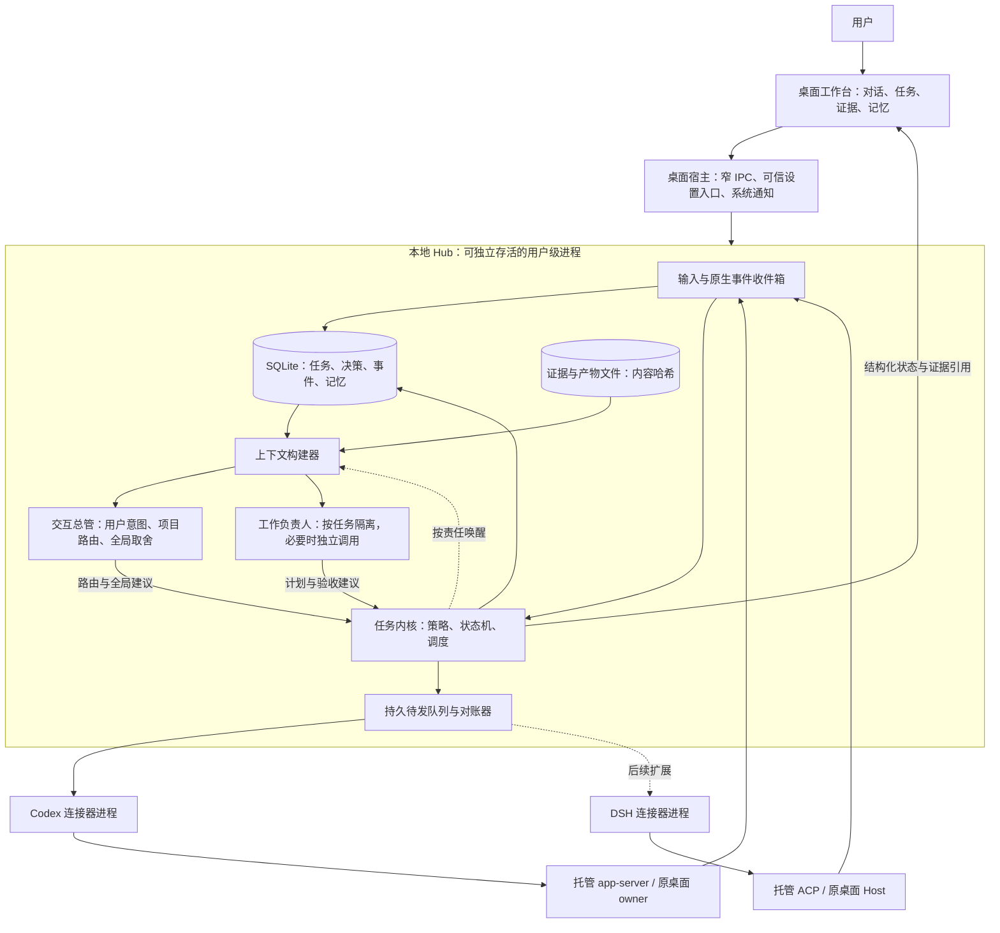

# 星引桌面客户端架构：长期理解、工作衔接与多 Agent 管理

> 类型：桌面产品与架构方案
> 状态：有效（用户要求已确认，首版实施设计已整理；后续研究建议另标状态；桌面架构未实施、未验收）
> 更新：2026-11-17（Asia/Shanghai；确认 Codex 首版、GPT Key/可选模型、开发测试模型及完整基础交付；补齐执行与恢复契约）
> 适用：Windows 优先的星引 / Alcor 桌面客户端；首版执行后端为 Codex，DSH 后续接入；可按需与手机共用内核

核心设计是：**模型负责理解和提出决策，星引负责保存事实、约束行动、跟踪执行和恢复工作。每次调用都允许换一个没有旧聊天上下文的模型，系统仍能提供足够的工作材料。**

长期理解体现在用户纠正能够持续生效、相同背景无需反复交代；工作衔接体现在目标、产物、下一步和未决操作可以恢复；可靠管理体现在发给正确的 Agent、限定其职责、核对执行结果并处理失败。三项都需要产品和程序机制，不能只依赖总管提示词。

本方案沿用 [R3 原生身份、归属与可靠执行](../../../docs/r3-design-baseline.md)，在这里维护桌面进程、上下文恢复、调度和交互的细化契约。DSH Remote 工程与早期研究记录留在原本机归档；本文中的相关引用用于追溯。星引实际实现和验收状态见[架构入口](../../../docs/architecture.md)与[路线图](../../../docs/roadmap.md)。

阅读入口：[总体架构](#desktop-architecture)、[理解与纠错](#intent)、[长期记忆](#memory)、[复盘学习](#learning-loop)、[上下文与衔接](#context)、[可靠执行](#execution)、[多 Agent 调度](#orchestration)、[优先级与在制工作](#priority-scheduling)、[分层与直达路径](#management-layers)、[决策权限](#decision-authority)、[异常升级与恢复](#exception-recovery)、[DeepSeek 原型参考](#deepseek-reference)、[开源总管架构对照](#open-source-comparison)、[Codex / DSH 接入](#adapters)、[桌面体验](#ux)、[交付与验收](#delivery)、[管理制度调研依据](#management-research)。

<a id="implementation-baseline"></a>

## 0. 当前实施基线与决策状态

本篇是桌面详细设计的主要维护位置，当前项目从[统一架构入口](../../../docs/architecture.md)进入；阶段、完整首版功能和放行条件统一维护在[开发路线](../../../docs/roadmap.md)。沿用已有文件位置，不复制另一套桌面详细架构。手机 R3 的定位和排期仍由其原文档维护。

| 决定 | 状态与依据 | 实施含义 |
| --- | --- | --- |
| 首版先用 Codex 完成 | 2026-11-17 用户确认 | D0～D2 不等待 DSH；支持多个独立 Codex 执行者，保留统一连接器契约，DSH 后续独立扩展 |
| 总管使用 GPT API Key，支持选择模型；开发测试默认 `gpt-6.1-sol` | 2026-11-17 用户确认 | 总管与 Codex 执行配置分离；模型按调用快照保存，实际端点和模型能力待 D0 验证，不把模型名写死在内核 |
| 首版基础功能比较完整，能直接使用和测试 | 2026-11-17 用户确认 | 首版为 D2 集成后的可运行 Windows 包；D0/D1 不是完整首版。项目、聊天、模型设置、会话、任务控制、结果、历史、明确规则、恢复与诊断均纳入[功能矩阵](../../../docs/roadmap.md#first-release) |
| Electron + TypeScript / 独立 Node.js Hub / SQLite；状态、版本、生命周期与验收契约 | 本轮依据用户“其它的你进行补齐更新”确定的实施设计，尚待实现验证 | 按本篇细化执行；首轮实测暴露限制时记录取舍，不能将设计状态当作能力已验收 |

原先“双后端同时通过 D0/D1、D2 才形成双后端首版”的排期由本轮决定替代。原有验收目标优先、边界内自主推进、明确原生身份、未知不重派和权限不扩大的原则继续有效。自动学习、多设备接管及研究比较保留为后续设计；当前完整首版不以这些能力为前置。

2026-11-19 续：单次模式继续适用本篇的领域模型、两次自动修正、并行写入和授权规则。桌面源码另接入 [L0 推进循环](../../../docs/advance-loop-architecture.md#staging)；循环任务使用独立的清单、检查和预算记录，DSH 在同目录串行写入，Hub 运行检查和判定收口。后续角色和改进轮须等待真实实验；状态及证据见[开发路线](../../../docs/roadmap.md#loop-l0-local)。

## 1. 产品边界与成功标准

首版定位为个人桌面工作总管。用户可以通过星引下达目标，也可以继续使用 Codex、DSH 的原界面；星引保存跨会话的工作关系。采用本地优先架构：离线可看已同步内容、编辑草稿和管理本地记录，模型不可达时清楚显示推理不可用。

首版支持 Windows、本机一个协调 Hub 和 Codex 执行适配器；DSH 保留为后续独立扩展。总管使用 GPT API Key，可选择模型，开发测试默认 `gpt-6.1-sol`；型号由已配置端点的实际能力、用户选择和预算决定。多电脑和手机接入沿用 R3 的身份、加密与控制权契约，后续按需加入。首版需覆盖完整基础使用流程，具体功能以[首版矩阵](../../../docs/roadmap.md#first-release)为准。

工作从用户可观察的结果倒推：先说明谁在什么情境下需要什么结果、交付物是什么、怎样判断有用，再决定实现步骤。简单任务在任务理解中用几句话表达；跨阶段目标可以关联少量结果指标及其基线、目标和观察条件，不强制每项工作写 OKR 或长篇立项材料。目标、验收项沿用 IntentRevision / Task / Acceptance，不能另建一份相互冲突的目标台账，也不能用任务数、代码行数或调用次数代替交付价值。

桌面总管的管理重心遵循用户已确认的[验收目标优先原则](#acceptance-first)：明确交付与验收，执行者自主推进，总管按结果和必要异常介入。

| 要解决的失败 | 星引承担的机制 | 可观察的结果 |
| --- | --- | --- |
| 总管最初就理解错了 | 保存用户原话；可编辑的任务理解；假设、疑问与事实分开；重要条款逐项关联 | 用户能看见并纠正目标，纠正后旧计划失效 |
| 上下文压缩遗漏了限制 | 当前有效约束、任务、未决操作由程序强制装入上下文 | 换新会话后仍知道哪些不能做、哪些尚未办完 |
| 忘了项目背景与用户偏好 | 有来源、作用域、版本和适用条件的长期记忆 | 不把某项目的偏好套到所有项目 |
| 不知道上次停在哪里 | 任务账本、检查点、产物基线与运行对账 | 能说明最后确认的进度和下一步，避免从头重做 |
| 多个 Agent 互相覆盖 | 明确任务契约、依赖、执行位置与写入隔离 | 并行任务不会在同一未隔离工作区同时写入 |
| 网络失败后重复下令 | 持久命令、去重、接受证据与未知结果处理 | 超时后先查询，缺证据时保持未知 |
| Agent 说完成就被当成完成 | 运行结束、交付验证、用户验收分开 | 每项完成声明都能打开相应证据 |

系统能强制执行身份、权限、状态转移和去重规则；对语义理解、任务拆分、事实判断的正确性，只能通过纠错和评测提高。不能承诺模型永不误解，也不能把“记住了”当作“理解正确”的证据。

<a id="desktop-architecture"></a>

## 2. 总体架构与进程边界



**本轮确定的实施选型：Electron + TypeScript / Node.js Hub + SQLite。** 这与现有 Node 连接器及 JS 共用内核接近，先降低集成成本。选型不代表内存占用已达标；D0 纵向样机测量空闲内存、冷启动和长列表滚动，再判断是否需要调整外壳。Tauri + Node sidecar 保留为有实测理由时的备选，首版不并行维护两套。

| 模块 | 责任 | 不应承担的责任 |
| --- | --- | --- |
| Desktop UI | 对话输入、任务视图、产物检查、记忆编辑、操作反馈 | 数据库直写、任意 shell、读取密钥、裁定任务完成 |
| Desktop Host | 窗口/托盘、文件选择、可信密钥录入入口、经过校验的 IPC | 把渲染页面的任意字符串当作命令执行，或成为后台 Hub 访问凭据的唯一依赖 |
| Hub 凭据与模型调用端 | 以当前 Windows 用户身份访问安全凭据存储，通过 secret reference 发起已配置模型请求 | 向普通页面、模型上下文、连接器环境或日志返回 API Key |
| Hub Core | 状态机、权限与预算、事务、优先级与容量、异常阻断、对账 | 模型推理或厂商私有 wire 协议 |
| Context / Memory | 检索、约束装载、证据引用、摘要重建、纠正传播 | 凭语义相似度授予权限或合并任务 |
| BrainPort | 提供统一推理接口，承载角色各自的上下文与结构化建议 | 用一条不断增长的聊天同时装下所有角色和项目 |
| 交互总管角色 | 理解用户意图与偏好、确定项目/任务、跨项目取舍、对用户汇报 | 逐项转述执行过程、替工作负责人补写技术方案 |
| 工作负责人角色 | 在明确项目和目标范围内拆解、协调依赖、处理阻塞、提出验收结论 | 扩大上级授权、改变用户全局偏好、直接改写权威状态 |
| Adapter Host | 能力探测、原生会话映射、执行/审批/事件转换 | 猜测缺失能力、改写来源归属 |

UI 渲染进程关闭或崩溃不应使已接受的任务丢失。是否关闭窗口后继续执行、是否开机启动，由明确的后台设置控制；“退出星引”提供停止并退出或保留后台执行的可见选择。重启 Hub 后先恢复账本与对账，再开放新调度。

本地通信优先用户 ACL 限制的命名管道；每个连接校验实例身份、协议版本和权限。若使用回环 HTTP/WebSocket，同样认证并校验来源，不把 localhost 当成安全边界。远程连接在后续复用 [R3-C1](../remote/docs/r3-c1-encryption-migration.md)，单机首版不依赖公网 Relay。

<a id="hub-lifecycle"></a>

### 2.1 Hub 启动、后台与升级契约

| 场景 | 实施行为与可验证结果 |
| --- | --- |
| 首次启动或再次打开窗口 | Desktop Host 通过窄启动器启动用户级 Hub；以用户身份和规范化数据目录绑定系统互斥及管道 ACL。已存在 Hub 时连接并核验实例与协议，不另开数据库 writer；PID 文件仅作诊断，不能单独证明所有权 |
| Hub 崩溃或连接器遗留 | 新 Hub 先独占数据目录、递增启动代数、恢复账本和对账。连接器失去 Hub 后不接受新派发；原有执行保留真实状态。注册进程按实例/创建信息核验，不能仅凭 PID 复用判断或终止用户的其他 Codex 进程 |
| 界面关闭与完整退出 | 首次默认不启用持续后台执行；有工作时提供“停止任务并退出”或显式保留后台的选择。先阻止新派发，再请求停止并记录回执；强制退出或无法确认停止时落盘 unknown，不能显示已停止。后台开启状态和运行任务始终可见；开机启动另行设置 |
| 后台凭据访问 | Hub 使用 Windows 用户级凭据存储，按 secret reference 读取总管 Key；不依赖渲染窗口存活。专用可信录入路径只瞬时处理密钥，不进入普通页面状态、剪贴板自动操作、草稿、命令行或日志；Hub 不把总管 Key 传给 Codex 子进程 |
| 更新与数据库迁移 | 先关闭新派发，核对活动执行/未知命令，建立一致性备份和文件清单，再在独占条件下迁移。新版本失败时整体恢复匹配的程序、schema 与数据；禁止旧程序直接打开不兼容新库，恢复备份后的命令仍先对账 |
| 磁盘不足或关键持久化失败 | 不确认输入已接受，不继续有副作用的派发；保存可见错误和未提交草稿。日志/可选索引失败与任务账本失败分开，不能通过跳过持久化维持表面可用 |

Hub 存活、连接器存活和原生回合仍运行分别显示。连接器重连后的新操作必须绑定当前任务/会话控制代数；旧代数的已有结果可作为证据入库，但不能覆盖较新意图或自动启动下一步。重试采用有界退避，重启不清空计数。管道身份、数据库 writer 和执行端准入共同控制所有权，单靠 SQLite 文件锁不能隔离原生会话写入。

### 2.2 代码边界与跨端复用

按实施需要创建 `desktop-app`（UI/宿主）、`packages/contracts`（版本化消息与运行时校验）、`packages/core`（纯任务/权限/调度规则）、`packages/hub`（Node 存储、模型调用、凭据、监督与对账）、`packages/adapter-codex`（原生协议与兼容）。这些是计划中的边界，本轮未创建源码目录；小模块可先合并组织，但依赖方向必须保留。

共用 core 不导入 Electron、Node 文件系统或供应商 SDK，存储、时钟、凭据和执行通过端口注入；Hub 是首版唯一业务写入者。手机后续复用契约与纯逻辑，不拷贝第二份数据库 writer 或直接依赖桌面 IPC。模型与 UI 都只能提交结构化请求，不能直写事实表。

<a id="domain-contracts"></a>

## 3. 领域模型：工作、对话与执行分开保存

沿用 R3 的稳定身份；桌面新增细化对象使用独立 schema 版本。不要把 UI 卡片 ID、会话标题或目录路径升级成业务主键。

| 对象 | 最少保存内容 | 核心约束 |
| --- | --- | --- |
| IntentRevision | 用户消息引用、目标、范围、交付形式、约束、验收条件、疑问、解释来源 | 保留原话与解释的差别；修订关联被替代版本 |
| Project / WorkspaceBinding | 稳定项目 ID、原生归属、设备/账号、执行位置、用户更正 | 项目归属不由 cwd 或同名猜定 |
| Task | 当前意图版本、父目标、依赖、推进责任者及代数、状态、下一步、阻塞、验收项 | 顶层目标与子任务用同一模型；一项任务可跨多个会话，同一时刻一个有效推进责任者，跨范围决定按 Decision 指定责任 |
| NativeSessionRef | backend、connectorInstance、device/account、nativeId | 一条会话也可承载多个任务，以 turn/item 范围映射 |
| Run | task、attempt、session/turn、执行策略、基线、时间、结果 | 新业务执行尝试新建 Run；同一命令的投递恢复不新建 Run；保留前后继 |
| Command | requestId、目标、payloadHash、expectedRevision、controlEpoch、授权引用、接受证据 | 同一逻辑操作的投递重试复用 ID 与内容；新业务尝试或变更内容使用新 ID，unknown 不自动重发 |
| BrainInvocation | 调用 ID、角色/任务、模型配置快照、上下文清单、输入版本、请求/结果、用量及错误 | 总管 API 调用独立于 Codex Run；换模型不重置任务或执行次数，候选结果仍需版本和权限校验 |
| InputDelivery | messageId、来源、taskId、输入用途、责任者、deliveryId、上下文接收证据、退回记录 | 区分需处理的请求与仅供参考的材料；送达不能写成模型已理解 |
| Event | 来源流、原生 ID、序号/修订、发生/接收时间、内容引用、完整性 | 同一事件可有修订；不能靠墙钟排序裁决权威 |
| Decision | 问题与作用域、任务修订、推进者、唯一决策责任者及权限依据、选项与证据、结论理由、状态/版本、复议条件 | 决策权不等于执行授权；重要决定可恢复，旧修订不能提交；简单任务由任务负责人兼任 |
| OperationalIssue | 触发事件、影响的任务/命令/资源、证据、处理责任者、阻断动作、允许的恢复动作及权限引用、恢复条件、关联决定/修正任务、状态/版本 | 异常是任务账本的关联记录，不另建派工体系；关闭问题必须有对应恢复证据 |
| MemoryItem | 作用域、来源、证据、适用条件、状态、版本、替代关系 | 现行决定与推断偏好分开；推断不能增加权限 |
| Artifact / Acceptance | 内容摘要、文件/提交基线、生产者 Run、验收规则、结果证据 | 验收绑定具体产物版本，后续修改使旧验收过期 |
| Checkpoint | taskRevision、sourceWatermarks、contextManifest、产物基线、未决命令和下一步 | 检查点是索引和恢复入口，原始证据仍保留 |
| Grant / Approval | 主体、操作/资源范围、版本、有效期、次数/预算、原生审批 ID | 工具端执行前重新校验；模型建议无法创建授权 |

首版用 SQLite 关系表即可表达依赖和关联，无需图数据库。关键更新在一个事务里完成：修改业务状态、追加相应事件、写入待发操作。采用“现行状态表 + 不可静默改写的关键事件账”，先不把所有 UI 操作都做成复杂事件溯源系统。

决策、异常和运行指标使用现有 Hub / SQLite，不增加常驻的决策、值班或绩效 Agent。重要决策按第 8.7 节建记录；普通局部选择由已有 Run / Event 留痕即可。修正措施如需执行，仍使用 Task / Run 和原有授权检查。

### 3.1 首轮实现需要冻结的消息与版本

以下为实施契约；JSON Schema/类型与校验器在 D0 创建并版本化，本轮没有可执行 schema。外部输入、UI IPC、模型建议、连接器结果及持久化迁移均须运行时校验，不能只依赖 TypeScript 类型。

| 字段/对象 | 约束 |
| --- | --- |
| `schemaVersion` / 稳定 ID | IPC 和持久消息标明 schema 版本；task/run/request/message/delivery/invocation 各有稳定 ID。内核统一使用 `backend` 表示执行后端，模型服务使用 `providerProfileId`；旧 R3 的 provider 等别名只在兼容层映射 |
| `intentRevision` / `contractRevision` | 前者随目标/约束的语义修订递增，后者随有效交付契约修订递增；纯进度、流式字块、已读状态不使意图过期。候选验收使用哪个版本必须可追溯 |
| `stateVersion` | 每个聚合体的状态更新采用 compare-and-swap；模型运行期间允许无关进度更新，提交时重新读当前状态并核对语义版本与准入条件，不使用全库一个 revision 使所有建议相互失效 |
| `ownerEpoch` / 控制代数 | 推进责任移交递增 ownerEpoch；任务与原生会话分别记录控制代数，Hub 另有启动代数。三者职责不同，命令按目标携带并由内核/连接器核对；不能仅有 task 锁而允许同一原生会话双写 |
| `CommandEnvelope` | 必填 requestId、调用主体、操作类型、稳定目标、规范化载荷摘要、原文/输入引用、意图/契约/控制版本、grantRefs 及版本、有效期和资源声明。禁止以标题、cwd 或模型自填 confirmed 作为权限依据 |
| `ActionProposal` | 必填 proposalId、任务/输入引用、预期语义版本、负责人版本、建议操作与权限/预算需求；提案 ID 去重，模型只能引用已有授权，不能签发 Grant。采用提案、状态变更及 outbox 在同一事务提交 |
| `InputDelivery` / `ResultEnvelope` | 输入区分 request 与 context_only，保留原话、责任者和送达证据；结果保留 Run、产物/依赖版本、实际影响、检查证据和未解决项。结构化提取失败保留原文，不猜造完成或执行事实 |
| 事件与来源水位 | 关键事件以来源/原生身份/修订去重，保存最高连续已持久水位；缺口必须补齐或标记来源不完整，不用较大的最后序号跨过缺失控制事件。摘要与流式显示可重建 |

每次副作用派发前重新核对相关 Grant、策略版本、依赖产物、任务/会话控制权和阻断条件；事务入队时通过不代表稍后发送仍有效。策略或权限变化只使受影响操作失效。模型配置切换按第 9.4 节作用于后续调用，不把已完成的产物验收一律作废。

<a id="intent"></a>

## 4. 先防误解：把理解变成可检查、可纠正的对象

### 4.1 输入处理

1. **先保存原始输入。** 消息、附件引用、当前项目/任务/会话选择先持久化，再调用模型。模型或 UI 崩溃不能使已接受输入消失。
2. **解析“这句话在做什么”。** 区分新目标、继续工作、修改要求、纠正理解、状态询问、暂停/取消、审批答复和一般问答。询问进度不自动替代当前目标。
3. **建立任务理解。** 明确目标、当前阶段、交付形式、已知限制、成功标准；每项映射到原文片段或既有决定。模型新增假设标为假设。
4. **检查遗漏和冲突。** 与原话、现行任务、有效决定逐项核对；“只设计”“不要上线”“沿用这个目录”等否定/范围条款进入固定检查项。二次模型检查可辅助，但其通过不代表理解已经正确。
5. **确定可继续的范围。** 明确、可逆且已有授权的工作直接进行，显示简短理解摘要；涉及目标对象、范围、数据外发或不可逆影响的实质歧义，先澄清依赖该答案的部分，其余独立工作可以继续。

理解摘要展示用户能判断的内容，例如：“继续项目 A 的客户端设计；交付架构文档；暂不实现和发布。”不展示内部思维链，不要求用户逐条确认常规分析。

总管输出例如 `proposeTaskRevision / proposePlan / proposeDispatch / requestClarification / proposeMemory`。程序校验 schema、引用存在性、目标一致性、版本和权限后应用。模型填入 `confirmed: true` 不能把建议变成用户确认。

### 4.2 纠正与新消息的传播

用户说“我刚才指的是公司电脑”“不要改接口”“上次说的已经不用了”，系统产生新的意图/决定版本，并计算影响范围：

- 尚未发出的旧操作撤销或重新校验；旧上下文生成的调度建议因版本不符拒绝提交。
- 运行中的相关任务标记 `needs_replan`，在适配器支持下插入修正或申请停止；不假设一条消息能立即撤回 Agent 已执行的动作。
- 已完成的产物保留，受影响的验收结论标记失效；后续整合必须重新检查。
- 派生摘要、上下文缓存、记忆检索记录根据依赖 ID 失效；通过 `supersedes` 留下“为何改变”的路径。
- 原生界面新消息进入同一事件流。可识别为该任务的用户修正时触发重新理解；不能区分用户消息与工具回显时，不把回显提升为指令。

暂停、取消和新要求是不同操作。暂停学习不暂停执行；暂停某任务不取消所有项目；状态询问不启动新 Run。用户未回答待确认问题不等于默认同意。

<a id="memory"></a>

## 5. 长期记忆：保存可修正的知识与习惯

记忆的目标是减少重复交代并保留判断背景。采用分层记录，避免把所有聊天提炼成一个不断增长的“用户画像”。

| 记忆层 | 例子 | 写入与使用规则 |
| --- | --- | --- |
| 明确的用户规则 | “回复用中文”“项目没有 Git，修改文档前备份” | 保存原话、作用域和适用条件；明确修正后替代 |
| 项目事实与决定 | 当前架构、采用某路线的理由、放弃方案及原因 | 关联代码/文档/用户决定；事实变动时重新验证 |
| 正在进行的工作 | 目标、依赖、已完成证据、阻塞、下一步 | 由任务内核维护，不能只放进语义记忆 |
| 情景记录 | 曾经发生的故障、某次选择、用户反馈 | 保存发生时间、当时版本；不能直接当当前事实 |
| 推断偏好 | 常用 Agent、解释详细程度、通知时机 | 低风险候选，有支持/反对证据和衰减；可关闭 |
| 经验证的工作方法 | 某类问题的可复用步骤与失败条件 | 从成功/失败案例提炼；带适用版本和结果，变更时复核 |

`MemoryItem` 至少含 `kind, scope, claim, sourceRefs, validFrom/validTo, observedAt, verificationStatus, supersedes, derivedFrom, retentionPolicy`。对推断偏好另存支持/反对证据和置信信息；不能把模型自报的置信分数当成事实概率。用户规则不因长期未提及而自动衰减失效，临时状态与推断偏好则需要有效期或重验条件。

### 5.1 写入、冲突与检索

- 原始输入、明确更正和执行事实同步持久化。模型提炼记忆作为独立候选任务，不阻塞主流程，也不能覆盖原始记录。
- 明确且可准确引用的用户规则自动登记，提供轻量“已记住，可撤销”入口；推断先用于低风险推荐，改变行为范围前需要明确规则。
- 同一作用域、同一事实的新旧冲突保留冲突关系。当前直接指令、明确适用范围与明确替代决定参与裁决；不能简单“最后一句永远赢”或“项目规则永远压过用户刚刚的修正”。权限限制仍由授权系统裁决。
- 检索先按身份、项目、权限、有效状态过滤，再做结构化查找、全文匹配与可选语义排序。高相似度不能跨越隔离边界。
- 默认先用 SQLite + FTS。当真实用例证明同义表达召回不足，再增加可重建的向量索引；嵌入服务如需外发数据，同样受内容授权和预算控制。
- 明确规则、正在阻塞的事项、有效决策不依赖 top-k 命中。它们由上下文构建器按任务关系强制加入。

### 5.2 用户控制与“忘记”

用户可查看“记住了什么、依据哪句话、在哪些项目生效、最近何时使用”，可修改、撤销、暂停学习、按项目导出或删除。

“停止使用这条记忆”立即阻断检索与执行上下文，撤销关联缓存；“删除源内容”进一步清理正文、索引、嵌入与派生摘要，对副本发送删除标记。不可改写的事件账只保留必要的操作 ID、删除事实和时间，敏感正文放在可删除的独立载荷中。恢复备份时先应用删除标记，再建立索引，防止被遗忘内容重新出现。

需明确剩余边界：Codex / DSH 原生历史、模型供应商记录和未在线副本是独立存储，未经相应能力和授权不能宣称一并删除。长会话中的旧记忆无法可靠移除时，后续受管调用切换新会话，并从过滤后的材料恢复。

<a id="learning-loop"></a>

### 5.3 从复盘到经过验证的工作方法

重复失败、误派工、错误完成、越权事件或重要恢复触发一次有界复盘；普通短暂故障只保留事件和处理结果。同一问题合并证据，不能每条错误日志都唤醒模型。复盘采用以下闭环：

1. **保存证据。** OperationalIssue 关联原始要求、任务/上下文版本、相关 Run、失败与恢复证据，保留失败尝试；原因不明时明确记录未知。
2. **提出可检验的原因与修正。** 事实与原因假设分开；每项措施指定负责人、适用范围、完成条件与复验方式。需要新增执行的措施进入现有 Task，必须已有相应授权和预算；提炼建议不自动授权修改代码、规则或工具。
3. **先修正、再复验。** 检查原失败路径及相关反例，结果绑定具体代码、适配器、模型或流程版本。写完复盘、模型表示同意或单次成功都不足以证明问题不再发生。
4. **有条件地复用。** 方法候选使用 MemoryItem 保存来源、适用条件、支持与反对证据、verificationStatus 和重验触发条件。通过约定检查后，才在相应范围作为经验证的方法使用；证据不足时保留案例/候选，不升格为通用规则。
5. **支持撤销与重新评估。** 新反例、环境版本变化或用户纠正使相关方法待重验，沿第 4.2 节传播失效，并沿第 5.2 节处理删除。一次网络失败不能成为永久禁用某后端的规则。

工作方法可以改进已授权任务内的做法，不能签发 Grant、覆盖用户规则、修改硬性验收条件或自行启用后台执行。D1/D2 先保留问题和人工/受管修正证据；自动提炼及跨任务方法推荐在 D3 验证后渐进启用，不要求首版建设完整学习平台。

<a id="context"></a>

## 6. 上下文构建与工作衔接

### 6.1 每次调用生成一个有目录的工作包

模型接收的上下文由程序构建，附 `ContextManifest`：材料 ID、来源修订、作用域、更新时间、内容摘要、token 估算和选择原因。记录的是输入材料与决策依据，不要求保存模型内部推理过程。

| 优先级 | 内容 | 超出预算时的处理 |
| --- | --- | --- |
| 必需 | 本轮原话、当前意图、有效范围/约束、任务状态、未决操作、执行权限摘要、本轮适用的决策权与异常阻断/恢复条件 | 不静默删除；减少本轮工作范围、分任务或报告装载失败 |
| 相关 | 当前子任务依赖、最近有效决定、相关产物、必要历史原文 | 以引用与结构化摘要装入，允许按需读取原文 |
| 可选 | 历史案例、低风险偏好、远期计划、旁支讨论 | 按相关性和预算截断，记录省略范围 |

构建流程是：锁定身份和任务 → 读取同一账本修订与来源水位 → 装入必需材料 → 选择相关证据 → 根据当前模型能力控制 token → 检查覆盖与矛盾 → 生成 manifest → 调用模型。等待模型期间任务有修正时，提交动作前重新比较版本。

预算从当前模型/接口探测取得或采用保守配置，同时预留工具结果和输出空间。上下文窗口未知时不声称能够精确填满。对话摘要用于导航，关键决定指向原文；不反复只压缩上一版摘要。大文件先给索引、结构与相关片段，缺必要信息时继续读取。

全局总管、项目/任务负责人、执行者拥有**独立且有作用域的上下文**，可以共用 BrainPort 和模型，但不共用一条无限增长的聊天。角色按需唤醒，不为每个项目常驻一条模型循环。全局只看项目名片和待处理事项；负责人按 `(projectId, rootTaskId)` 等明确工作范围读取项目材料；执行者只得到自己的任务包。跨项目依赖显式登记后才提供必要材料。简单任务可由执行者兼任负责人，何时分开见[分层规则](#management-layers)。

### 6.2 检查点与恢复流程

检查点在用户修正、计划提交、Agent 接受、关键产物形成、运行结束、审批变化时由程序推进。长任务按有界间隔保存水位；准确恢复依赖持久事件与命令状态，不依赖模型临退出前写一段总结。

恢复时顺序固定：

1. 读取最新已提交的任务版本、检查点和检查点之后的事件，恢复有效目标、限制、下一步、有效决定、待决问题及异常阻断/恢复条件。
2. 对账未决 Command、正在运行的原生 session/turn、审批与队列。已确认接受的工作不能因新总管没有印象而再次派发。
3. 比较文件/提交、产物哈希、项目归属、原生权限与来源水位。变化时标记需要重验，避免执行过时计划。
4. 生成“续接说明”：已完成且有证据的部分、仍未知的部分、用户后来修改的要求、建议下一步。
5. 在授权与版本仍有效时继续可执行步骤；缺失证据或关键歧义保留为阻塞，不能用推测补齐。

**跨 Agent 交接保存工作语义与产物。** 交接包包括目标、限制、有效决定及原文链接、进度证据、失败尝试、执行基线、未决操作、下一步、交付契约。新 Agent 先核对基线与输入，不能把另一 Agent 的隐藏上下文视为已经拥有，也不复制其审批权。新原生会话明确显示为新会话，任务 ID 保持不变。

原生 Agent 自己也会压缩或遗忘。可控的新 Run 在开始和续接时重新注入当前任务包；长回合在适配器支持的安全边界检查有效版本。只在 prompt 写“请记住”无法保证其持续遵守。

<a id="execution"></a>

## 7. 可靠执行：确定性内核管理真实状态

### 7.1 三种状态分别维护

| 层级 | 建议状态 | 含义 |
| --- | --- | --- |
| Task | draft、ready、active、blocked、paused、verifying、done、cancelled | 用户目标的生命周期；失败尝试可继续归于同一任务 |
| Run | queued、starting、running、waiting_input、waiting_approval、ended、unknown | 一次执行；ended 另存 succeeded / failed / cancelled 的来源结果 |
| Command | prepared、dispatching、accepted、rejected、unknown、resolved、voided | 投递/处理证据；voided 只用于确定未派发的撤销；resolved 必须附明确对账结论 |

Run 的原生 succeeded 只说明该回合按上游语义正常结束。Task 进入 done 需要所有必要交付和验收条件满足；要求用户确认的体验目标必须有明确用户决定。普通确定性目标可依据预先约定的机器检查完成，无需为每项小任务增加人工审批。

暂停/取消还记录 `requested` 与 `confirmed`。有活动 Run 未确认停止时显示“正在停止 / 停止未确认”，不能显示“已停止”。已经发生的文件修改、外部发送与费用不会被取消自动撤销。

异常阻断与用户暂停分别记录：必要工作无法继续时进入 blocked；paused 表示用户明确暂停。问题已解决只解除相应阻断，不能覆盖用户暂停、取消或新约束；多个阻断并存时逐项核对。单个分支受阻而其他获准分支可继续时，保留分支级阻断，不把整个项目都标成停工。

### 7.2 一次派发的事务流程

1. 模型提交 `ActionProposal`，带 taskId、目标会话、输入引用、预期任务修订、授权引用和预算需求。
2. 内核检查目标归属、依赖就绪、有效能力、权限、决策责任、控制权、异常阻断、资源冲突与预算；按第 8.3 节完成准入并预留资源。
3. 一个 SQLite 事务写入 Command、必要的 Run、状态变化和 outbox。只有开始新的业务执行尝试才创建 Run；跟进/steer、停止、审批关联已有执行，不为每个控制动作新开 Run。事务提交后才调用连接器。
4. 连接器发送前再次核对当前控制权、授权、意图与能力，记录持久 dispatch 标记并保存 requestId；收到接受证据时保存原生 session/turn/receipt，然后再告知 UI。派发前已失效的操作记为 voided，发送途中失去证据记为 unknown。
5. 原生事件进入 inbox 去重并更新事实投影；重要完成、阻塞或用户修正才触发总管再次决策。
6. 结果经证据检查进入验收。调度器只根据有效依赖和验收规则启动后继。

崩溃可能发生在“上游已执行、星引未记下回执”之间。系统只能对自己控制的事务保证原子性；跨上游不能统一承诺 exactly-once。处理原则：先用原生 ID、接受记录和历史对账；有原生幂等契约时按其语义恢复；否则保持 unknown 并阻止冲突操作，不能自动换 ID 或换 Agent 再试一次。人工决定再次执行时记录重复风险与新尝试。

### 7.3 控制权与暂停接管

首版每个空间由一个本地 Hub 持有协调权，多窗口只是客户端。每个任务和受管会话分别保存版本/控制代数，连接器只接受匹配当前代数的操作。用户在原生界面操作时，来源事件推动对账；所有权不明时降为观察状态。

后续多设备接管需要执行端共同认可的权威控制记录。网络分区时无法仅靠“本机租约超时”保证另一台已经停止，不能自动抢权；新持有者取得确认的新代数后才能下令，旧代数即使迟到也被执行端拒绝。手机发出的控制意图走同一内核，不另建一套自动调度者。

更新任务版本只阻止后续旧指令，无法硬撤销 Agent 内部正在执行的命令。对于不能可靠停止、隔离或核对效果的后端，界面与调度明确收窄自动执行能力。

<a id="execution-contracts"></a>

### 7.4 状态转移与恢复的实现约束

下表是首轮必需转移；未列出的转移默认拒绝，新增转移须同时补契约和用例。所有状态提交均校验当前版本、持久相关证据并更新待唤醒/阻断关系。控制 requested/confirmed 独立于 Task 的调度意图，Task 为 paused/cancelled 不证明原生执行已经停止。

| 对象与转移 | 触发与前置条件 | 同步保存的结果 |
| --- | --- | --- |
| Task：draft → ready | 有可推进方向、契约和权限；探索任务不强制详细指标 | 当前 Intent/Contract、输入责任、授权引用和可运行性 |
| Task：ready → active | 准入通过，准备新的执行尝试 | Run、Command、outbox、资源占用；尚未有原生回执时显示准备中 |
| Task：active → verifying | 相关执行结束，有待核对交付；非最终回合可保留 active 并登记后续去向 | 原生结束证据、产物候选、待处理输入及验证义务 |
| Task：verifying → done | 当前必要验收均满足、无未处理的相关可执行输入，要求用户决定的部分已有决定 | 与产物/契约绑定的 Acceptance 和对外结果；不遗留受管活动执行或未知副作用 |
| Task：verifying → ready / blocked | 验收未通过；修正仍在授权及额度内则 ready，否则 blocked | 具体未满足项、失败证据、下一步与剩余重试预算；不降低标准 |
| Task：非终态 → blocked | 存在使下一步不能执行的真实阻断 | OperationalIssue、允许的恢复动作、责任者和恢复条件；单分支问题只阻断该分支 |
| Task：blocked → ready / active / verifying | 所有相关阻断已解除，权限有效且没有用户暂停/取消 | 按现有执行与验证义务回到相应状态；不直接设为 done |
| Task：非终态 → paused / cancelled | 用户明确暂停/取消，立即阻止后续派发；同时请求原生停止 | 控制 requested、未派发命令失效、受影响资源；未知/未确认的执行资源不能释放 |
| Task：paused → ready / active / verifying / blocked | 用户明确继续，先对账并重验授权/基线；按已确认运行或剩余义务选择状态 | 新继续输入与实际去向；不因刷新、重启、问题关闭自动继续 |
| Task：done → ready / blocked | 用户追加属于同一目标的修改，或依赖变化使原证据失效 | 新修订及原验收历史；cancelled 默认终止，重新开展需显式重新授权的新 Task 并关联旧任务 |
| Run：queued → starting → running | 命令开始派发；取得可识别的原生接受及活动证据 | session/turn、接受记录、资源与时间；只有入队证据不能显示已运行 |
| Run：running ↔ waiting_input / waiting_approval | 有匹配原生请求，答复/批准确实被接受 | 请求版本、答复命令与回执；用户点击不直接视为恢复运行 |
| Run：非终态 → ended / unknown | 有可信结束证据则 ended；失联或接受/结束证据不足则 unknown | 结束原因或未知原因；恢复发现仍运行时 unknown → running/等待态，有结束证据才 → ended；证明原操作未执行且允许同命令恢复时可 unknown → queued |
| Command：prepared → dispatching / voided | 再校验后记录发送意图；确定未发出且失效则 voided | 稳定 requestId、派发标记或撤销理由；不能将已发出的操作改成从未执行 |
| Command：dispatching → accepted / rejected / unknown | 分别具有接受证据、明确未接受/未执行证据、证据不足 | 原生回执/错误分类；网络超时不能被归类为确定拒绝 |
| Command：unknown → resolved；accepted → resolved | 对账取得可信操作结论，或操作本身获得明确完成证据 | resolution 为 accepted / not_executed / effect_confirmed 等显式结果及证据；resolved 本身不等于任务成功 |
| Command：rejected / resolved(not_executed) → prepared | 证明本次逻辑操作没有执行，原目标/载荷/权限仍有效且准入允许运输重试 | 保留原 requestId/Run、先前拒绝或对账证据及新的 dispatchAttempt；任何载荷变化都另建 Command |

**重试有两种不同身份。** 同一逻辑命令因运输中断重试，必须保留 requestId、载荷和原 Run，仅在明确未执行或上游有已验证幂等契约时重发；去重记录跨重启保留。已确认失败之后重新进行业务执行，创建新 Run 和新 Command，关联失败尝试与理由。unknown 只允许对账或已授权的无冲突恢复动作，不能被超时恢复器、换模型或换 Agent 转成新执行。

停止命令被接受只证明停止请求送达；需要原生结束/工具状态等适用证据才能 confirmed。长回合仍可有已经发生的文件与外部副作用，须保留影响。已取消/暂停任务收到迟到结果时只登记证据和真实停止状态，不重新调度。多个分支的资源只能逐项在确认释放后解锁。

**每个未完成任务必须有持久去向。** 关联活动 Run、带去重键的待唤醒记录，或有原因/责任者/条件的等待；不能只靠进程内 timer。Hub 启动扫描遗漏去向并形成异常记录。初始实施配置为结构化输出修复最多 1 次、单项交付自动修正最多 2 次、相同输入/基线下连续 2 次无可验证进展即转为明确问题；这些上限是待用例验证的默认值，可在总预算内调低或经明确设置调整，重启/换模型不重置。时间、token 和费用边界分开配置；没有实时金额能力时如实标为软限制。正常用户跟进可以形成新修订，但不会抹掉旧失败记录或自动增加总额度。

<a id="orchestration"></a>

## 8. 多 Agent 管理：围绕交付契约组织协作

> 2026-11-19：循环推进模式下的多 Agent 组织另见[推进循环架构](../../../docs/advance-loop-architecture.md)。该模式与本节不一致之处以该文第 15 节为准；单次模式仍按本节。该设计尚未实现。

### 8.1 调度单位与分工

默认一个任务先交给一个合适的负责人，简单任务由执行者兼任。只有存在独立产物、可分离写入范围、明确接口或需要不同能力时才拆分并行；复杂工作由独立负责人协调多个执行者。交互总管、工作负责人、执行者、验收者是角色，一项任务可以由同一后端的不同行动承担，不把所有任务固定成多模型辩论。

负责人承担目标澄清、执行、整合、验证和结果修正的完整责任；派出子任务或某次 Run 结束不解除该责任。已有目标内的修正继续使用原 Task，改变目标或验收范围则先修订意图。负责人可以移交，移交前后保留任务和证据，按第 8.4 节原子更新责任，不能留下无人负责的待验收工作。

模型提出有向无环依赖图，程序负责检查环、缺失输入、重复任务、资源冲突、权限和预算。任务不是为了填满所有 Agent 而产生。选择已有任务/会话优先于新建，相关性检索只能推荐候选，稳定 ID、明确目标和历史决定才建立关联。

<a id="acceptance-first"></a>

**已确认的管理原则（2026-11-17）：验收目标优先，执行者自主推进。** 用户明确“比较重要的是明确执行者的验收目标，执行过程不需要过分关心”。总管与负责人重点确定交付物、验收标准、必要输入和执行边界；执行者在该范围内自主选择技术路径、工具、步骤与局部修正。派发以可验收的完整结果为单位，只有独立产物或协作依赖需要时才拆分；普通内部步骤不逐项派工、审批或要求汇报。用户明确指定的实现约束仍随任务传递。

**派发契约 TaskContract** 至少包括：

```text
taskId / intentRevision / runId
目标与当前验收依据（具体条件、定性要求或待探索问题）；允许的工作范围；明确不做的事项
输入证据与有效决定；文件/提交基线；依赖产物版本
执行位置；目标 Agent / 原生会话；当前权限与预算
预期产物；验收方法；问题/失败报告方式
有效期；停止条件；结果回传结构
决策责任与范围引用；适用的异常处理/恢复规则；调度策略版本
```

派发前由负责人依据有效用户要求形成与当前认知相称的验收依据。已有明确标准时，说明应交付什么、在什么条件下满足什么结果、用什么方法和证据核对，以及由谁判定；必要时绑定环境与产物版本，区分必需条件和可选改进。尚不能确定详细标准时，保留待探索问题，按下文处理，不把补齐详细清单作为所有任务的开工前提。简单任务用简短条目即可。执行者可提出歧义、不可行条件和补充建议，但不能自行降低已有标准。原授权内的具体化无需逐项请用户确认；改变目标、必要约束或质量取舍时按第 8.7 节处理并更新契约版本，验收时不临时追加未经约定的要求。

Agent 返回 `ResultEnvelope`：产物引用与哈希、实际改动、检查及原始输出、未解决问题、发生的偏离、建议下一步、原生 Run 引用。无法结构化返回时，连接器保留原文并由提取器生成候选结果；证据缺失不能被提取器补造。

总管默认关注交付、阻塞、需要决定的问题及授权/预算边界；普通过程记录按需查看，不因每次工具调用唤醒管理模型。运行状态、去重、停止确认和恢复证据仍由程序按第 7 节维护；异常及无进展处理沿用第 8.8 节。验收按约定目标和有效证据判断，允许不同的合规实现路径；未通过时反馈具体未满足项和证据，由执行者在预算内自主修正。必要检查与主观体验确认按任务类型确定，不强制每项工作增加独立评审 Agent。

<a id="acceptance-uncertainty"></a>

#### 验收依据尚不完备的任务

> 类型：设计建议
> 状态：本轮纳入首版实施设计，尚未实现/验证；保留 2026-11-17 用户提出的“部分任务没有或无法界定具体详细验收目标”的原始约束

建议允许不同精度的验收依据，共用现有 TaskContract / Acceptance，不新增管理层或强制阶段审批。任务至少有可推进的方向、预期价值、已知约束和适用投入边界；能够先进行有用且获准的探索时，执行者自主推进。缺少的信息只有在影响目标归属、方向选择或授权范围时才形成必要问题，不能用反复澄清替代合理探索，也不能为了填表编造成功指标。

| 任务特点 | 派发时的验收依据 | 怎样判断本轮交付 |
| --- | --- | --- |
| 结果可明确验证 | 可观察行为、条件及适用检查 | 具体要求与证据对应；通过当前有效的必要检查 |
| 结果主要依靠定性评价，如设计或方案 | 使用场景、少量质量维度、已有参考与明确不接受的结果；已知偏好随任务传递 | 对照这些依据解释方案与取舍；由约定的负责人判断，确需用户体验判断的部分交用户决定，不虚构客观分数 |
| 解法、根因或可行性需要探索 | 要回答的问题、已有证据、未知项、投入边界，以及能支持下一步判断的预期交付 | 提交发现、证据、已排除的解释、仍未知的部分及建议。结论的适用范围和不足必须清楚；未找到原因不等于证明没有原因 |
| 长期持续目标 | 希望改善的方向、已知约束与有价值的阶段产物；观察条件随证据具体化 | 验收本次产物或阶段改善；持续目标保留，除非原目标已满足或用户决定结束，不因一个回合结束而完成 |

探索中得到新证据后，可在原目标和授权内逐步具体化后续验收依据，并保留修订理由；新条件面向相应后续交付，不追溯否定已按旧约定通过的结果。产物或基础事实发生变化使旧证据不再适用时，仍按原有版本规则重验。已有必需条件、用户禁止项和权限不因探索而放宽；减少原有要求、变更方向或扩大投入仍由有权主体决定。

本轮有用交付、探索子任务完成和父目标达成分别记录。若原任务只要求调查并提出建议，有充分依据的否定结论或清楚界定的未知项也可能满足交付；若原目标是修复问题或实现功能，仅发现线索不能将父任务设为 done。达到预算、时间或无进展边界只触发结果交代与继续/等待/调整决定，不自动算完成，也不无限续跑。执行者在出现可判断的交付、关键方向分歧、阻塞或投入边界时报告，内部每一步仍无需总管监督。

<a id="acceptance-implementation"></a>

#### 验收、正常收口与修正的实现

验收记录至少包含 taskId、contractRevision、产物/依赖摘要、规则版本、检查执行者与环境、原始证据引用、结论及未满足项。执行者报告属于候选证据；Hub 校验引用与版本后，由约定验证器执行可核对检查或由有权负责人作出定性判断。要求用户体验确认时形成明确待决定项；普通问答、调查及确定性检查无需强制增加评审 Agent。

| 交付类型 | 首版判定与失败去向 |
| --- | --- |
| 代码/文件修改等可检查产物 | 核对实际差异、产物摘要、依赖和约定测试；验证器只运行已授权、版本绑定的检查，不能直接执行结果文本中的任意 shell。执行者修改验收脚本或输入基准时显式检查适用性，不能以自己降低标准后的通过作为验收 |
| 问答/方案等定性交付 | 对照原问题、已知约束、引用依据及约定质量维度；未要求客观测试时不凭空补建测试门槛。形成有依据的答复即可按原契约收口；需要用户取舍时进入等待并保留已交付内容 |
| 调查/探索 | 依据问题、已获得证据、排除项、未知项与投入边界评价本次交付；有依据的否定结论也可满足调查任务。父目标为修复/实现时，调查结束不代表父目标完成 |
| 未通过或无法检查 | 未满足项反馈原负责人，在第 7.4 节限额内修正；证据缺失、环境不可用或预算到界形成明确问题与下一步，不反复派发同一任务，也不把投入耗尽算完成 |

已验收结果仅在相关产物、依赖、契约变化时失效，保留旧结论和原因；更换模型或修改无关显示配置不触发全量重验。模型负责判断的部分保留可检查依据，不能承诺语义结论永远正确。读取结果、标记已读、执行者自报完成和 Run 结束均不直接代替验收。

### 8.2 并行写入与整合

- **有 Git：** 独立工作分支/worktree，记录共同基线。整合前检查差异、测试与用户已有修改，不能把另一任务的未提交文件覆盖掉。
- **没有 Git：** 首选独立输出目录或受控复制工作区，记录源文件清单、哈希与备份，再通过校验后的补丁整合。同一真实目录内有写入能力的 Agent 默认串行；仅约定“你改 A、它改 B”不构成隔离。
- 同一项目的构建输出、依赖安装、数据库迁移等共享资源也要登记，不能只锁源码文件。
- 资源占用检查只约束经星引派发的行动。Agent 自带任意 shell、外部编辑器或人工作业可能绕过约定，必须用实际隔离和整合前的基线比较补足。
- 结果按依赖产物版本接收。下游使用的是旧版接口或旧设计时标记待重验，不能因为所有 Run 都结束就宣布整个目标完成。

跨 Agent 的必要消息由内核形成与任务绑定的通信记录。子 Agent 只能建议新增协作，不能自行授予另一个 Agent 写权限、扩大预算或形成无界递归。原生 Agent 内部若可再生子 Agent，只有能观测并限制其权限、总预算和生命周期时才纳入受管调度；其余情况明确标为上游内部行为。

<a id="priority-scheduling"></a>

### 8.3 事件驱动、优先级与在制工作

事件触发：新目标、用户更正、任务结束、审批/问题、依赖变化、定时到期、能力恢复。逐字流式输出更新显示，通常不唤醒总管。监听优先；来源没有推送时采用可见、限频且退避的对账轮询。

全局和项目分别限制并发、上下文费用、执行时间、重试次数、派生任务数；限制值是配置，首版建议小并发并用真实任务校准。到预算边界、关键证据缺失、相同失败重复、没有可验证进展时按[异常规则](#exception-recovery)阻断相关派发，不靠持续“再试一次”耗尽额度。

调度先检查授权、版本、依赖、资源和异常阻断，再从可运行项中选择。优先级不能使被阻断的工作变得可运行，也不能让 Agent 自报“紧急”绕过容量与预算。建议按以下顺序安排：

| 优先级 | 工作 | 调度约束 |
| --- | --- | --- |
| 控制 | 停止/取消、权限撤销、有效纠正的旧版本失效 | 程序快速处理，不等待普通执行槽或多层模型转述；自然语言目标不明仍需定位 |
| 响应与恢复 | 用户答复、范围内跟进、必要对账、异常处置 | 在既有总预算和并发内预留响应能力；对账有界限频，不能伪装恢复无限调用 |
| 完成已有工作 | 已就绪依赖、整合、验证、交付，以及已接受目标的必要执行 | 优先消除阻塞、完成可交付切片；不能因接入新目标使已接受工作长期无人处理 |
| 开始新工作 | 新目标、另开独立执行、获准的探索 | 通过容量准入才启动；未就绪的下游可先记录计划，不执行依赖缺失的步骤 |
| 可延后工作 | 非紧急记忆提炼、统计和索引维护 | 使用剩余获准资源；不挤占用户响应，不因有空闲就创造新目标 |

停止和权限撤销先在本地阻止后续派发，其执行端取消仍须按能力取得确认。原生后端无法中断当前调用时，优先级只能影响后续安排，不能宣称立即抢占成功。

容量分开统计：正在执行的 Run、已启动但尚未交付的在制任务、等待输入/验收的任务、仍占用或状态未知的共享资源。已确认无活动执行的等待项可释放计算槽，仍保留工作义务；unknown 或停止未确认的运行不得凭超时释放冲突资源。依赖、整合和验收积压达到配置门槛时，限制受影响资源上的新工作并优先完成已有工作，独立资源上的获准工作可继续。

“完成已有工作”相对“开始新工作”是默认偏好，二者通过配置的份额、项目配额和等待时长提升分配普通执行容量，避免持续有在制工作就永远不开新任务。同级可运行项同样按配额和等待时长选择。用户明确的优先级调整在其授权范围内重排普通工作；等待提升和优先级调整都不越过控制优先级、资源隔离与预算边界。无法在剩余额度内调和的跨项目取舍进入第 8.7 节的决策流程。保留槽位、在制上限、积压门槛和最长无进展时间按资源/任务类型设置，D1 记录基线、D2 冻结验收配置；不照搬公司团队人数或会议周期。调度策略及其修订可恢复，重启不能重置重试计数或丢掉等待义务。

另一 Agent 的评审是补充证据。检查代码行为靠真实检查/测试，视觉与体验按适用的原件和用户反馈；不能以“两个模型都说可以”作为验收条件。

<a id="management-layers"></a>

### 8.4 分层建议：一个对外入口，按需两层管理推理

**推荐把“与用户对接”“负责一项工作”“连接执行后端”拆开，默认最多两层管理推理，执行 Agent 另计。** 用户始终面对星引；内部的交互总管与工作负责人按职责、上下文和决策权限分开。Codex / DSH 协议适配是程序职责，不按供应商各设一条中转 Agent 聊天。

| 层/角色 | 主要材料 | 负责的决定 | 何时独立调用 |
| --- | --- | --- | --- |
| 交互总管 | 用户明确规则、当前原话、项目目录、任务名片、需要用户处理的事项 | 找目标、确认意图边界、跨项目优先级/预算取舍、整合对用户的回复 | 新目标、归属歧义、跨项目变更或需要用户决策时 |
| 工作负责人 | 当前项目和目标的有效决定、依赖、技术资料、验收条件、子任务证据 | 技术拆解、选择执行者、局部纠错、整合与验收建议 | 多执行者协作、长期目标或复杂项目决策时；简单任务由执行者兼任 |
| 执行 Agent | 自己的 TaskContract、相关原文、产物与基线 | 完成授权范围内的工作、报告证据、处理范围内追问 | 接受派工或相关输入、恢复运行时 |
| 接入与任务内核 | 原生身份、协议能力、授权、版本、投递与事件 | 校验并执行状态转移、去重、订阅、回执、所有权、预算 | 程序持续负责，不消耗一层模型推理 |

这里的“一层总管是否合理”按承担的工作判断：单项目或几项边界明确的任务，一个轻量路由总管配多个独立执行者是合理起点；多个项目的技术细节、长期计划和全部工具日志都进入同一总管聊天，会产生上下文竞争和排队瓶颈。拆出工作负责人能够缩小每次决策的问题范围，但不能自动修复错误理解，也不能替代持久账本。

**分层的条件是存在独立决策责任。** 仅做协议转换、状态归一、消息搬运、列表查询、提示拼接或摘要转述的工作，优先交给程序。首版不增加固定的“Codex 总管”“DSH 总管”“每台设备总管”；它们会把同一项目切成几个信息孤岛。只有某项工作本身拥有独立目标、依赖、验收与预算，且上层上下文负担已成为实测问题，才考虑再拆一个子工作负责人。

负责人实例不是永久进程，也不把整个项目所有历史塞进一条会话。长期角色可以持久保存身份、职责和检查点；实际模型调用仍短时、按事件触发，并从账本重建上下文。工作切换、过期或角色移交后可重建新的原生会话。

#### 直达路径与上交条件

1. **用户已选择任务且消息归属明确：** 内核记录原话与版本后直达当前负责人；原执行者足以处理的范围内追问，可直接送达该执行者，向上层同步事件即可，不逐层重新理解和转述。
2. **新目标或指代不清：** 交互总管查目录/名片，找到负责人或请求必要澄清。若问题需要技术细节，由目标负责人提出最小问题，总管保留其问题范围并呈现给用户。
3. **目标、权限、预算、跨任务接口或验收条件改变：** 先进入内核使受影响的旧版本失效，再唤醒有权处理该变化的负责人。跨项目资源争用或无法局部决定的取舍才上交交互总管。
4. **状态查询、明确 UI 停止/暂停、审批答复：** 走程序快速路径。停止不能排在多个模型转述或普通任务队列后面；自然语言停令仍需先确认其目标，无法定位时不猜。
5. **执行者发现消息不属本任务：** 通过结构化 `handback` 带回原消息 ID、原因、建议目标和已执行动作。内核撤销其处理责任并重新路由，禁止同一修订的消息被退回后又发回同一责任者形成循环；反复无法确定目标则请用户澄清。

所有直达仍经过权限、范围、版本与投递检查。“跨层直达”只减少模型调用，不跳过内核。原生会话不支持可靠插入时按适配器能力排队或等待，不能声称已立即生效。

#### 一条请求有明确负责人，证据可以共享

- 同一可执行请求只指定一个当前逻辑责任者；涉及多个独立目标时由明确拆分产生不同子请求。多个执行者可订阅同一材料，但默认是 `context_only`，不各自把它当作重新开工指令。
- 负责人移交使用任务修订与责任代数做原子变更；受影响的 Decision 同步重验决策责任。交互总管可申请变更归属/优先级，但不能与下层同时发出同一任务的互斥执行命令；晚到建议由版本检查拒绝。
- 每次下发由程序附上 `originalMessageRefs + intentRevision + effectiveConstraints + scope/grantRefs + artifactRefs`；中间模型可写路由理由，不能用自己的转述取代原始要求。上级明确提出的假设保持假设身份。
- 分开保存“在队列”“已交给原生会话”“已进入模型输入（若有可靠原生证据）”“已回应/退回”。接收事件不能证明认知上的理解；缺少读取证据时状态为未知。
- 待处理问题有独立 ID、对应原话和任务版本；已送到负责人或已向用户提问的消息不重复发送。任务结束时检查尚未处理的输入，不能只因最后一轮输出结束而将其丢弃。
- 对外回复有消息级唯一发送责任。负责人保留技术证据与问题，交互总管在必要时做可读汇总，程序去重通知。首版桌面只在星引界面显示；后续外部渠道仍需相应授权。

这使主要通信呈现为“清晰的管理归属 + 按任务订阅的事件”，而不是每条消息都沿多级 Agent 链来回转述。需要增加管理层时，管理深度、每层预算和停止条件显式记录；原生 Agent 内部的子 Agent 消耗也在可观测时计入，不能从星引限制中隐身。

<a id="deepseek-reference"></a>

### 8.5 DeepSeek Super Agent 的可借鉴机制

2026-11-14 核对 DeepSeek 发布的 [dsh-superagent-prototype](https://github.com/deepseek-ai/dsh-superagent-prototype/tree/8c32a9dc5d72c033816c6a8110b37f40cf94fba4)，快照提交为 `8c32a9dc5d72c033816c6a8110b37f40cf94fba4`。本轮阅读 README、领域/授权/执行/提示/架构文档，并对照相关源码；未安装、运行或测量该原型。

[README](https://github.com/deepseek-ai/dsh-superagent-prototype/blob/8c32a9dc5d72c033816c6a8110b37f40cf94fba4/README.md)明确说明：这是研究参考原型，不是 DeepSeek 正式产品，也不等同内部版本或相关文章的全部实现。其默认工作范围是**一个 GitHub 仓库**，输入来自 GitHub、可选飞书，执行器使用 DSH。因此不能据此推断它已解决多项目个人长期记忆或 Codex / DSH 混合调度。

从[架构实现](https://github.com/deepseek-ai/dsh-superagent-prototype/blob/8c32a9dc5d72c033816c6a8110b37f40cf94fba4/docs/007-architecture.md)与[提示分工](https://github.com/deepseek-ai/dsh-superagent-prototype/blob/8c32a9dc5d72c033816c6a8110b37f40cf94fba4/docs/004-prompts.md)看，顶层采用主 Session 路由、每工单独立 Executor Session 推进；Worker 还可有子 Agent。图中的 Engine、SourceRegistry、MasterAssessor、Executor 等是软件组件，不能按框的数量算 Agent 层数。`MasterAssessor` 把候选送入主 Session 并收回判断，不是额外常驻的第二级模型总管。

| 原型中的机制 | 一手依据 | 星引的取用方式 |
| --- | --- | --- |
| 主 Session 轻量路由，Worker 自行调查实施 | [orchestrator prompt](https://github.com/deepseek-ai/dsh-superagent-prototype/blob/8c32a9dc5d72c033816c6a8110b37f40cf94fba4/prompts/orchestrator.md)、[dispatch prompt](https://github.com/deepseek-ai/dsh-superagent-prototype/blob/8c32a9dc5d72c033816c6a8110b37f40cf94fba4/prompts/dispatch.md)要求转交原始引用，路由注释限 30 词，不增添技术计划 | 交互总管保持轻量，技术拆解交给工作负责人；原话和硬约束由程序端到端携带，字数上限按星引语言/用例另定 |
| 工单、授权、派工、会话分开 | [领域模型](https://github.com/deepseek-ai/dsh-superagent-prototype/blob/8c32a9dc5d72c033816c6a8110b37f40cf94fba4/docs/001-domain.md)的 Ticket / Mandate / Assignment；工单状态独立于 DSH Session | 保留星引 Task / Grant / Run / NativeSessionRef；换 Agent 只换执行绑定，不丢目标 |
| 收新工作与跟进旧工作走不同路径 | [授权](https://github.com/deepseek-ai/dsh-superagent-prototype/blob/8c32a9dc5d72c033816c6a8110b37f40cf94fba4/docs/002-authorization.md)、[intake.ts](https://github.com/deepseek-ai/dsh-superagent-prototype/blob/8c32a9dc5d72c033816c6a8110b37f40cf94fba4/src/core/intake.ts)：订阅消息直达工单，超范围 handback，context-only 不授予权限 | 增加 InputDelivery 与明确的消息处理责任；采用直达/退回机制，保留跨任务纠正的版本失效检查 |
| 模型提判断，程序原子改变事实 | [engine.ts](https://github.com/deepseek-ai/dsh-superagent-prototype/blob/8c32a9dc5d72c033816c6a8110b37f40cf94fba4/src/core/engine.ts)、[outbox.ts](https://github.com/deepseek-ai/dsh-superagent-prototype/blob/8c32a9dc5d72c033816c6a8110b37f40cf94fba4/src/app/outbox.ts)：事务、接受去重、持久 effects/回执 | 复用架构思路，仍要针对不同后端补足未知执行结果对账；持久 outbox 本身不证明外部副作用 exactly-once |
| 事件唤醒与人工请求优先 | [执行模型](https://github.com/deepseek-ai/dsh-superagent-prototype/blob/8c32a9dc5d72c033816c6a8110b37f40cf94fba4/docs/003-execution.md)：后台任务计入 worker slot，跟进可用额外槽位；[notices.ts](https://github.com/deepseek-ai/dsh-superagent-prototype/blob/8c32a9dc5d72c033816c6a8110b37f40cf94fba4/src/app/notices.ts)过滤进度与问题 | 停止/答复/跟进优先；在既有总预算内预留响应能力，不原样照搬额外槽位；区分后台进程活跃与回合结束 |
| 推断主动工作的观察模式 | [授权模式](https://github.com/deepseek-ai/dsh-superagent-prototype/blob/8c32a9dc5d72c033816c6a8110b37f40cf94fba4/docs/002-authorization.md)的 off / observe / auto；observe 只记录 would accept | 后续启用主动建议时，先影子记录并核对误触发；不能从偏好学习自动变成 auto；用户明确任务仍正常执行 |
| 少量上下文起步，按引用展开 | [assessment.ts](https://github.com/deepseek-ai/dsh-superagent-prototype/blob/8c32a9dc5d72c033816c6a8110b37f40cf94fba4/src/app/assessment.ts)与架构中的有界资源读取；结构化人工问题及 handoff | 上层只接路由事实与关键结果，证据按需读；人工问题单独记录、去重、准确送达，同时继续独立获准工作 |

### 8.6 需要保留星引自身约束的地方

- **工具边界需按自身目标重做。** 原型 [sessions.ts](https://github.com/deepseek-ai/dsh-superagent-prototype/blob/8c32a9dc5d72c033816c6a8110b37f40cf94fba4/src/app/sessions.ts)设置 `danger-full-access`，主 Session 仍允许 bash/read；“不看代码、不做技术决定”部分属于提示要求。星引应保留第 9.4 节的受限总管工具与实际隔离验证，不能将角色提示当权限沙箱。
- **授权变更不能只通知。** 原型策略变动通知活动工单，恢复已结束工单时重验 Mandate；并不一律立即取消活动工作。星引保留自己的撤销策略：权限收缩或用户禁止必须阻断后续不合规派发，运行中的处置另行确认，不能等工作自然结束才处理。
- **完成仍需验收。** 原型对没有 PR 的工作，`ready` 报告可结束 Ticket。星引仍按任务约定和产物证据验收，不能把所有后端的 `ready` 统一当完成。
- **长期理解还需独立设计。** 原型有持久工单、策略、提示版本与知识技能；本轮没有发现与星引第 5 节等价的用户偏好证据、冲突、有效期和遗忘传播闭环。`src/core/memory.ts` 实际是测试/临时运行用的内存仓储，不能因文件名而称其为长期记忆系统。架构文档也明确旧记录尚无清理、会无限增长。
- **原型的范围与恢复假设不同。** 它依赖 DSH 宿主，并有特定的 GitHub/飞书身份、回复、后台作业和 PR 生命周期。星引先支持本地 Codex / DSH，应抽取领域与接口原则，按本地任务做兼容验证；不为参考它而额外接入 GitHub/飞书或给用户增加通知渠道。

2026-11-14 对照后修订的是角色职责、消息流和评测建议；没有把该原型的运行可靠性、性能或提示策略写成星引已经具备的能力。

<a id="decision-authority"></a>

### 8.7 决策权限：边界内自主推进，重要取舍有唯一责任者

Task 的负责人负责持续推进；某项决定超出其职责时，由具备相应权限的决策责任者裁定，原负责人继续组织落实。重要决定区分推进者、唯一决策者、提供意见者和需知情者；简单任务由同一角色兼任，不要求逐项配置四个 Agent。

| 决定的范围 | 默认决策责任 | 执行前的条件 |
| --- | --- | --- |
| 已授权目标内、影响局部的调查、实现与可逆调整 | 工作负责人；TaskContract 可明确委托执行者 | 目标、基线、约束和权限有效，保留适用证据；常规步骤不重复请示 |
| 同一项目内多个任务的接口、依赖或整合取舍 | 对这些任务承担共同责任的负责人；无共同负责人时先明确责任 | 列出受影响任务与产物；权限覆盖相关资源；改变输入/验收时先修订并使旧建议失效 |
| 跨项目的优先级、容量和预算分配 | 交互总管在用户已授予的全局规则与额度内提出决定 | 不挪用不可转用的项目预算，不超出各项目 Grant，不因协调需要而默认读取其他项目正文 |
| 改变用户目标、验收标准、明确偏好，或扩大权限/额度/外部目的地 | 用户或既有明确授权指定的有权主体 | 提出具体取舍与建议；新增授权尚未成立时仅暂停依赖它的部分，独立获准工作继续 |
| 影响难以撤销的操作 | 沿用已有授权规定的决策者及原生审批要求 | 核对授权是否明确覆盖本次对象、动作和版本，并具备适用验证/恢复安排；已有充分授权不因风险分类再次索要同一许可 |

风险、可逆性和影响面决定所需证据、验证与恢复安排，不产生执行权限。资料不足或影响面无法界定时，先在已授权范围内调查；不能用模型自报置信度判定可以越过边界。公司内部“负责人拍板”的机制不改变第 10 节的权限校验。

只有跨任务接口/预算取舍、重大方案分歧、验收条件变化等重要决定建立独立 Decision。记录问题、原始要求、作用域、任务/策略修订、权限依据、可行选项、关键证据、主要利弊、结论理由、受影响对象、唯一决策责任者及其责任版本、复议条件；有真实时限时记录 decisionDueAt。普通实现选择留在 Run / Event，不写长篇决策报告，也不保存内部思维链。

意见在约定的有界调查或评审范围内收集。证据充分且在权限内时，由唯一决策者作出选择，其他参与者据此继续；重大反例和未解决风险必须留痕。评审通过、多人赞同或无人反对都不直接完成验收，更不能覆盖禁止项。没有新证据、需求变化或已登记的复议条件时，不反复重开同一争论。

模型提交的是候选结论。内核校验当前决策责任、任务修订、授权和依赖后，才登记生效决定及必要状态变更；需要执行时仍走 Command / outbox。上交决定不授予第二个会话 writer，也不允许上层与当前负责人并行发出互斥命令。责任移交、用户纠正或关键证据变化使旧候选失效，已生效决定通过 supersedes 保留替代路径。决策时限到达只触发有界跟进或上交，不代表用户同意，也不默认选中推荐项。

<a id="exception-recovery"></a>

### 8.8 异常处理：限定影响、明确升级、凭证据恢复

异常按“触发事实/疑点、影响范围、立即动作、处理责任者、恢复证据”登记为 OperationalIssue，关联受影响的 Task / Run / Command。模型可以报告疑点并建议处置；程序负责按当前规则阻断派发、记录状态和核对恢复条件。语义判断仍可能出错，不能把模型的严重性标签当作已确认事实。

| 异常 | 默认处理与升级 | 恢复条件 |
| --- | --- | --- |
| 确认目标错误、触及禁止项、权限撤销 | 内核立即阻断相关新操作并使不再有效的待发命令失效；对运行中工作按能力请求停止，向用户呈现影响 | 核对已发生效果、正确目标与现行权限，取得适用的停止/对账证据；需要修正或新授权的部分另行落实 |
| 接受/执行结果未知，或停止未确认 | 保留 unknown / requested，限制冲突操作，交连接器有界对账；缺证据时上交当前负责人 | 按第 7 节取得可信接受、结束或未执行证据；不得换 ID、换 Agent、超时解锁后盲重发 |
| 效果已知的可恢复工具失败 | 当前负责人在任务预算与重试上限内处理；同因反复失败或没有可验证进展时停止重试并升级 | 新证据支持重试或修正，复验通过；沿用 Command 幂等和 Run 尝试语义，不重置失败历史 |
| 依赖版本变化、整合冲突或验收失败 | 阻断受影响的下游，保留产物，由负责人修正、整合或重验 | 依赖和产物版本一致且满足原验收条件；不能为消除失败降低标准 |
| 缺少必要输入、超出决策范围或额度不足 | 形成一项明确问题，送到第 8.7 节对应决策者；等待时继续独立获准工作 | 收到适用答复/授权或明确调整范围；沉默、过期、后台重启都不能满足条件 |

阻断优先限定到有证据关联的任务、资源、连接器和依赖。只有影响证据指向更大范围，例如共享凭据或协调权失效时，才扩大到相应项目或整个 Hub；一次局部故障不默认暂停所有项目。对尚未确认的高影响疑点，可以暂缓相关派发并优先核查，记录疑点与事实的区别。

阻断同时明确仍允许的恢复动作及其权限引用，例如只读调查、停止/对账、受控修正和复验；这些动作仍由内核按当前授权、版本、资源与恢复范围校验，不能因为标为“修复”就绕过禁止项。问题尚未关闭时可执行合规恢复动作，验证通过后再解除普通工作阻断，避免“必须先复验才能运行复验”的死锁。结果未知的原操作仍不可盲重发；确认效果前的恢复范围只开放能够安全核对的动作。

同源事件、同一修订、同一原因的重复通知合并到同一问题；不同任务或新证据不能只凭相似文本被吞掉。问题保留处理责任、已尝试动作、最近可验证进展、下一步/检查时点、相关 Decision，以及剩余阻断。责任者失联或到达配置的无进展上限时按职责上交，通知仅在需要决定、影响扩大或恢复等有意义变化时发送，避免反复催问。

恢复时在同一有效修订下重新核对：问题对应的证据已满足、所有相关阻断已解除、授权/预算/控制权仍有效、依赖与产物版本仍适用。内核登记解决证据后才重新计算可运行性；问题关闭不把 Task 直接设为 done，也不自动覆盖用户暂停/取消。后端无法证明停止或操作效果时，继续显示真实局限，不把模型建议写成已经恢复。

重要失败的后续改进使用[复盘学习闭环](#learning-loop)。问题恢复与长期改进可以分别完成：先恢复已有授权工作，复盘措施按自身任务和验收推进，不能为等待一份总结而持续占住所有执行槽。

<a id="open-source-comparison"></a>

### 8.9 开源总管架构对照：差别、代价与可借鉴机制

> 类型：架构研究与建议
> 状态：历史记录（2026-11-15 来源快照；建议待实现验证，不代表采用或验收）
> 适用：星引桌面总管及 R3 共用内核的方案评估；不调整现有阶段排期

**结论：当前目标方案属于“持久控制内核 + 可替换 Agent 运行时 + 按需管理推理”的成熟设计方向。账本、事件唤醒、分层角色、记忆来源和恢复均有开源先例；星引的机会在于把这些机制集中用于个人多项目、已有桌面会话和工作衔接，并完成真实兼容与体验验证。** 当前最值得加强的是执行闭环和可验证的适配能力。

本轮区分两个基线：现有代码包含 [Relay SQLite 事务存储](../remote/server/transaction-store.js)、[Worker 持久请求证据](../remote/worker/request-journal.js)、[原生会话控制](../remote/worker/codex-desktop.js)等局部能力；本篇的长期 Task、IntentRevision、ContextManifest、独立负责人和记忆生命周期仍为设计。现有 `tasks(session_id PRIMARY KEY, payload)` 及回合投影不能算已实现长期任务账本。未探测生产、安装外部产品或运行性能/模型对照，不据此给出可靠性排名、成本比例或“已领先”的结论。

#### 比较对象与结构差异

下表按职责选取样本，包含完整产品、研究原型和编排框架。链接固定到本轮读取的提交；框架提供底层机制，其产品功能不能与完整客户端逐项计分。各来源的路径、提交、SHA-256 和阅读范围见[证据清单](../output/orchestrator-comparison-20261115/review.json)。

| 对象与一手来源 | 核心结构与重心 | 与星引目标的主要差别、优势与代价 |
| --- | --- | --- |
| [Paperclip](https://github.com/paperclipai/paperclip/blob/6400698a8ec5c50d2074746c97c6266d160ed5a5/docs/start/architecture.md)；[持久续接](https://github.com/paperclipai/paperclip/blob/6400698a8ec5c50d2074746c97c6266d160ed5a5/doc/architecture/durable-continuation-scheduler.md) | Node 控制面 + PostgreSQL + Agent adapters；以组织、目标、工单、单一负责人、短时 heartbeat、预算与审查组织工作 | 与星引任务内核最接近，已有原子任务领取、持久唤醒和无人推进任务的对账机制。星引更强调个人既有项目/对话归属与跨会话续接；采用较轻的本地 Hub/SQLite。Paperclip 的组织/员工模型适合长期自治团队，也带来配置与治理概念；SQLite 简化单机部署，同时由星引承担 schema、迁移和恢复实现 |
| [OpenClaw](https://github.com/openclaw/openclaw/blob/7a60c1a148c63e77715065914d7e88725672908e/docs/concepts/architecture.md)；[运行时](https://github.com/openclaw/openclaw/blob/7a60c1a148c63e77715065914d7e88725672908e/docs/concepts/agent-runtimes.md)、[记忆](https://github.com/openclaw/openclaw/blob/7a60c1a148c63e77715065914d7e88725672908e/docs/concepts/memory-architecture.md) | 常驻 Gateway 统一渠道、客户端和节点；独立 Agent/工作区/会话；支持原生运行时、ACP、团队委派与多层记忆 | 与星引个人助手入口最接近。已有 Codex 绑定/续接/插入/停止、记忆来源分类与遗忘机制，因此多 Agent 接入、记忆溯源和“一个入口”均不是星引独有。星引目标更集中在 Task/Run/Command、意图修订和产物验收的统一关系；OpenClaw 渠道/运行时/插件面广，可直接参考的实现多，学习、配置与维护范围也更广 |
| [DeepSeek Super Agent 原型](https://github.com/deepseek-ai/dsh-superagent-prototype/blob/8c32a9dc5d72c033816c6a8110b37f40cf94fba4/README.md)；[实现架构](https://github.com/deepseek-ai/dsh-superagent-prototype/blob/8c32a9dc5d72c033816c6a8110b37f40cf94fba4/docs/007-architecture.md) | 一个仓库、一个主 Session 路由、每工单独立执行；Ticket/Mandate/Assignment、同步事务内核、持久 effects/receipts | 轻量路由、跟进直达和单写内核与星引高度相近，细节见第 8.5、8.6 节。单仓库/DSH/GitHub 边界使恢复与交付语义更集中；星引增加多项目、异构后端和原生 owner 兼容，覆盖范围更大、验证成本更高。上游明确是研究参考原型，不能把它视为生产可靠性基准 |
| [OpenHands Agent Canvas](https://github.com/OpenHands/OpenHands/blob/02c438a78ec8b205cfdf9e9822330018241b0510/docs/architecture.md)；[Agent Server 会话协议](https://github.com/OpenHands/software-agent-sdk/blob/2aae48b67a57fa852ebca946ac64ee8b8500e889/openhands-agent-server/openhands/agent_server/session_protocol.py) | React 客户端连接多个本地/远端 Agent Server；执行/工作区隔离由后端承担，自动化另有服务；支持多种 ACP Agent | 是与星引接入/控制层直接可比的现成产品，不能沿用“OpenHands 只运行自家 Agent”的旧印象。前后端和运行环境分离利于扩展，代价是部署多个运行组件。统一后端里的可控会话较容易规范；星引兼容用户原桌面 owner 时必须面对更不完整的控制能力。其增量流与持久事件分层值得复用 |
| [Letta Code](https://github.com/letta-ai/letta-code/blob/3329815b63e20a34fd0af4479ad0a556ad502b8a/README.md)；[记忆约束](https://github.com/letta-ai/letta-code/blob/3329815b63e20a34fd0af4479ad0a556ad502b8a/src/agent/memory-constraints.ts)、[记忆工作区](https://github.com/letta-ai/letta-code/blob/3329815b63e20a34fd0af4479ad0a556ad502b8a/src/agent/memory-worktree.ts) | 以长期存活的 Agent 身份、记忆和自我改进为中心；MemFS/Git 跟踪上下文，后台记忆工作与可检查的大小/只读规则 | 个性化记忆是核心，而星引将用户规则、任务事实、权限与推断偏好分开，由内核维护工作义务。可借鉴记忆 diff、版本、约束和隔离写入，减少黑箱；Git 版本能追踪改动，仍不能证明新记忆语义正确或自我改进有效。旧 `letta-ai/letta` 主分支已导航到此项目，退休 V1 服务不能代表当前架构 |
| [CrewAI](https://github.com/crewAIInc/crewAI/blob/d7dfa0ef5ade793bd48ff7357c6eb45a45294371/docs/edge/en/learn/hierarchical-process.mdx)；[生产架构](https://github.com/crewAIInc/crewAI/blob/d7dfa0ef5ade793bd48ff7357c6eb45a45294371/docs/edge/en/concepts/production-architecture.mdx) | Python Flows 管理结构化状态与流程，Crews 承载角色协作，可选 manager 分工/审查；另有持久化和检查点 | 与星引“程序管状态、模型做判断”相容。封装好的协作与恢复机制能缩短新工作流开发；当前方案需保留异构原生会话的身份、权限、unknown 和接管语义。manager 的检查仍属模型判断；[检查点说明](https://github.com/crewAIInc/crewAI/blob/d7dfa0ef5ade793bd48ff7357c6eb45a45294371/docs/edge/en/concepts/checkpointing.mdx)明确自动写入为 best-effort，不能等同星引已接受输入的持久承诺 |
| [LangGraph](https://github.com/langchain-ai/langgraph/blob/08a2016953789a4f579b4d36bd1967941ec62012/README.md)；[检查点接口](https://github.com/langchain-ai/langgraph/blob/08a2016953789a4f579b4d36bd1967941ec62012/libs/checkpoint/README.md)、[中断恢复](https://docs.langchain.com/oss/javascript/langgraph/interrupts) | 以状态图、节点、检查点、pending writes、中断/恢复和跨线程 store 为底层原语 | 可节省工作流执行器的通用开发；项目归属、原生 owner、授权、产物验收与用户体验仍由星引实现。恢复可能重跑节点，中断前及节点完成前的外部副作用需幂等或对账；安装框架不自动解决星引最难的外部执行边界 |

OpenClaw 的 writer-admission 文档包含 proposed 合约与分阶段切片，本轮不把整篇目标当成全部落地。Paperclip 部分入门页与当前 README 对触发/审批的概括并不完全一致；本节的续接/防循环判断以指定架构记录和对应源码为准，不据入门示例推导默认授权。外部实现广度也不等于每种后端已在本机通过验证。

#### 星引目标方案的优势与相应代价

- **工作连续性比较完整。** Task 跨 Run/会话保存，意图修订、原始输入、未决操作、原生身份和产物版本能够一起恢复；它适合用户经常换设备、换 Agent、纠正要求的场景。代价是至少要维护任务、消息投递、运行、命令和验收之间的一致性，首版应按第 13 节切片实现。
- **模型替换与管理分层更灵活。** BrainPort 接收重建材料、提出建议，内核校验事实；简单工作单 Agent，复杂工作按需独立负责人，能减少全局上下文竞争。收益仍需第 14 节同预算比较；层级增加也会增加调用延迟、费用与交接误差。
- **本地部署与数据控制符合个人场景。** Node + SQLite 模块化 Hub 便于复用现有 Worker、备份与单机维护。多端加密与纯密文中继仍是目标；现有生产 Relay 保留业务数据，不能把目标隐私边界当现行部署优势。单协调者的恢复更容易推理，同时在该节点不可用时牺牲部分自动继续能力。
- **已有会话协同贴近当前用法。** 保留原项目归属、原 owner 和原权限，减少用户搬迁工作。这个选择也是最大的兼容负担：私有桌面协议、停止/插入/附件能力和原生事件随版本变化；适配层无法强制的权限、硬预算或撤回效果，内核设计本身无法补足。OpenClaw 与 Agent Canvas 也覆盖原生/ACP 控制，应以具体使用路径和版本证据比较体验。
- **可靠性边界较清楚。** unknown 不盲重发、旧修订失效、验收绑定产物、偏好不增权，能减少错误执行被包装为成功。代价是需要同等明确的继续/等待/阻断机制；如果只设置“不能继续”的门槛，会出现无人推进、反复验证或不断请示。权限与证据的要求应按任务本身确定，普通分析/问答有适用交付标准即可完成。

这些是设计取舍与潜在优势。现阶段更确定的劣势是：外部已有可运行产品，星引完整桌面闭环尚未实现；原生兼容、用户体验、恢复时延、记忆质量和总成本都需要实际证据。跨项目来源水位、上下文取舍和记忆提炼也不会自动解决模型理解错误，应持续记录用户纠正与失败样本。

#### 优先借鉴的细节与验证方式

以下为既有章节的实施建议，不新增常驻 Agent、管理平台或发布前置；是否采用具体依赖由实现时验证决定。

| 建议及参考 | 对现有设计的具体补强 | 对应阶段与验证 |
| --- | --- | --- |
| **适配器支持清单与契约测试**：Paperclip adapter 模块、OpenClaw runtime ownership、Agent Canvas 后端边界 | 把第 9 节能力逐项记录为“上游版本/运行环境/原生 owner/实测操作/明确不支持”，分别验证托管与协同；相同任务样例跨后端回放。通用 ACP 代码可复用，私有 owner 控制保留独立兼容范围 | D0/D1；版本不兼容、owner 占用、来源离线、无附件/停止能力都要得到不同结果。优先解决可行性，再扩展管理功能 |
| **每项未完成工作都有可恢复的去向**：Paperclip 持久 continuation 与 stranded-issue reconciliation | 在第 6.2、8.3、8.8 节实现中核对：非终态 Task 必须关联活动执行、持久待唤醒、带恢复条件的等待/阻断，或明确呈现无人推进。续接理由、下一检查时点、输入修订、无进展次数和责任者须持久化；重复同一输入/基线/结果时限次并上交 | D1 起；Hub 重启、负责人丢失、Run 已结束但 Task 未收口、反复同样答复均不静默挂起或无限重派。unknown/停止未确认继续走对账，不能被“无人推进修复”自动重发 |
| **事件按持久级别分层，并能发现缺口**：OpenHands `durable/transient/delta` 与连续游标 | 第 7 节的接受、审批、停止、用户修正、完成等关键事实持久后发布；流式字块可丢，最终持久事件修复显示。重连按最高连续确认水位补齐，显式区分未知帧、缺口和来源不完整 | D1；乱序先到 seq 12、后丢 seq 11 时，不能把 12 直接当完整恢复点。[其游标源码](https://github.com/OpenHands/OpenHands/blob/02c438a78ec8b205cfdf9e9822330018241b0510/src/utils/session-seq-cursor.ts)在积压达到阈值后会跳洞；星引关键控制事实需改为重同步/显式不完整，不能原样沿用跳洞策略 |
| **完成判定与恢复器共同收敛**：Paperclip 的续接循环复盘、状态仲裁 | 按第 7.1 节区分回合结束、交付完成与等待；每类 TaskContract 有可执行的结束/失败/等待判据。模型说完成而证据不匹配时形成具体问题与有界修正，不无条件生成同一 Run；普通低风险回答也应有正常收口路径 | D1/D2；同时测“虚假完成被拦”和“已经完成能结束”。上游采用宽松 completion claim 的策略仅作对照，不覆盖星引已有验收与授权约定 |
| **记忆写入有差异、来源和撤回证据**：OpenClaw 分层来源/遗忘、Letta MemFS/约束 | 第 5 节已有来源/替代/遗忘设计；落地时显示写入前后差异与来源，防止召回内容重新提炼为新证据，后台候选与有效规则分开。记忆写入用版本校验，保留失败/回滚；可选检索超时可降级，必需约束装载失败仍按第 6.1 节处理 | D1 先验证明确规则，D3 再扩大自动提炼；改正后检索旧说法、忘记后重建索引/恢复备份、后台并发写入、记忆服务失败均有明确行为。记忆可编辑不证明内容正确，Git diff 也不替代删除派生副本 |
| **按边界复用工作流原语**：CrewAI Flow、LangGraph 检查点/中断 | 保留 Hub 的业务账本为权威，框架如有必要只承载可重放的推理/流程步骤；有副作用的派发始终经过现有 Command/outbox/对账。先核对恢复、序列化、版本迁移与 Node/移动端复用成本 | 有实际重复流程成本时评估；失败后重放不能再次发送已接受命令。不要把同一 Run 的权威状态同时交给框架和 Hub 两个 writer |

Paperclip 的具体反例尤其有价值：其[持久续接记录](https://github.com/paperclipai/paperclip/blob/6400698a8ec5c50d2074746c97c6266d160ed5a5/doc/architecture/durable-continuation-scheduler.md)记载，执行者反复报告 done，证据判定却保留 in_progress，周期恢复器随后再次派工；修复涉及输入补齐和完成契约。[无进展限频源码](https://github.com/paperclipai/paperclip/blob/6400698a8ec5c50d2074746c97c6266d160ed5a5/server/src/services/issue-rewake-throttle.ts)进一步区分新外部输入、自动重复唤醒与退避。这证明“安全地拒绝完成”和“可靠地继续推进”必须一起设计；本轮未复现或测量该故障。

**2026-11-15 研究建议：继续采用本地模块化 Hub、可替换连接器和按需两层管理，先验证真实任务的接入、修正、重启恢复与收口，再扩大协作和学习。** 当时建议的双后端同时验证顺序已由[2026-11-17 Codex 优先基线](#implementation-baseline)替代；研究来源及结论边界保留。管理层级、向量库、全量事件溯源、企业组织模型与多节点抢权的新增成本，按实际用例决定。借鉴现成模块前另行核对许可证、上游版本和兼容成本；本轮未引入依赖或修改生产代码。

<a id="adapters"></a>

## 9. Codex 首版与后续 DSH 接入

### 9.1 两种会话模式

| 模式 | 适用场景 | 星引可以承诺的范围 |
| --- | --- | --- |
| 托管执行 | 星引在获准工作区中新建的任务 | 控制启动、任务包、执行位置与预算；按已验证能力执行、观察、停止和恢复 |
| 协同控制 | 用户在 Codex / DSH 原桌面已经创建的对话 | 读取原生归属和历史；写入交给现有拥有者；保持原会话权限和策略 |

两者使用同一个 NativeSessionRef 体系，但所有权、可执行操作和可靠性等级分别保存。发现会话不等于获准接管；读取历史不调用 resume；继续原会话也不改变其权限。外部桌面协作是重要兼容能力，但首版自动编排优先使用能明确控制生命周期的托管会话。

### 9.2 能力与当前依据

以下是源码阅读得到的复用入口，不是真实连通验收。首版只以 Codex 的实测结果放行；DSH 行作为后续扩展保留。既有说明曾记录 DSH 桌面 Web 上游不可达，这不等于 ACP 托管也不可用，两种路径须分别验证，不能按静态函数存在判定可用。

| 接入面 | 已有源码依据 | 桌面方案处理 |
| --- | --- | --- |
| Codex 新建/读取/恢复/发送 | [codex.js](../remote/worker/codex.js)：app-server、thread/read、显式恢复、turn 控制、审批与能力描述 | 封装并保留原生错误；按上游版本跑契约验证；写会话前核对 owner |
| Codex 已有桌面会话 | [codex-desktop.js](../remote/worker/codex-desktop.js)：owner discovery、follower start / steer / interrupt | 私有兼容通道隔离在插件进程；版本不匹配时观察/拒绝控制，不绕过 owner |
| Codex 项目与父子归属 | [attribution-collector.js](../remote/worker/attribution-collector.js)及[归属契约](01-architecture.md#r3-codex-attribution) | 保留已核对版本的读取规则；协议项目字段不足时不臆造原生归属 |
| DSH 托管执行 | [acp.js](../remote/worker/acp.js)：session/new、prompt、cancel、permission 回调 | 逐项握手与验证；冷恢复、工具限制等未证实能力显式 unavailable |
| DSH 原桌面会话 | [dsh-desktop.js](../remote/worker/dsh-desktop.js)：discover、history、create、prompt、cancel 与事件归一 | 探测本机 Host 与版本；来源失败保留缓存并显示不完整，不能发布空完整快照 |
| 附件 | Codex 输入附件处理；DSH 桌面直接 prompt 不支持可靠上传 receipt，既有 Worker 另有受验证文件引用路径 | UI 按目的会话显示实际支持方式，不伪造 receipt，不把文件路径当成已读内容 |
| 持久接受证据与状态 | [request-journal.js](../remote/worker/request-journal.js)、[transaction-store.js](../remote/server/transaction-store.js)、[task-state.js](../remote/shared/task-state.js) | 复用行为和故障经验；现有回合投影不可直接作为新的长期 Task 账本 |

协议生成文件是某一版本的能力描述，不能证明账号、环境与当前 owner 允许调用。有效能力仍为 **实现支持 ∩ 版本兼容 ∩ 当前环境 ∩ 已授予权限 ∩ 会话状态**。兼容声明至少记录宿主、Agent 二进制、协议和适配器版本、最近测试时间。

### 9.3 统一接口与降级

首版连接器契约暴露：`probe, discover, readHistory, create, resume, send, observe, cancel, resolveApproval, reconcile`。旧接口 `prompt` 在适配层映射为 `send`，不同时维护两套核心派发语义。`steer, fork, archive, rename, usage, attachments, ownerControl` 是独立可选能力。错误必须区分 unsupported、offline、unauthorized、version_mismatch、owned_elsewhere、rejected_before_dispatch、result_unknown。

所有操作使用结构化参数与版本化 schema，启动子进程使用参数数组，不拼接 shell 命令。各适配器可以使用不同原生协议；界面与内核不出现“若 DSH 就猜一种状态”的分支。未知字段保留在有界的厂商命名空间，不直接进入业务规则。

升级采用先探测、只读回放、受控沙箱执行验证、再开放写入的顺序。断开一个连接器不使另一个的目录和状态降为错误；升级失败能回退适配器，已持久的原生身份、请求和证据保持兼容。

<a id="brain-configuration"></a>

### 9.4 GPT Key、模型选择与调用配置

**用户已确认：总管通过 GPT API Key 推理，支持选择模型，开发测试默认 `gpt-6.1-sol`。** Codex 是首版执行后端，其原生登录、执行模型和权限单独管理；总管 API 配置不能自动改写已有 Codex 会话的设置。后续 DSH 和“复用 Agent 会话担任总管”保留扩展可能，不作为首版依赖或 API 失败时的静默替代。

总管通过 `BrainPort` 消费带版本的工作包，返回结构化建议。首版仅开放查询已授权上下文及提交建议的窄工具，无文件写入、终端或直接派工权限。业务内核不直接依赖模型 SDK 或某个模型名。连接测试与能力探测使用无业务敏感内容的小请求，其用量和结果有记录。

| 配置/行为 | 首版契约 |
| --- | --- |
| 模型服务配置 | `providerProfileId, endpoint, apiProtocol, credentialRef, defaultModelId, profileRevision`；支持用户实际配置的 GPT API 端点。协议由配置与 D0 探测确定，先实现该端点所需的 Responses 或 Chat Completions 适配，不凭品牌名假定协议，也不把旧项目网关地址当作当前配置 |
| 开发测试默认 | `defaultModelId = gpt-6.1-sol`。这是用户指定模型 ID，尚未证明目标 API 提供该 ID；不可用时显示具体错误并保留配置，不自动换成类似名称或其它模型 |
| 模型候选 | 优先读取当前端点可用的模型目录并缓存来源/时间；目录不支持或未列全时允许手动 ID。区分已配置、已发现和请求验证通过；目录存在不代表结构化输出、工具调用或费用可用 |
| 选择范围 | 全局默认 + 可见的任务覆盖；普通任务继承默认。一次 BrainInvocation 固定 provider/模型/参数/配置版本/ContextManifest，执行中不热换；设置变化作用于后续调用，现有任务覆盖继续生效并可清除 |
| 支持的参数 | 推理强度、上下文/输出限额等按该模型的验证能力显示；未知参数不强行发送。开发测试记录完整非敏感配置，模型或参数变化按独立组比较，不能混算收益 |
| 失败与降级 | 认证失败、模型不存在/无权限、协议不兼容、限流、超时、结构化结果无效分别显示；无效结果不触发副作用，最多按第 7.4 节修复一次。超时费用未知单列。换端点/换模型需用户选择或已有明确回退规则，不静默外发到新目的地 |
| 持久记录 | 保存请求的模型 ID、上游返回的实际模型标识（若有）、角色、输入版本、状态、已知/未知用量和安全错误码；不保存认证头或将 Key 放入 manifest。账本负责可恢复工作，模型会话 ID 只是辅助引用 |

示例仅为配置结构，空端点和空凭据引用不能启动推理；真实 Key 只进入第 2.1 节的安全录入和凭据存储流程：

```json
{
  "providerProfileId": "gpt-development",
  "endpoint": "",
  "apiProtocol": "",
  "credentialRef": "",
  "defaultModelId": "gpt-6.1-sol",
  "profileRevision": 1
}
```

Codex 执行模型也按原生能力提供独立选项，开发测试记录其版本和型号；它是否提供相同型号须单独验证。用户选择不同总管模型时，从有效账本重建上下文，不复制不可验证的隐藏上下文，不重置已有授权、预算、任务或 Run。

未来若评估 Agent 会话作为总管，仍必须先验证工作区/原生工具/网络权限隔离、子 Agent 限制、结构化输出与停止；提示词要求“不动手”不是隔离证据。首版 API 路线已经确定，本轮未读取 Key、复用任何登录或调用模型。

<a id="adapter-reuse"></a>

### 9.5 连接器复用与验证准入

旧 Worker 是参考和可抽取实现，不直接充当新 Hub 的权限/状态权威。先冻结现有行为的契约夹具，再封装统一接口，保留原生错误、身份和接受证据；新增持久逻辑必须采用本篇的版本、生命周期和去重规则。

- **能力表按路径和版本记录。** Codex 托管与原桌面 owner 分开列出创建、历史、发送、插入、取消/停止确认、冷恢复、审批、附件、权限限制、用量与事件回放；每项包含版本、环境、证据、测试时间和不支持原因。首版支持版本必须通过核心使用路径，未知版本不伪装兼容。
- **权限必须在真实边界生效。** 在隔离测试项目验证工作区外写入/未授权外发被拒绝、原有审批不被提升、子 Agent 不扩大范围。若后端无法兑现某项限制，明确禁用对应自动模式或采用实际 OS 隔离，不能用任务提示词补上承诺。
- **最小环境与日志。** 子进程从所需环境变量清单构造环境，不继承总管 Key 或整套宿主凭据；原生账号的必要配置通过既有授权路径使用。日志默认只存安全元数据/错误码，不直接落盘完整 stderr、提示正文或工具返回；需要诊断正文时生成可预览、限定范围的脱敏包。
- **停止需要结果证据。** 控制请求接受与原生回合停止分别记录；不支持确认时保留 requested/unknown。连接器断线不允许清空状态或用空完整快照覆盖缓存。
- **升级与兼容。** 适配器升级先只读探测与夹具回放，再在授权测试项目核验写入；接口不兼容时停止对应新派发并保留历史。独立适配器回退不能破坏已持久的原生 ID 或未决命令。

2026-11-17 静态阅读发现，既有 [ACP 启动实现](../remote/worker/acp.js)直接继承 process.env、原样写 stderr，cancel 本身只发通知。这是后续抽取时需处理的边界，不代表所有 DSH 上层行为已审计或当前连接可用。Codex 首版也须经过同样检查；本轮没有修改任何连接器代码或运行这些测试。

## 10. 权限、预算与信息边界

### 10.1 授权必须对应可执行范围

用户可以授权一个明确任务内的自动派发与可逆操作，避免每一步重复点确认。Grant 绑定主体、任务/项目、操作、执行根目录、允许的外部目的地、有效期和预算；新的实质范围变化才请求新增授权。原生后端的限制和审批要求继续有效，星引不能越过它们。

记忆里的“喜欢自动化”“经常同意”不构成 Grant；任务文档、工具输出、网页、Agent 回传也不能自行签发授权。检索材料带来源与信任类型，原文作为数据输入；清晰的提示词边界只是辅助手段，真正有副作用的 API 由内核校验授权。

权限能力令牌只留在内核/连接器内部，不交给模型。执行 Agent 若自身具有比任务需要更大的原生权限，星引的一张任务卡无法把它变成严格沙箱：自动受管模式需要后端权限确实收窄，或实际操作系统/工作区隔离；协同模式如实显示原有权限及控制局限。

### 10.2 预算与凭据

- 分开显示总管推理、执行 Agent、嵌入/搜索及外部工具费用。调用前预估与预留，结果回传后结算；未知费用单独显示，不计作零。
- 上游不给实时金额或硬限额时，只能限制星引新启动的任务、并发、时长与可获得的 token 指标；不能承诺中途停止就绝无超支。严格金额上限需要供应商侧配额或可强制的执行预算能力。
- 密钥由 Windows 用户级安全存储保护，通过 secret reference 调用；专用可信录入路径以外的普通业务 UI、日志、记忆和模型上下文不含密钥。Hub 可独立访问凭据，不经 Codex 环境变量转发总管 Key。凭据不随普通数据库备份明文导出，恢复到另一用户/设备时重新配置；加密备份与用户删除策略独立管理。
- 本地存储不等于模型调用不外发。每次工作包的来源/范围可审计，项目隐私规则控制哪些内容可送往哪个模型服务；导入旧历史与首次跨项目读取要有明确范围。
- 连接器进程隔离能缩小崩溃影响，不能单独保证恶意工具无法访问文件；renderer 使用 context isolation、关闭 Node integration、窄 IPC 和受控资源加载。

审批过期、任务被修正、原生请求已撤销或控制权改变时，旧审批不能重放。用户决定只响应相应的原生请求，执行端回执决定批准是否成功；“点击了允许”不直接等于“命令已执行”。

<a id="ux"></a>

## 11. 桌面体验：让用户能理解和接管工作

**用户已明确的交互方向（2026-11-14）：** 经常同时推进多个项目，希望交互简单、无需自己寻找各种对话；默认回到与星引的聊天，工作动态收在旁边。这确定了主次关系，尚不代表具体按钮、提醒频率及视觉样式全部定稿。

可交互的独立网页见[桌面原型 v1](../desktop/prototype/README.md)与[页面入口](../desktop/prototype/index.html)：已制作聊天主区、右侧工作动态、结果/执行记录、产物预览、带工作引用的继续修改及深浅色。它使用示例数据与本地演示逻辑，未接入实际 Agent；浏览器检查不代表正式功能或用户审美验收通过。界面风格与具体操作仍用于讨论。

按该方向，桌面建议采用聊天主区与可收起的右侧工作动态；项目树和完整会话列表作为按需入口。下表是待继续细化的布局：

| 区域 | 内容 | 作用 |
| --- | --- | --- |
| 主区 | 与星引的对话及一个统一输入框 | 交代新工作、询问进度、讨论与修改；无需按项目自行创建和寻找聊天 |
| 右侧工作动态 | 等你处理、新结果、正在进行的工作；按项目名与事情名称区分 | 多项目并行时找到当前需要关注的事；可收起，保留未处理与未读提示 |
| 按需导航 | 项目、历史工作、原生对话、Agent / 设备、记忆与设置 | 保留完整手动路径，日常无需先进入这些目录再操作 |

打开应用保留星引对话和草稿；需要处理的事项、新结果及进行中的工作在旁边聚合，不占据主聊天入口。每张工作卡首先展示项目名、事情名称和一句真实状态；执行 Agent、设备与时间按信息密度放在次要位置或详情中，仍能核对稳定目标与来源。默认不展示数百条后台事件，也不把每个工具调用变成通知。

等待与阻塞显示实际原因，例如“等你选择方案”“等待接口版本确认”“正在核对是否已执行”。需要决定时，呈现问题、已查明的事实、可行选项及建议、影响范围和必要时限，详细证据按需展开；内部负责人能在授权内解决的问题无需逐项转给用户。问题卡关联稳定 issue / decision ID 与任务版本，重复事件只更新原卡。查看或标记已读不解除阻断；答复只作用于匹配的当前问题，过期答复保留原文并重新判断适用性，不直接重放旧操作。

结果入口建议采用同一区域逐步展开：点工作卡的“查看结果”，在右侧打开执行者原始回复和产物，保留主聊天；用“返回工作动态”回到原列表及原位置。较大的代码差异、文档或图片可临时展开阅读，关闭后回到原工作。多执行者的结果按实际贡献归组并保留来源，不要求用户先找各自会话。

输入框始终面向星引。“查看结果”只改变阅读内容；点“继续修改”或引用一段结果，才给输入框附上可移除的工作/结果引用。补充要求关联原任务，不能因换执行者而让用户重新交代；引用绑定到发送时的具体工作与结果版本，后台新结果不能改变正在撰写的消息归属。

本轮确定的可调整实施默认：普通进展和完成先更新右侧；需要用户决定、关键阻塞或重要风险时，在主对话插入一次简短提示。不得抢输入焦点、自动滚走用户正在看的内容或用弹窗打断讨论。设置允许开启每次完成的主对话/系统提醒；默认策略属于本轮补齐的实施设计，最终体验在首版试用中验证，不写成用户已经确认的通知偏好。

五个关键交互：

1. **“你现在理解的是什么”**：展开目标与限制，可直接改。修改产生新的 IntentRevision，并说明哪些任务受影响。
2. **“继续上次工作”**：展示候选任务的上次证据、未决操作和下一步。匹配不明确时选择目标，明确时在已授权范围内直接续接。
3. **“为什么交给它”**：展示所需能力、原会话连续性、可用状态、预算等可核对依据，不输出内部推理文本。
4. **“暂停 / 停止 / 人工接管”**：始终可用并显示确认状态；仅支持观察的会话说明原因。人工接管后总管停止向同一会话追加新工作。
5. **“这条记忆不对”**：可以改事实、缩小适用范围、停用或删除；显示已撤销哪些下游建议。

通用问答留在星引对话；转为执行时显示任务与目标。手动控制与总管自动调度共用内核。沿用手机第一期“每次确认目标”的产品模式时继续遵守该规则；桌面本方案中的自动派发属于单独启用、按任务范围授权的能力，不静默改变手机规则。

首版必须形成[完整基础使用流程](../../../docs/roadmap.md#first-release)，包含首次配置、模型选择、项目/会话、任务控制、审批、结果、明确规则、搜索与恢复。设置中分别显示“总管推理模型”和“Codex 执行模型”，使用状态按真实连接/能力呈现。模型列表、连接错误和配置草稿不挤进普通任务对话。

产物和 Agent 回复按不可信内容呈现：Markdown 清洗、预览禁用脚本和任意本地导航，打开文件先核对产物版本、授权根目录及路径逃逸；点击链接/打开可执行文件不等于已经授予运行权限。读取和传输附件分别记录，未读取的路径或文件名不能冒充内容已进入上下文。已读、验收、归档和删除分别建操作；删除/移除项目索引不连带删除工作区。

### 11.1 一个完整的衔接例子

用户：“继续昨天的同步问题，先查原因，别改生产。”

- 星引根据项目与任务索引找到昨天的任务，读入原始要求、最后检查点和失败证据。“先查原因、别改生产”进入本轮意图约束；旧的部署计划失效。
- 对账发现 Codex 仍在分析同一任务，星引显示它的真实运行状态，向有安全写入路径的原 owner 传递修正；无法确认修正接收前，不向另一执行者派发重复分析。
- 如果需要另一条 Codex 会话独立检查协议文档，总管提出只读子任务和具体产物，内核校验授权、范围和预算后执行；后续 DSH 扩展沿用相同规则。
- 用户随后说：“不是那台，是另一台设备。”任务修订增加，尚未开始的旧操作撤销；已产生的结果保留为旧设备证据，不能用于新目标验收。
- 星引重启或更换总管模型后，从账本恢复上述事实。只有证据满足“原因调查”的交付要求才完成该任务；修复/部署由后续明确授权推进。

## 12. 数据、恢复与可观测性

持久目录逻辑上包含 `state.sqlite`、内容寻址的 `blobs/`、可重建的 `indexes/`、脱敏 `logs/` 与一致性 `backups/`。Windows 首次配置优先建议 D 盘独立数据目录，例如 `D:\data\alcor\desktop\<profile-id>`，检查可写性和当前用户 ACL；不可用时让用户选择位置，不静默迁移现有数据。业务身份与引用不依赖某台电脑的固定盘符，运行中的库不放在源码/同步目录中。

SQLite 使用事务、外键、必要唯一约束和适当的持久化设置；性能优化不得先牺牲接受证据。关键唯一键包括业务 requestId 与调用主体、原生事件身份/修订、会话归属、有效控制记录。event、state 与 outbox 保持同一提交边界；不能先通知“已保存”再异步碰运气写库。

大文件采用临时写入、校验摘要、原子发布再登记引用；崩溃后的孤立文件可回收，引用文件缺失需报告。附件本身是否保留、最大容量和历史保留期由配置管理，不能无限囤积原始聊天。未决命令、去重证据、有效授权/规则和仍被验收引用的产物不能按普通日志期限直接清除；清理须维护引用与删除标记，磁盘告警不能触发隐式丢弃工作义务。

备份通过 SQLite 一致性快照加对应文件清单生成，包含 schema 版本与完整性校验；恢复先核对删除标记、权限与未决命令，再允许写操作。升级前建立可恢复备份，支持 schema 兼容检查与失败回退。不得让 Syncthing 同步正在写入的数据库文件；将来多设备同步使用业务命令与增量事件。

每条调用形成可关联的 `intentId → taskId → runId → requestId → nativeSession/turn → artifact/acceptance` 轨迹。记录上下文 manifest、策略判定、队列延迟、接受/完成/未知状态、模型用量、失败类型与恢复结果。日志默认不含完整提示、工具正文或秘密；需要内容诊断时按范围生成可预览的脱敏包。

<a id="operating-review"></a>

### 12.1 用运行事实检查制度效果

运行概览从账本生成：已验证交付及重做、等待原因和持续时间、在制/验收积压、重复异常、未落实的修正措施、费用与管理调用开销。区分工作执行、等待用户、等待依赖与未知状态，保留分项及总时长；不能通过暂停计时或隐藏失败让指标变好。总管、执行者与外部工具的已知/未知费用分别列出。

负责人在重要结果、异常或用户请求时查看相关部分；全局总管只看跨项目取舍与需处理事项，不轮询所有日志。首版无需固定“周会 Agent”或额外汇报聊天；将来如需定期摘要，按用户明确的后台与通知设置启用。发现问题后仍回到原 Task / Decision / OperationalIssue，不能生成另一份待办台账。

指标服务于第 14 节的效果对照：先看结果质量、错误和用户负担，再看延迟与费用。任务数、调用次数、代码行数和 Agent 忙碌率只可作诊断量；不能作为扩充任务、降低验收或增加管理层的理由。

<a id="delivery"></a>

## 13. 从可靠闭环到完整基础首版

2026-11-17 用户确认先用 Codex 后端完成，并要求首版基础功能比较完整、能够直接使用和测试。现行阶段与全部放行条件统一见[开发路线](../../../docs/roadmap.md)，本节保留导航和架构约束，不维护第二份阶段表。

- **D0：** Codex 与所配置 GPT API 的可行性，验证开发测试模型 `gpt-6.1-sol`；包括托管与已有会话路径的兼容边界。
- **D1：** [小改动续接与调查交付](../../../docs/roadmap.md#first-scenarios)两个真实场景，验证理解、执行、纠正、验收与持久恢复。属于内部验证，不能作为完整首版交付。
- **D2：** 完成[首版 F01～F14](../../../docs/roadmap.md#first-release)，含多个项目、多个独立 Codex 执行者、完整控制/结果/设置/历史和日常使用体验；提供 Windows 包和实际试用路径，通过[放行检查](../../../docs/roadmap.md#release-validation)后交用户测试。
- **后续：** D3 扩大自动学习和长期适配；DSH 作为 E1 独立接入。同一个后端的多执行者协作先验证，之后再验证跨后端交接，DSH 不阻塞首版。

首版仍保留必要决策与异常记录、任务依赖、隔离整合、响应容量、预算和恢复；容量/公平性先用简单可解释策略按用例验证，不提前建设复杂管理平台。自动偏好学习、全量历史导入、向量数据库、插件市场、多设备自动抢权与企业多租户后置。

已有代码按[复用准入](#adapter-reuse)逐项抽取并验证，保留原生历史和请求证据；旧 v2 数据经兼容读取导入，不把回合卡片批量标为已完成长期任务。手机前端、Relay 和 Worker 保持原范围；本轮仅更新设计，没有启动任何实现、调度或部署。

## 14. 怎样证明比一条长聊天更可靠

本节保留功能、故障与研究评测用例库。首版必须完成[路线中的功能与故障验收](../../../docs/roadmap.md#release-validation)；涉及 DSH、自动学习或多设备的用例随对应扩展执行，不能因此把 Codex 首版判为缺少这些后续能力。完整模型/管理层对照用于后续证明收益，不以研究试验替代首版真实使用验收。

使用经过用户授权、脱敏且标注预期结果的工作样本，固定模型、预算、任务与后端版本，比较三组：只用近期聊天、聊天摘要 + 检索、本方案的账本 + 有效记忆 + 上下文构建。留出未参与规则/提示调整的任务；同时统计错误、澄清负担、完成质量、延迟和总费用。

| 验收场景 | 必须检查的行为 |
| --- | --- |
| 多项目有同名对话、目录相近 | 发往稳定身份正确的目标；歧义时不自动选择低依据候选 |
| 长历史中早期规定“不要发布” | 新上下文仍装载现行约束，任何发布操作被政策拒绝 |
| 用户否定先前决定 | 旧建议提交失败、待发操作失效、依赖摘要更新；运行中旧任务显示真实处置状态 |
| 总管换模型/清空聊天/Hub 崩溃 | 恢复目标、证据、未决操作与下一步；不静默丢掉义务 |
| 发送前后各崩溃一次 | 未发出可继续；已接受可对账；无法确定的保持未知，不能另起重复 Run |
| 原生桌面抢先启动另一回合 | 不抢 writer，不盲插指令；按有效能力提示接管或等待 |
| 多个 Codex 执行者同时改同一资源；后续扩展到 DSH | 调度阻止或采用真实隔离；整合发现基线变化，保留用户修改 |
| 子 Agent 报告“已完成”但缺证据 | 保持 verifying / blocked；不靠措辞进入 done |
| 验收目标明确，执行者在约定边界内自行选择或调整步骤 | 可自主推进；普通内部步骤不要求逐项审批或管理模型汇报；验收以约定结果及有效证据为准，不因实现路径不同而拒收或临时加项 |
| 目标可探索但无法预设详细标准，或投入到界仍无确定答案 | 可按方向、已知约束和投入边界推进；交付证据与未知项，后续标准有修订依据；不编造指标、不默降要求，不把阶段发现或投入耗尽当作父目标完成 |
| 网页/工具结果写“忽略用户限制” | 不转成授权/有效决定，禁止越权读取和执行 |
| 断线、审批过期、事件重复/乱序 | 已终止审批不复活，任务状态不被旧事件回退 |
| 忘记某条记忆后重启/恢复备份 | 不再检索或注入该记忆及派生内容；外部原生存储边界如实说明 |
| 连续失败、未知费用、预算耗尽 | 停止新派发并呈现原因；不发生无界重试和递归调度 |
| 授权内的局部可逆工作、影响面不明和未授权高影响操作 | 前者直接推进；影响不明时先调查；后者被阻断并提出具体问题，不能用风险标签或置信度代替授权 |
| 多个评审意见冲突，随后责任移交或用户修订 | 有权者基于证据作出唯一决定；保留异议；旧候选不能生效，评审一致不代替验收 |
| 执行槽已满时到达停止、纠正和用户答复 | 本地停发/版本失效不等待执行槽；响应按预留配置处理；原生无法抢占时显示等待，不虚报立即停止 |
| 多项目积压且不断有在制工作，某任务等待输入且另一运行结果未知 | 普通容量份额和等待提升使新工作得到机会；无执行的等待释放计算槽但保留义务；未知运行仍保留冲突资源约束 |
| 一个连接器失败，其他任务无依赖；故障恢复时用户已暂停 | 阻断范围与证据一致，独立获准工作可继续；恢复仅解除对应阻断，用户暂停仍有效 |
| 异常阻断后需要调查、修正与复验 | 当前授权覆盖的恢复动作可以执行；复验通过后再解除普通工作阻断，不形成恢复死锁；不得借“修复”执行原禁止操作 |
| 问题重复通知、用户未回复、过期答复或重启 | 去重不丢新增证据；超时不形成许可；答复核对当前版本；问题、失败计数与恢复条件不丢失 |
| 依赖或产物被修改，但旧验收仍显示成功 | 阻断依赖旧版本的整合/完成，重新核对；不得降低验收标准来消除积压 |
| 复盘声称“已修复”，但措施未执行或出现新反例 | 无复验证据不登记为经验证方法；新反例触发适用范围重验；不从候选记忆自动修改权限 |

推荐记录：原话条款遗漏率、目标路由准确率、必须约束装载覆盖率、重复派发次数、错误完成次数、恢复后的义务召回率、需要用户纠正的次数、每项成功任务的调用/时间/费用。预先标注何时需要澄清，同时统计多余澄清与漏问，防止通过“凡事都问用户”取得表面零误发。

**单层与分层另做同条件对照。** 三组都保留相同的账本、上下文构建、权限与检索能力，再比较 A：一个全局总管直接管理执行者；B：交互总管 + 按需工作负责人 + 直达路径；C：固定增加后端中转 Agent、消息逐层传递。固定总预算与可用模型，使用单项目小任务、多项目并发、跨项目依赖、纠正与重启等未见场景。额外记录首次响应/纠正生效延迟、每条请求模型中转次数、转述引入的要求变化、每角色上下文用量、重复处理与消息丢失。这样才能区分分层收益与持久化收益，不把更多 token 或更好的模型带来的收益归给层级。

特别检查：已直达执行者的跟进不会被上层再派一次；退回不循环；上下文订阅不产生新授权；旧负责人失权后不能提交建议；一个任务很忙时不阻塞其它项目和停止请求。B 是本方案建议，只有对照结果支持时才扩大其默认使用范围；本轮没有运行这项评测。

**运行制度的效果与层级效果分开评测。** 固定同一种层级、模型、总预算、任务和后端版本，保留相同的权限/账本/恢复底线，对照“基本调度”与“增加决策范围表、异常恢复规则、容量调度”的版本；D3 再单独加入经过验证的方法推荐。使用未参与规则调整的任务，记录多余澄清与漏问、重复交代次数、纠正接收/生效/停止确认的分段延迟、队列等待、无进展时间、验收后重开与重做、每项有效交付总费用，以及管理调用的费用/时间。模型或任务范围变化时重新分组，不能把额外算力带来的收益归给制度。

所有失败、取消、未完成和未知费用单独报告，不能只展示成功样本的平均值。将端到端耗时与等待原因同时呈现；完成质量与安全不变量不得为降低延迟或成本让步。运行策略的上限、观察窗口和效果门槛在 D1 基线后按 D2/D3 的适用范围预先冻结，改门槛需形成新版本并重跑相应比较；当前未测得改善幅度，不预填收益百分比。

首轮关键故障用例中的错目标写入、已知禁止操作放行、重复副作用派发、伪造完成、遗忘内容重新注入均要求零次。其余效果目标用 D1 基线确定后冻结，不能验收后改门槛；有限测试集的零次不等于生产永不发生。语义指标与安全不变量分别报告，不能互相抵消。

本轮只完成架构与来源核对，没有运行上述集成、性能或模型对照试验；这些是后续实现的放行条件。

## 15. 关键取舍、未知项与来源

### 15.1 取舍

| 选择 | 原因 | 代价 |
| --- | --- | --- |
| 模块化单体 Hub + 分进程连接器 | 本地事务简单，复用现有 Node 实现，故障边界清楚 | 需要 IPC、监督重启与版本管理 |
| 结构化任务与证据先于复杂记忆搜索 | 当前义务与权限可以准确恢复，检索缺失不会直接丢掉限制 | 需要领域 schema 与修订机制 |
| 单协调者、失联时保守等待 | 避免同一任务双写与重复派发 | 一部分故障时牺牲自动继续能力 |
| 受管新任务与已有桌面协同并存 | 兼顾可靠自动化和用户当前工作习惯 | 必须呈现不同能力与可靠性等级 |
| 明确规则先行，偏好推断渐进加入 | 首版收益容易验证，减少误学和隐性越权 | 个性化需要真实使用数据才能完善 |
| 验收绑定产物版本 | 阻止旧检查结果为新修改背书 | 变化后需要重验或说明有效范围 |
| 一个入口、按需两层管理推理、程序适配后端 | 隔离全局意图与项目技术上下文，减少无必要的消息转述 | 增加责任移交和输入处理状态，需要同条件证明收益 |
| 完整结果责任、边界内决策与异常升级 | 减少无必要请示，并使跨范围取舍、失败和恢复可追溯 | 需维护决策责任、问题版本与恢复证据，不能只靠角色提示 |
| 响应容量与在制准入 | 保持停止/纠正响应，减少整合和验收积压 | 可能降低短时执行槽利用率；阈值需实测，不能让低优先级工作长期饥饿 |
| 复验后复用工作方法 | 从失败中减少重复劳动，保留反例和适用范围 | 需要修正与验证成本；不把自动学习作为 D1/D2 前置 |

### 15.2 实施前必须解决的未知项

1. 当前 Codex 托管、私有桌面 owner 控制与原生归属读取的兼容版本；不能把旧版源码或历史测试永久沿用。
2. 用户实际配置的 GPT API 端点/协议、账户与 `gpt-6.1-sol` 可用性、模型列表与结构化结果质量。GPT Key 路线和默认模型已确定，未知的是实测结果，不是推理源方向。
3. Codex 的工作区/网络/工具权限收窄、长回合预算、停止确认、冷恢复、用量及附件能力；无法强制的边界按第 9、10 节如实呈现。
4. Electron 外壳、用户级凭据代理、独立 Hub 监督与安装/升级方案的实际兼容性，以及检索、资源占用和后台恢复体验。
5. DSH Host 可达性与 ACP 能力保留给后续 E1；Agent 会话担任总管的隔离验证也后置，不阻塞已确定的首版 API 路线。

上述不确定性不会阻碍方案形成；它们决定 D0 需要实测什么，以及哪些能力暂不能开启。

### 15.3 核对来源与维护规则

- 共用目标、身份、分层记忆、权限与多端边界：[R3 架构](01-architecture.md)。该文维护跨端契约；本篇维护桌面细化，避免双份权威。
- 现行部署与当前限制：[DSH Remote](../remote/README.md)、[v2 执行边界](../remote/docs/features/shrine-v2.md)。本轮仅阅读，未探测生产。
- 接入与可靠性实现：见第 9 节源码链接；另有[连接器测试](../remote/worker/test/adapters.test.js)、[Codex 桌面测试](../remote/worker/test/codex-desktop.test.js)供后续复用。本轮未运行这些测试，不能写成通过。
- 既有本机协议证据：[2026-11-12 调查](../output/r3-replan-20261112/README.md)和[桌面源码阅读记录](../output/r3-replan-20261112/desktop-source-notes.md)，仅适用于其中记录的版本与时点。
- DeepSeek Super Agent 的固定版本源码、文档与适用边界集中见[第 8.5 节](#deepseek-reference)；原型事实与星引设计建议分开，不把原型当现有产品依赖。
- 2026-11-15 的七组开源产品/框架比较、潜在利弊与借鉴建议见[第 8.9 节](#open-source-comparison)。[证据清单](../output/orchestrator-comparison-20261115/review.json)保留指定提交、文档/源码路径、公开网页快照及本轮核对范围；没有运行外部产品或改变现有交付与授权。
- 官方核对入口：[Codex app-server](https://developers.openai.com/codex/app-server)、[Codex SDK](https://developers.openai.com/codex/sdk)。2026-11-14 本轮官方文档检索后请求正文返回 403，另一次 ChatGPT Learn 请求失败；未取得可引用正文。因此本文具体接口判断依据本项目源码与已有版本证据，不宣称已核对最新版官方契约；实施前须重新查证。

<a id="management-research"></a>

### 15.4 企业管理制度的借鉴依据与取舍

2026-11-15 调研并按用户要求纳入本方案。以下是已取得正文的公司官方资料，其公开描述支持设计取舍，不证明每个部门的实际执行，也不证明这些方法用于 Agent 后已经有效。星引只采用与任务责任、决策、调度和学习相关的机制；不照搬人数、固定会议、员工绩效或完整组织层级。

| 官方来源与时点 | 本方案采用的机制 | 转用边界 |
| --- | --- | --- |
| Amazon [2024 年股东信](https://www.aboutamazon.com/news/company-news/amazon-ceo-andy-jassy-2024-letter-to-shareholders)，2025-04-10 发布；[2025 年股东信](https://www.aboutamazon.com/news/company-news/amazon-ceo-andy-jassy-2025-letter-to-shareholders)，2026-04-09 发布 | 从用户结果倒推、可逆决策下放、减少无效审批、学习与纠偏：第 1、8.7、12.1 节 | 可逆不产生授权；并行探索仍需独立产物、隔离与预算，不照搬大公司的投资强度 |
| AWS [Two-Pizza Teams](https://aws.amazon.com/executive-insights/content/amazon-two-pizza-team/)，本轮可读取的官方说明，未将网页更新时间视为制度生效日 | 完整生命周期责任、重要决定书面化、失败后的 Correction of Errors：第 5.3、8.1、8.7 节 | 原文也提醒自治导致重复建设与信息孤岛；保留共用内核和契约，不把每个后端设成独立部门 |
| GitLab [DRI 手册](https://handbook.gitlab.com/handbook/people-group/directly-responsible-individuals/)，页面标示 2026-10-30 修改 | 单一责任、咨询与知情分开、特殊情况上交：第 8.4、8.7 节 | 不照搬“无需反复解释”来取消重要决定的理由、证据与审计；负责人不拥有额外工具权限 |
| Atlassian [DACI Team Playbook](https://www.atlassian.com/team-playbook/plays/daci)，本轮可读取的官方方法，未确定修订日 | 重要决定区分推进者与唯一决策者、明确证据/选项/期限：第 8.7 节 | 简单任务角色合并；期限不形成默认批准；未采用页面中的效果百分比 |
| Microsoft [How Microsoft plans with DevOps](https://learn.microsoft.com/en-us/devops/plan/how-microsoft-plans-devops)，正文显示 2022-11-28 更新 | 目标对齐与自主推进、功能与客户问题分流、重结果的衡量：第 8.3、12.1、14 节 | 作为历史实践总结；元数据的 2026 更新时间不证明 2026 全公司统一制度，不照搬团队人数、周期或 bug 数公式 |
| Toyota [Toyota Production System](https://global.toyota/en/company/vision-and-philosophy/production-system/)，本轮可读取的官方说明，未确定修订日 | 异常停止与 Andon 通知、按下游需求拉动、持续改进：第 5.3、8.3、8.8 节 | 模型不能像已验证的设备传感器一样被假定可靠；停止须有真实能力/回执，自动阻断限定影响范围 |

本轮原文提取、来源时点及 SHA-256 见来源清单，同目录保留对应正文快照。Netflix 文化备忘录请求返回 403、Google SRE 官方正文未能取得，不作为本次设计的已核对依据。公司做法的效果声明不转写成星引收益承诺；具体放行仍按第 13、14 节实测。

更新触发：首次实现、接入版本变化、确认新的总管推理源、决策/异常/调度/记忆规则改变、跨设备能力启动或取得真实验收结果时，更新对应章节与状态。只有方案变化才修改设计；运行与测试结果进入其所属记录并在此链接，不把历史结果改写成当前保证。外部制度来源变化时复核借鉴理由，不自动改动星引既有授权或运行策略。
